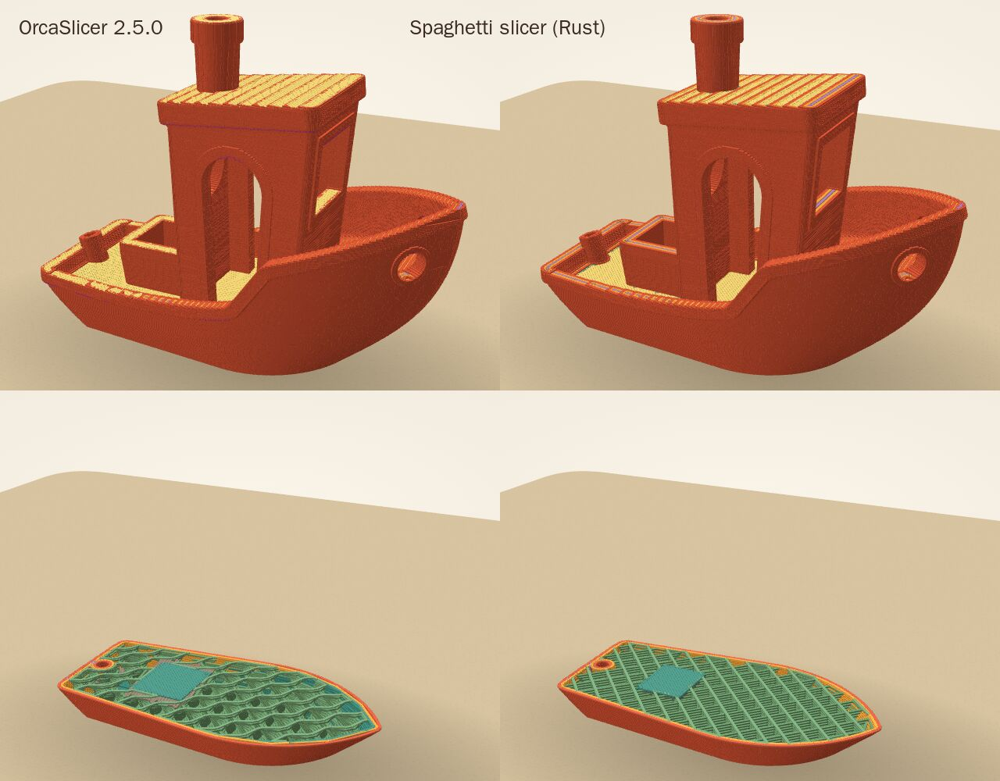

# Proposal: a slicer of our own, in Rust

Status: in [`slicer-rs/`](../../slicer-rs), measured against OrcaSlicer, and in the app beside OrcaSlicer's engine since Nov 13 (decision 0055): a model slices with it when its settings pick it, and Orca's engine slices what it can't yet ([slicer.md](../slicer.md)). Since Nov 13 its files carry the X2D's own start and end G-code and are ready for a first, watched test print (section 4). Carl Oscar asked on Nov 13, after slicing in the browser with Orca's engine ([slicing.md](slicing.md)), for a Rust implementation of slicing built for speed: "First step is actually building it, and making sure it's hyper performant". Later it might run on a bridge-like host as an offline slicing proxy.

## 1. What it is

A self-contained crate, about 37,000 lines of Rust on seven small crates (polygon booleans, a Voronoi diagram, deflate, CRC32, MD5, maths functions, and threads natively). It turns STL and plain 3MF files into a `.gcode.3mf`, with the defaults the app slices with (Bambu Lab X2D, 0.4 mm nozzle, 0.20 mm Standard, Bambu PLA Basic, Textured PEI) or with the slicing settings people choose (below). Its files open in Spaghetti as Orca's do: the reader finds the estimate, weight, filament, settings and plate picture, and the 3D view shows every layer by feature. Around the toolpaths they carry the printer's own G-code, from the presets the app's engine ships (copied into `slicer-rs/profiles/x2d/`): the X2D's start and end, and its layer change and timelapse G-code, filled as Orca fills them (`src/template.rs` ports Orca's placeholder language). For the X2D's other nozzles, 0.2, 0.6 and 0.8 mm, the command line has Bambu's presets from the engine's release 2 too (`profiles/x2d-0.2/` and the others: each nozzle's machine, its Standard process and Bambu PLA Basic), and slices with them with `--nozzle 0.2`.

The same code builds two ways:

- **Native**: a 3.3 MB command line, `spaghetti-slicer model.stl -o model.gcode.3mf`, slicing on every core (OrcaSlicer's AppImage is 210 MB).
- **WebAssembly**: a 3.1 MB module (964 kB gzip; Orca's engine is 11 MB, 3.4 MB gzip), one thread, with a plain C interface and no generated bindings (`src/wasm.rs`).

What it does, in order:

1. **Read**: binary and text STL; 3MF with units, components, transforms and Bambu's object names (a sliced 3MF is refused). Corners are welded, and an inside-out model is turned right way out. Their heights are the ones Orca slices at: Orca holds each part round the middle of its bounding box in floats, which can move a corner a float's step (section 3).
2. **Lay out**: arranged on the plate as the app's `arrange.ts` does, or kept where a Bambu project placed it. A model that is too big, too tall, or one too many is refused, and so is one kept partly off the plate, as Orca refuses it; one wholly off it (on another of a project's plates) is left out.
3. **Slice** every layer at its middle into outlines, in integer coordinates of 0.1 µm, made as Orca makes them: each object's on its own, joined, closed (gaps and notches under 0.1 mm filled, Orca's `slice_closing_radius`) and simplified.
4. **Regions**, as Orca's classic walls: two walls, the outer one placed precisely, and only the outer one round a top surface and on an object's last layer (`only_one_wall_top`); gap fill along the middle of what is too narrow for a wall (Orca's medial axis of a Voronoi diagram, ported). Then Orca's own passes over a layer's surfaces: 5 top and 3 bottom layers, and solid infill wherever a slope would leave the shell thin ("ensure vertical shell thickness"); every top surface, bottom surface and bridge grown into the infill beside it, bridges spanning the way Orca's bridge detection picks (`src/surfaces.rs`); internal bridges where Orca makes them, across the sparse lines below and reaching to the nearest of them (`src/bridges.rs`); 15 % sparse infill, with small sparse areas made solid.
5. **Supports**, when the settings ask for normal ones (Orca's `normal(auto)`, the app's "normal" and "snug" styles): Orca's generator, ported (`src/support.rs`, from its `SupportMaterial.cpp` and `SupportCommon.cpp`); in the snug style the areas follow the overhangs, closed and rounded off, instead of the grid below (section 3). An overhang steeper than the support angle, or a small island that starts in the air (a sharp tail), gets a contact layer the top gap below it, stretched onto Orca's support grid (its rasteriser, `src/grid.rs`); columns run down from there to the plate, or to a top surface of the model, which gets a contact layer of its own; between the contacts the support has layers of its own, as thick as the printer allows and evened out (0.28 mm at most here, so most fall between the model's layers); it keeps the XY gap off the model, has two interface layers at each contact and a flange on the plate. They print in Orca's support pattern (`src/base_support.rs`: lines on the support grid, joined into zig-zags along the column's edge), the flange as a loop round rectilinear lines; on a layer the model shares, an object's support prints when the tour first comes to it, inside its labels. Tree supports, the app's style unless people pick another (Orca's `tree(auto)` in its default style, which Orca makes organic), are Orca's organic trees, ported (`src/tree/`, from its `TreeSupport3D.cpp`: PrusaSlicer's port of CuraEngine's trees, with Orca's own overhang detection). They hold up the overhangs Orca's trees find: steeper than the support angle and not too small, or with supports only where needed just those that reach more than 3 mm from what holds them, and islands that start in the air. Each gets a roof of interface layers where it is large enough, and tips under it on the support's lines; from there the branches grow down layer by layer, widening, moving clear of the model and merging where they meet, until they stand on the plate or on the model. Each branch then becomes a round tube, smoothed clear of the model and cut into the layers, which prints as a loop round it (two round the thick ones), with a flange on the plate. Without supports, it warns of each object that needs them as Orca does (its `is_support_necessary`, which runs the trees' overhang detection whatever the supports): one with an island that starts in the air ("It seems object … has floating regions. Please re-orient the object or enable support generation."), else with an overhang reaching more than 6 mm from what holds it ("… has a floating cantilever."), in the summary's `warnings` with Orca's kind, `need_support_on`.
6. **Toolpaths and G-code**, every layer in parallel. Paths print in Orca's order (`src/order.rs`): a layer's islands on Orca's tour of them, which ends next to the plate's origin; in each island the walls round each hole and then round the outline, inside out, each stopping a tenth of the nozzle short of where it started (Orca's seam gap); then its infill and gap fill, chained as Orca chains them. Sparse infill is Orca's crosshatch (or, when asked, its gyroid, grid, cubic or honeycomb) on each object's own grid, or its lightning trees, grown for each object from the top down (`src/lightning.rs`); either is cut to the area and joined along the walls as Orca joins it (`src/fill.rs`). Solid infill, tops, bottoms and bridges are Orca's monotonic lines (`src/monotonic.rs`), and the narrow bands of solid infill along slopes print in loops and lines along their middle, where Orca's Arachne fill puts them (`src/solid.rs`). Walls that run beyond the layer below print as overhang walls, and walls and bridges slow down where they hang, by how far (`src/overhang.rs`). Every path is simplified as Orca simplifies them before printing: a point goes where dropping it keeps the path within the profile's resolution (0.012 mm; 0.04 mm for sparse infill). On the first layer, each object's brim prints just before it (`src/brim.rs`): Orca's auto brim, the X2D's default, which gives an object one only where its footprint is small for its height, or the brim people turn on. Travels retract where Orca's do (always off an outer or overhang wall and before a wall, never within the object's inside on the way to infill) and wipe as Orca's do, lifts are Orca's (spirals for Bambu PLA; for the generic filaments its Auto Lift, up the travel slope as the travel sets off, or a spiral where it sets off over an overhang of the last 0.4 mm of layers, `src/lift.rs`), speeds and accelerations are the X2D's for each feature, and short layers slow down as Orca's cooling slows them (the fastest extrusions first, all to one speed). Between the layers come what Orca writes there: the printer's layer change G-code, a timelapse photo at the spot Orca's picker would choose, and the fans; around each object's moves, the labels (`M624`/`M625`) that let the printer skip it. The file carries Orca's markers (`; FEATURE:`, `; CHANGE_LAYER`, `M73` progress), so readers of Bambu files follow it.
7. **Several filaments**, a plate whose objects each print in a filament of their own (a Bambu Studio or Orca project names each object's, the command line's `--filaments` gives each file one, and so does the WebAssembly module's `add_in`), as Orca 2.5 prints it on the X2D (`src/toolchange.rs`, `src/wipe_tower.rs`, `src/filaments.rs`). The filaments go on the X2D's two nozzles as Orca groups them ("Auto For Flush", its `FilamentGroup`), or as the setup's manual map says: of every way to share them out, the one that keeps each filament on a nozzle that reaches all its objects (the right one prints from x = 20.5 mm and up to 256 mm), that fits each nozzle's AMS (one 4-slot unit, as Orca's command line assumes), and then costs least, the flush its layers need counted as time plus the time loading and unloading takes; the larger group then goes on the left nozzle. Two filaments get a nozzle each, the first the right one. Each layer prints them in Orca's order: the first layer by size, the others nozzle by nozzle, each nozzle's filaments in the order that flushes least, starting with the nozzle that ended the layer below. Between them come Orca's tool changes, on Orca's prime tower (its Type1 tower for Bambu printers, ported: the rib wall with its fillets, the gaps the travels pass through, its brim, the purge after each change, and the 1 mm lines that ram the filament before a nozzle change; its wall and brim fitted with arcs, `G2` and `G3`, as Orca fits them, `src/arc_fit.rs`), with the X2D's `change_filament_gcode` filled as Orca fills it. Where a nozzle changes filament, the printer flushes the old one away by itself, as much as Orca's flush volumes say (its table of colours and its multipliers per nozzle, `src/filaments.rs`). The estimate times the changes as Orca's does (the extruder change, loading and unloading, the flush, and the moves the printer makes by itself, which the template gives as `;VG1` comments), and the file's totals, header, settings and plate description list every filament with its nozzle, as Orca's do. Where a nozzle waits for its next use, it cools and heats again as Orca's G-code processor has it, in a pass after the estimate (`src/preheat.rs`): `M104 T… S… N0 ;Multi extruder pre cooling` where the wait begins, and `;Multi extruder pre heating` at the move from which heating ends as the wait does, by each move's time as Orca's estimator hands it out.
8. **Estimate and pack**: the print time comes from a port of Orca's move planner (acceleration, jerk, the X2D's limits), with the changes Bambu made to it, which Orca's estimator carries: a curve slows down to what the acceleration allows round it, and a corner's jerk counts X, Y and Z together. Timed with it, Orca's own G-code comes to Orca's estimate within 0.3 % for every feature. The plate picture is the app's `render.ts`, ported. The package is deflated in parallel.

Left for later: painted colours and objects whose parts are in different filaments, the other styles of support, and arachne walls (section 5).

### Settings

It slices from the same settings object as the app's engine (decision 0047). The app's `sliceSetup` turns people's slicing settings (`src/shared/slicing/settings.ts`: quality, walls, infill and pattern, supports, brim, filaments, plate, nozzle, scale) into OrcaSlicer configs through `orca.ts`, the one place that knows Orca's presets and keys, and hands them to Orca's engine. The Rust slicer takes that same setup, as JSON: `spaghetti-slicer --setup setup.json` natively, `setup()` in WebAssembly, and `node slicer-rs/bench/setup.mts presets.json '<settings>'` writes one with the app's own code. It reads every setting by Orca's own keys (`src/config.rs`), laid over the X2D's presets, so a layer height, a filament or a plate needs no code of its own: Fine at 0.12 mm takes Orca's 0.12 mm process, ABS takes Generic ABS, with its first-layer and later temperatures and its heated chamber. The fans follow Orca's cooling layer by layer: off for the filament's first layers, then by how long each layer takes. A setup for another nozzle brings that nozzle's presets whole, as the app's `sliceSetup` takes Bambu's for the nozzle fitted (decision 0056), so the WebAssembly module slices for any nozzle without presets of its own. Without a setup it slices with the X2D's defaults, to the same file as before.

What it can't do yet, it refuses by name ("can't slice with a raft yet"), so the app can slice those with Orca's engine: slim, strong and hybrid trees, painted supports, rafts and supports only on the plate, objects whose parts are in different filaments (and, on a plate in several, models that don't say which they print in), spiral vase, printing one object after another, and brims other than one round the outside (ears, or inside holes). What it prints otherwise than the settings ask, it says with the file ("gyroid sparse infill printed as straight lines"): sparse infill patterns other than crosshatch, gyroid, grid, cubic, honeycomb, lightning and straight lines, solid infill patterns other than monotonic and straight lines (zig-zag), arachne walls (classic), and ironing and fuzzy skin (none). Bambu's tray id goes in the plate's description only for Bambu PLA Basic (`GFA00`), as the engine's presets carry Orca's own ids.

## 2. Speed and memory

Every runner slices the same placed models with the app's defaults; the Orca runners read the flattened presets the app's engine uses. Times are the median of three runs. Memory is the process's peak resident memory, or for Chromium how much its processes grew while slicing. Everything ran in an agent's sandbox (4 ARM cores, nothing else running). [`slicer-rs/bench/README.md`](../../slicer-rs/bench/README.md) says how to run it again.

| Runner | 3DBenchy (225,154 triangles) | Steampunk glasses (30,080) | UOBF text with clips (1,354) | 12 Benchies on one plate (2,701,848) |
| --- | --- | --- | --- | --- |
| **Rust, native, 4 threads** | **0.49 s, 37 MB** | **0.65 s, 47 MB** | **0.10 s, 21 MB** | **5.55 s, 237 MB** |
| Rust, native, 1 thread | 1.64 s, 35 MB | 2.31 s, 40 MB | 0.26 s, 21 MB | 18.8 s, 204 MB |
| Rust, WebAssembly, Node | 2.43 s, 150 MB | 3.29 s, 142 MB | 0.48 s, 120 MB | 28.4 s, 432 MB |
| **Rust, WebAssembly, Chromium** | **2.42 s, 106 MB** | **3.30 s, 71 MB** | **0.48 s, 70 MB** | **28.5 s, 508 MB** |
| OrcaSlicer 2.5.0, native, 4 threads | 1.42 s, 208 MB | 1.48 s, 256 MB | 0.35 s, 112 MB | 16.3 s, 964 MB |
| Orca's engine, WebAssembly, Node | 8.65 s, 597 MB | 7.68 s, 626 MB | 1.75 s, 483 MB | 93.4 s, 1,927 MB |
| Orca's engine, WebAssembly, Chromium (the app today) | 8.81 s, 489 MB | 8.36 s, 458 MB | 1.72 s, 351 MB | 97.2 s, 2,050 MB |

- **Native, it is 2.3 to 3.6 times faster than OrcaSlicer** on the same four cores, in a quarter to a sixth of the memory.
- **In the browser, it is 2.5 to 3.6 times faster than OrcaSlicer's engine**, in a quarter of the memory or less, from a module a quarter the size. In Chromium, on one thread, it slices a Benchy in about 1.7 times what native OrcaSlicer takes on four cores.
- **Its own memory is small**: the WebAssembly heap ends at 30 MB for a Benchy, 32 MB for the glasses and 170 MB for the plate; the rest of the Node figures is Node itself and the model files. Orca's engine starts at a 256 MB heap.
- **Most of the time is spent on regions**: the polygon booleans and offsets of walls, shells and gap fill, of the shells on slopes and of the surfaces grown into the infill beside them. For the plate, natively, regions take 2.9 s of 5.3 s; toolpaths and G-code 1.7 s, slicing into outlines 0.28 s, reading 0.1 s, the picture 0.09 s and packing 0.1 s. A corner exactly on a layer's cutting plane leaves pieces of outline that meet only there, which slicing joins end to nearest end, slowly: while the Benchies' lettering lay on the cut at 0.3 mm (from when the layers were cut at floats' heights until the heights were Orca's, Nov 14), the plate took 1.9 s to slice into outlines. Making the outlines as Orca makes them, each object's joined, closed and simplified, costs 0.1 s of that on the plate (simplified once before the closing too, so that it offsets a seventh of the points), and 1 to 4 % in the browser. Toolpaths doubled when solid infill took Orca's monotonic lines and narrow loops: the loops' lines along the middle of a band come from a Voronoi diagram, as gap fill's do, and splitting a region into lines and loops takes polygon operations of its own. That made the four models 3 to 59 % slower to slice (the text, all narrow strokes, the most). Orca's print order, with its local search over each island's chain of paths and its tour of a layer's islands, then cost another 2 to 10 % natively and 7 to 19 % in the browser (the glasses, with the most paths to an island, the most). Overhangs cost nothing measurable: each wall's distance from the layer below is looked up in a grid of that layer's edges, and the polygon offsets that decide where a wall leaves what holds it up run only near where it might; the four models slice within the benchmark's noise of before. Simplifying every path, as Orca does, and gap fill on Orca's medial axis cost nothing measurable either; one wall round top surfaces costs 3 to 5 % on a Benchy, the glasses and the plate (finding the tops wide enough for it, island by island, near the tops only). One thread is 2.7 to 3.6 times slower than four, and WebAssembly another 1.4 to 1.8 times. Orca's infill, joined along the walls, costs about 3 % of the toolpaths' time against straight lines. Lightning's trees grow layer after layer, one object at a time: a Benchy at 10 % slices 7 % slower with them than with crosshatch, the plate 3 % (its objects grow side by side). Brims cost under 1 %: they are worked out once, before the layers, from what lies near each (46 ms for the plate's twelve). When supports are off, only Orca's check for objects that need them runs (section 3), the trees' first pass over the layers with the overhangs that can't reach 6 mm left unmeasured: 3 to 5 % natively (13 ms of a Benchy's slice, 0.16 s of the plate's) and 1 to 5 % in WebAssembly. With normal ones a Benchy slices in 0.86 s natively (native Orca 1.6 s), 0.38 s of it the supports: mostly carrying the columns down the model layer by layer, which can't run in parallel, and finding the overhangs.

### With tree supports

With Orca's organic trees everywhere (the X2D's support settings otherwise), the same way:

| Runner | 3DBenchy | Steampunk glasses |
| --- | --- | --- |
| **Rust, native, 4 threads** | **1.25 s, 56 MB** | **3.49 s, 102 MB** |
| Rust, WebAssembly, Node | 5.63 s, 155 MB | 14.7 s, 171 MB |
| OrcaSlicer 2.5.0, native, 4 threads | 2.02 s, 261 MB | 3.38 s, 441 MB |
| Orca's engine, WebAssembly, Node | 10.5 s, 636 MB | 15.4 s, 874 MB |

Tree supports cost more than they should. With them a Benchy slices 1.6 times faster than native Orca and 1.9 times faster than Orca's engine, but the glasses, with trees under every part, only as fast as either; memory stays at a quarter of Orca's or less. The glasses' supports take 2.9 s of the 3.5 natively, where Orca's take about 1.9 s: nearly all of it polygon offsets and unions, in working out where each size of branch may go on every layer (about a third), growing the branches (a fifth) and drawing them (a quarter). Making them faster comes next (section 5).

### In two filaments

A 36 mm block with an S cut through it in orange and the S in blue, 10 mm tall (`bench/colour.py`), as two objects, each in its filament: on a nozzle each, as Orca groups them, and both on the left nozzle (Orca's manual grouping), which flushes at every change. 50 tool changes either way.

| Runner | Two colours, two nozzles (1,384 triangles) | Two colours, one nozzle |
| --- | --- | --- |
| **Rust, native, 4 threads** | **0.04 s, 24 MB** | **0.04 s, 22 MB** |
| Rust, native, 1 thread | 0.08 s, 24 MB | 0.07 s, 23 MB |
| Rust, WebAssembly, Node | 0.26 s, 131 MB | 0.25 s, 151 MB |
| OrcaSlicer 2.5.0, native, 4 threads | 0.32 s, 112 MB | 0.30 s, 112 MB |

The tower and the tool changes cost little: the plate slices 7 times faster than native Orca, and its WebAssembly memory ends at 21 MB. The module grew by 333 kB (111 kB gzip) for them, most of it the tower (116 kB of code) and the planning of the changes (87 kB). Orca's pre-heating, which times every move of the finished G-code again, takes 7 ms of the two-nozzle plate's time natively and 18 ms in WebAssembly (one nozzle, where no nozzle waits, under 1 ms), and 14 kB gzip of the module. Weighing every grouping as Orca does takes under 1 ms for up to four filaments and 2 ms natively (4 ms in WebAssembly) for eight, and 8 kB gzip of the module. Fitting the tower's walls with arcs, as Orca does, takes 3 ms of the two-nozzle plate's time natively and 7 ms in WebAssembly (without the fitting the tower costs what it did), and 10 kB gzip of the module. A plate in one filament slices to the same file as before, byte for byte.

### On the other nozzles

A Benchy for each of the X2D's other nozzles, with Bambu's presets for it, as above: on the 0.2 mm nozzle 0.10 mm layers (480 of them) and four walls, on the 0.6 mm 0.30 mm layers and on the 0.8 mm 0.40 mm, with two walls each. Every runner slices with the same presets (`bench/run.py` hands them to Orca's engine and native Orca too):

| Runner | 0.2 mm nozzle, 0.10 mm layers | 0.6 mm nozzle, 0.30 mm layers | 0.8 mm nozzle, 0.40 mm layers |
| --- | --- | --- | --- |
| **Rust, native, 4 threads** | **1.26 s, 61 MB** | **0.38 s, 34 MB** | **0.35 s, 33 MB** |
| Rust, native, 1 thread | 4.65 s, 57 MB | – | – |
| Rust, WebAssembly, Node | 6.48 s, 150 MB | – | – |
| **Rust, WebAssembly, Chromium** | **6.55 s, 105 MB** | – | – |
| OrcaSlicer 2.5.0, native, 4 threads | 2.23 s, 310 MB | 1.19 s, 168 MB | 1.08 s, 161 MB |
| Orca's engine, WebAssembly, Node | 15.1 s, 722 MB | – | – |
| Orca's engine, WebAssembly, Chromium (the app today) | 14.7 s, 588 MB | – | – |

The 0.2 mm nozzle's twice as many layers, of thinner lines, take a Benchy 2.5 times as long to slice as at 0.20 mm, natively and in the browser alike, and it stays 1.8 times faster than native Orca and 2.2 times faster than Orca's engine in Chromium, in a fifth of its memory (measuring the shells as Orca does costs it 5 %, a Benchy at 0.4 mm 1 %; laying the narrow bands' beads by Arachne's rules, from one medial axis for each band, made it 2 to 3 % faster than the stand-in before, and Arachne's filter on where a band's bead count changes costs nothing measurable). The larger nozzles slice 3.1 times faster than native Orca. Their presets are in the command line only: the WebAssembly module slices whatever presets the app's setup brings, so they cost it nothing, and Orca's bridging flow, which the 0.2 mm presets need (section 3), grew it by 2 kB (1 kB gzip); Arachne's bead rules grew it by 11 kB, and its filter by 20 kB (6 kB gzip).

### Output size

| Model | Rust `.gcode.3mf` | Orca's G-code, packed as the app packs it | Rust G-code | Orca's G-code |
| --- | --- | --- | --- | --- |
| 3DBenchy | 876 kB | 654 kB | 3.17 MB | 2.61 MB |
| Steampunk glasses | 1.46 MB | 1.46 MB | 6.20 MB | 6.59 MB |
| UOBF text with clips | 169 kB | 148 kB | 831 kB | 845 kB |
| 12 Benchies on one plate | 8.57 MB | 5.66 MB | 36.48 MB | 29.35 MB |
| Two colours, two nozzles | 136 kB | 122 kB | 879 kB | 938 kB |
| 3DBenchy, 0.2 mm nozzle | 3.04 MB | 2.18 MB | 11.30 MB | 8.66 MB |
| 3DBenchy, 0.6 mm nozzle | 514 kB | 383 kB | 1.75 MB | 1.53 MB |
| 3DBenchy, 0.8 mm nozzle | 356 kB | 274 kB | 1.15 MB | 1.06 MB |

Our G-code runs from 6 % shorter than Orca's (the glasses) to 24 % longer: both drop the points a path doesn't need, but Orca also fits arcs to curves (its gyroid and crosshatch waves among them), where we write short lines, and lines of varying width (gap fill, narrow solid infill) take a width line for each stretch; walls slowing down over an overhang take a speed for each stretch, as Orca's do. Packed, ours runs from the same size (the glasses) to 51 % larger. We deflate at level 4 in parallel chunks, for speed, and our G-code packs less tightly: at level 6 in one stream, as Orca's above, the plate's would be 7.7 MB against 5.7 MB.

## 3. Quality against Orca

The same models in native OrcaSlicer 2.5.0, with the same settings and placements:

| Model | Layers, Rust / Orca | Filament, Rust / Orca | Estimate, Rust / Orca | Extruding, Rust / Orca | Travel, retractions and lifts, Rust / Orca | Retractions, Rust / Orca |
| --- | --- | --- | --- | --- | --- | --- |
| 3DBenchy | 240 / 240 | 11.32 g / 11.33 g (−0.1 %) | 37.5 / 37.7 min (−0.6 %) | 24.2 / 24.2 min (−0.1 %) | 8.2 / 8.4 min (−2.1 %) | 1,377 / 1,442 |
| Steampunk glasses | 253 / 253 | 7.63 g / 7.66 g (−0.3 %) | 77.2 / 76.4 min (+1.0 %) | 27.6 / 27.9 min (−1.2 %) | 44.5 / 43.4 min (+2.6 %) | 8,763 / 8,665 |
| UOBF text with clips | 68 / 68 | 4.02 g / 4.02 g (+0.0 %) | 18.8 / 18.8 min (+0.2 %) | 9.6 / 9.6 min (−0.1 %) | 4.0 / 4.0 min (+1.3 %) | 700 / 686 |
| 12 Benchies on one plate | 240 / 240 | 135.81 g / 135.88 g (−0.1 %) | 357.5 / 361.8 min (−1.2 %) | 250.8 / 253.1 min (−0.9 %) | 101.6 / 103.5 min (−1.9 %) | 16,531 / 17,449 |

The Benchy and the plate are measured with the shells as Orca measures them, Arachne's beads in the narrow bands and Orca's heights (below); the glasses and the text are from before those changes, whose models weren't at hand for them. The estimate is the whole print. Both count its start alike, 5 min 8 s: the X2D's allowance for levelling the bed and the moves of its start G-code, timed as Orca times them. The rest is split the same way for both: the time spent extruding (every feature's), and everything else after the start (travel, retractions, wipes and lifts).

A Benchy's filament by feature, in mm³ (Rust / Orca): outer wall 2,414 / 2,414, inner wall 2,350 / 2,347, sparse infill 1,386 / 1,383, internal solid infill 1,489 / 1,475, gap infill 558 / 575, internal bridge 363 / 371, top surface 258 / 261, bridge 113 / 114, bottom surface 38 / 38, overhang wall 13 / 13.

With a generic filament (Generic PLA here), which lifts with Orca's Auto Lift, the estimate comes within 1.1 % of Orca's on a Benchy, 4.1 % on the glasses, 0.7 % on the text and 0.5 % on the plate. Lifting in spirals instead had put 6 to 22 % on them, the travels, retractions and lifts taking 36 to 44 % longer than Orca's. Where both slicers' travels set off from the same place, they lift alike: on box models with ledges, the same spirals on the same layers. On a Benchy and the glasses ours still lifts in spirals more often, on 87 travels against Orca's 49 and on 2,857 against 2,325: its loops end beside overhangs more often than Orca's, whose seams keep off them (section 5). Finding each layer's overhangs costs a generic filament's slice 1 to 2 % (5 ms for a Benchy, 46 ms for the plate, natively); Bambu PLA, which lifts in spirals, slices to the same file as before.

In the 3D view the two Benchys look alike from outside (the picture is of the first version, whose sparse infill was still straight lines and whose slopes had no extra solid infill). The differences are inside and on top:

- **Layers are cut where Orca cuts them**, halfway up each layer, at the heights Orca gives the model's corners. Orca holds each part of a model round the middle of its bounding box, moved there in floats (`ModelVolume::center_geometry_after_creation`), puts it on the bed in doubles and moves it back in floats when it slices, so a corner can end a float's step from where the file put it; ours does the same with the heights (`mesh::settle_heights`). It decides on which side of a cut a face lies that the file puts exactly on it: the lettering under a Benchy, 0.3 mm deep, ends just under the cut at 0.3 mm in Orca, which closes it on its second layer and bridges over it there. Until Nov 14 ours cut the letters open on that layer and bridged a layer higher: walls round the letters that Orca's layer hasn't (25 mm³), and the solid infill above them a layer off (layer by layer the Benchy's solid infill was 149 mm³ off Orca's; it is now 40 mm³ off).
- **Walls** match on a Benchy and the text to about 1 %, a top surface having the outer wall alone round it as Orca's do (below). Each loop stops a tenth of the nozzle short of where it started, as Orca's do (its seam gap), rather than print over its own start; that brought every model's walls a little closer to Orca's (the glasses' outer wall from 0.6 % over to 0.2 %). On the glasses ours have 4 % more inner wall, on layers without a top: in some narrow parts Orca's second wall stops sooner than ours and leaves the rest to gap fill (section 5).
- **Gap fill** follows Orca's rules for which gaps to fill and prints them as Orca does, a line as wide as the gap plus a little (h·(1 − π/4)), so that it takes the gap's area in plastic. Its lines are Orca's medial axis, ported: no branch into a corner, each free end drawn out to the outline at its full width, short dead ends dropped, and a line running on through a junction where Orca's does. It comes within 4 % of Orca's on a Benchy, the text and the plate, its lines ending as Orca's do (a tenth of them narrowing to nothing, against two fifths before); the glasses' is 7 % lighter, where Orca's second wall stops sooner than ours (above).
- **Sparse infill** is Orca's: its crosshatch, which turns its direction over a few millimetres of height (the waves at layer 30), and when asked its gyroid, grid (lines two ways), cubic (three ways, shifted with the height) and honeycomb (hexagons, turned 60° every layer), on the same grid as Orca's (each object's own, from the middle of its bounding box), so the lines lie where Orca's do. A Benchy's grid, cubic and honeycomb come within 1 % of Orca's plastic. As Orca, the lines are joined along the walls into a few long paths, and an end that joins nothing hooks onto the wall (Orca's `connect_infill` and its anchors, ported). A Benchy's is within 1 % of Orca's. Lightning, the Light strength's pattern, prints only under the top surfaces: trees that reach in from the walls just far enough to hold a top up, carried down layer by layer and cut back at 45° until they're gone (Orca's `FillLightning`, from CuraEngine, ported with its points, their order and its trees' rules, and grown round where internal bridges will rest as Orca grows them). At the Light strength (two walls, 10 % lightning) a Benchy, the text and the plate come within 1 % of Orca's estimate and filament. The trees themselves take from a quarter less to a quarter more plastic than Orca's, model by model (a Benchy a quarter less, a 20 mm cube a quarter more): which point each tree reaches first follows a shuffle, and where a tree meets a wall Orca's port reads memory it never set, so its trees can't be matched one for one; ours do what CuraEngine's do there.
- **Solid infill goes where Orca's goes**, from Orca's own passes over a layer's surfaces, ported: as many shells under a top and over a bottom as Orca, and more wherever a slope would leave the shell thin ("ensure vertical shell thickness": the teal patches by Orca's walls at layer 30); every top, bottom and bridge grown into the infill beside it as far as Orca grows them (one and a half walls' width into solid infill, a wall's spacing into sparse); and solid infill resting on sparse infill made an internal bridge only where Orca makes one, where enough of it has nothing but sparse infill under it. The shells are measured as Orca measures them, on its infill area, which reaches into the walls by the infill/wall overlap: so a band along a sloping wall, or round the letters under a Benchy, is no wider than Orca's (it shifts into the wall rather than widening), and a piece of sparse infill turns solid only when it is under `minimum_sparse_infill_area` with that overlap counted (until Nov 14 both were measured inside the walls, which put 3 % more solid infill on a Benchy at 0.4 mm and 4 to 13 % more on the other nozzles). On a Benchy the areas come within a few percent of Orca's: 7,460 mm² of internal solid infill against the 7,380 Orca's plastic covers, and internal bridges, top surfaces and bridges within 10 %.
- **Solid infill is laid as Orca lays it.** In lines all one way: Orca's monotonic fill, ported, prints a line only after every line to its left that it touches, joins neighbours along the edge where that takes under three spacings, and chains the strips that come of it in the order Orca's ant colony search finds (with Orca's random generator and seed). Across each region the lines are spread evenly, up to a fifth further apart and printed that much wider, as Orca's are. Where lines would run short and zig-zag, in the narrow bands along sloping walls, Orca prints loops instead (`detect_narrow_internal_solid_infill`): its split of a region into lines and loops is ported, with the filter that finds the short lines, and the loops stand in for Orca's Arachne fill, with its bead counts and widths but not its skeleton: a band holds as many beads a line's spacing wide as Arachne's thresholds give, and the middle one or two take up what is left. So a band too thin for two beads is a line along its middle, as wide as the band; one that holds two is a loop of two half-bands; a wider one gets a loop half a bead in, and so on inwards, the odd middle beads along the band's medial axis. A loop's width follows the band's along each side, as Arachne's beads do, with its points no closer than the 0.5 mm Arachne's simplification keeps. Where a band is a little wider or narrower than a bead count takes, for a stretch, it keeps the count round it as Arachne's filter does (within a quarter of the nozzle of the width where the count would change): a bulge gets no loop of its own, a short narrowing doesn't break a loop, middle lines that meet are one line, and a band that runs all the way round is filtered all the way round. A Benchy's internal solid infill now weighs within 1 % of Orca's and prints within 1 % of its time; as zig-zag it took 26 % more plastic and 77 % more time, and with the stand-in before Arachne's rules (until Nov 14) a band two or three beads wide got a full bead each side and a line down the middle, up to 40 % more than the band.
- **Bridges** span the direction Orca's bridge detection picks (across the gap, from the edges that hold them), at this profile's flow (flat lines a nozzle wide, as `thick_bridges` is off), and bridges whose growth meets print as one. Internal bridges cross the sparse lines below and reach to the nearest of them at both ends, as Orca's do. Both are monotonic, joined along the edge at any length, as Orca's. A Benchy's bridges and internal bridges come within 1 % of Orca's.
- **Top surfaces** are as large as Orca's, grown into the infill beside them as Orca grows them, and printed as Orca's "monotonic line": every line on its own, one after the other across. As Orca's, they have the outer wall alone round them (`only_one_wall_top`, ported from `split_top_surfaces`): where the layer above leaves a top at least three inner walls wide (`min_width_top_surface`) and no bridge is near, the inner walls give way to top infill, which reaches the outer wall, and an object's last layer has one wall. Tops come within 2 % of Orca's plastic and 3 % of its time on all four models; with two walls round them they were 9 to 22 % short, and until the slices were closed as Orca closes them (Nov 14), 4 % short on a Benchy and the plate.
- **Travel is Orca's.** Paths print in Orca's order, ported from its sources: its tour of a layer's islands (exact up to ten, else greedy and then improved), each island's walls nested as Orca nests them (round each hole, then the outline, inside out, holes clockwise), and its infill and gap fill chained together by Orca's multi-fragment algorithm, a few paths exactly and more improved by its local search. Whether a travel retracts is Orca's rule too: not under 1 mm, always off an outer or overhang wall, and otherwise only where it leaves the object's inside, crosses a top or bottom surface or goes to a wall. A Benchy's travel now comes to about Orca's length (21.4 m against 21.7 m; it was 27.1 m), and the four models retract 0.95 to 1.02 times as often as Orca (they did 1.15 to 1.58 times; the Benchy's walls round its lettering, which Orca's second layer hasn't, made up for some of the difference until Nov 14). Moving (travel, retractions and lifts) takes within 3 % of Orca's time on all four; the glasses' took 7.5 % more while their gap fill still branched into corners and broke into short lines.
- **Overhangs are Orca's.** A wall's stretches more than half the nozzle beyond the layer below print as overhang walls, a bridge line wide at the bridge's speed (Orca's `detect_overhang_wall`), and walls and bridges slow down by how far they hang over the layer below's outline: at their own speed while little hangs, down through 50, 30 and 10 mm/s and back up to the bridge's speed where nothing holds them (`enable_overhang_speed`). Orca's passes over each path are ported: the points it adds where a line crosses the outline below, its probes along long lines, and its cuts that keep a slowdown to the stretch beside a slow end. Overhang walls come to within 3 % of Orca's length on a Benchy (184 against 189 mm), the text and the plate (2.21 against 2.27 m), and on the plate, where no layer slows down for cooling, the outer walls print 73.1 m slowed down against Orca's 72.0 m, 39.0 minutes at their speeds against 38.9. One difference: a sliver of the layer below thinner than a third of the nozzle, which Orca leaves out of what holds a wall up, holds ours up; the glasses, with their thin parts, come 4 % short of Orca's overhang walls.
- **Brims are Orca's.** Its auto brim, the X2D's default, is ported (`Brim.cpp`): an object gets one where its first layer is small for its height. The width grows with the height over the footprint's second moment of area, with the fastest of the profile's speeds (300 mm/s) and with how far the filament curls (Orca's table of materials); under 5 mm there is none, and it is at most 18 mm. A tall object's island too thin to hold on its own gets 5 mm anyway, no wider than the island. A brim people turn on is the profile's 5 mm round every island. The band starts 0.1 mm off the object, stays a line clear of the edges of other objects' openings, on the plate, out of an earlier object's brim and out of what the support's lowest layer prints (its flange, below), and is filled with loops from the outside in, an even number of them. On the first layer each loop prints from the point nearest the nozzle and stops the seam gap short of it, before the object's labels, as Orca's do. The glasses get the same 20 loops as Orca's round the two small islands of their first layer, 648.8 mm of line against 648.4 mm; a Benchy the same three tiny loops by islands of its first layer, 5.4 mm against 5.2 mm; and a fin 4 × 20 mm and 40 mm tall the same 20 loops, 1,544 mm both.
- **The estimate is Orca's.** Its planner is Orca's estimator with Bambu's changes to it (section 1): timed with it, Orca's own G-code comes to Orca's estimate within 0.3 % for every feature. And our paths are simplified as Orca simplifies its own before printing them, so a line that runs along a wall no longer slows down for moves a few micrometres long: the plate's sparse infill had 33,000 moves under 0.05 mm where Orca's has 125, and took 6 % longer than Orca's; it now has 65, and takes 0.3 % longer. Ours comes within 1.2 % of Orca's on all four: a Benchy 0.6 % under, the glasses 1.0 % over (their brim takes Orca's 19 s now, and their travel is 2.6 % over), the text 0.2 % over and the plate 1.2 % under (before tops had one wall, as Orca's, the plate came 1.7 % under). The Benchy and the plate come under mostly for retracting less often than Orca's: their loops start elsewhere (aligned seams, section 5). Feature by feature, the plate's walls, its sparse infill, its bottoms, its internal bridges and its tops take within 1.6 % of Orca's time, its bridges 4 % less for the same plastic; its solid infill 1.8 % more, for 1.1 % more plastic; and its gap fill 4.5 % less, for 3 % less plastic. A single model's short layers slow down for cooling, which hides part of these differences; a plate's layers are long enough not to. They slow as Orca's do, the fastest extrusions first and all to one speed; until Nov 13 every extrusion slowed alike, so a short layer took Orca's time but split it otherwise between its features (on a T with supports, 15 % more of it in the support and 15 % less in the inner walls).

### Supports

With Orca's normal supports (`normal(auto)`, the X2D's support settings otherwise), on box models made to need them, a plate of two of them and a Benchy, against native OrcaSlicer 2.5.0 with the same settings and placements:

| Model | Layers, Rust / Orca | Support | Support interface | Filament | Estimate |
| --- | --- | --- | --- | --- | --- |
| A T: a pillar under a slab | 181 / 181 | 1,359 / 1,359 mm³ (+0.0 %) | 90.7 / 90.7 mm³ (+0.0 %) | 4.29 g / 4.27 g (+0.3 %) | 17.4 / 17.4 min (+0.1 %) |
| A shelf: a ledge off a wall | 202 / 202 | 1,224 / 1,224 mm³ (+0.0 %) | 122.3 / 122.3 mm³ (+0.0 %) | 5.84 g / 5.85 g (−0.0 %) | 19.5 / 19.6 min (−0.3 %) |
| A ledge over a step: support standing on the model | 191 / 191 | 1,565 / 1,565 mm³ (−0.0 %) | 268.2 / 268.2 mm³ (+0.0 %) | 8.09 g / 8.09 g (−0.1 %) | 20.3 / 20.3 min (−0.3 %) |
| The T and the shelf on one plate | 258 / 258 | 2,583 / 2,583 mm³ (+0.0 %) | 213.0 / 213.0 mm³ (+0.0 %) | 10.13 g / 10.12 g (+0.1 %) | 25.7 / 25.7 min (+0.1 %) |
| A fin with an arm: a brim round the flange | 234 / 234 | 253.4 / 253.4 mm³ (+0.0 %) | 33.6 / 33.6 mm³ (+0.0 %) | 3.23 g / 3.23 g (+0.0 %) | 21.7 / 21.7 min (−0.0 %) |
| 3DBenchy | 300 / 300 | 4,491 / 4,524 mm³ (−0.7 %) | 463.7 / 465.8 mm³ (−0.5 %) | 17.58 g / 17.60 g (−0.1 %) | 54.3 / 53.9 min (+0.7 %) |

The layers fall where Orca's do, the support's own 0.28 mm ones between the model's (the T's at 0.2, 0.4, 0.48, 0.6, 0.76, 0.8 mm…), and on the box models the support prints the same lines as Orca's to the micrometre, at the same speeds: each is cooled with the object layer above it, as Orca's cooling holds it back until an object layer comes. Support and interface take within 0.6 % of Orca's time on the box models, and within 0.8 % on a Benchy. On a Benchy a few of the columns' ends come out shorter than Orca's (section 5). The first layer's loop round the flange starts at another corner than Orca's (where Clipper's output begins a polygon), so a model with two flanges may print them in the other order.

A brim keeps out of the flange, as Orca's does: Orca measures what the support's lowest layer prints (each line grown by half its spacing, with square corners and flat ends) and leaves the brim out of it. A fin 4 × 20 mm and 40 mm tall, with an arm 10 mm up whose support reaches the plate beside it, gets the same 10 loops as Orca's round the flange, 1,225.6 mm of line against 1,225.4 mm, where the fin alone gets 20; until Nov 13 ours printed all 20 over the flange. At its closest a brim line passes 0.36 mm from a line of the flange (Orca's 0.45 mm), at the corner where our flange's loop starts and ends.

### Snug supports

Orca's snug style of normal supports (the app's "Snug") follows the overhangs instead of the grid: each contact and each layer of the columns is the area itself, closed across gaps of up to 4 mm (`support_closing_radius`) and rounded off outward by a support line (`smooth_outward`), with no part of it left without dense interface; the interfaces under it cover the whole overhang, rounded off as the trees' are. On the same models, against native OrcaSlicer 2.5.0:

| Model | Layers, Rust / Orca | Support | Support interface | Filament | Estimate |
| --- | --- | --- | --- | --- | --- |
| A T: a pillar under a slab | 181 / 181 | 1,221 / 1,221 mm³ (+0.0 %) | 74.4 / 74.4 mm³ (+0.0 %) | 4.09 g / 4.08 g (+0.3 %) | 17.1 / 17.1 min (+0.2 %) |
| A shelf: a ledge off a wall | 202 / 202 | 1,064 / 1,064 mm³ (+0.0 %) | 91.8 / 91.8 mm³ (−0.0 %) | 5.60 g / 5.61 g (−0.0 %) | 19.3 / 19.3 min (+0.1 %) |
| A ledge over a step: support standing on the model | 173 / 173 | 1,151 / 1,151 mm³ (+0.0 %) | 221.7 / 221.7 mm³ (+0.0 %) | 7.51 g / 7.51 g (−0.1 %) | 19.4 / 19.4 min (+0.0 %) |
| The T and the shelf on one plate | 258 / 258 | 2,285 / 2,285 mm³ (+0.0 %) | 166.2 / 166.2 mm³ (+0.0 %) | 9.70 g / 9.69 g (+0.1 %) | 25.1 / 25.1 min (+0.0 %) |
| A fin with an arm: a brim round the flange | 234 / 234 | 219.8 / 219.8 mm³ (+0.0 %) | 24.4 / 24.4 mm³ (+0.0 %) | 3.18 g / 3.18 g (+0.0 %) | 21.7 / 21.7 min (+0.1 %) |
| 3DBenchy | 283 / 283 | 2,556 / 2,552 mm³ (+0.2 %) | 297.1 / 297.0 mm³ (+0.0 %) | 14.93 g / 14.91 g (+0.2 %) | 49.9 / 49.5 min (+0.8 %) |

On the box models the support is Orca's to the micrometre, a tenth less plastic than on the grid. On a Benchy the support comes within 0.2 % of Orca's and the interface level with it. The support's areas and offsets are Orca 2.5's own (Clipper2, `offset_c2`), for both styles now: the grid's prints the same lines as before on the box models, and on a Benchy within 0.01 mm³. A layer of the support's own with nothing to print (a ring of support too thin to fill, round the Benchy's chimney) is left out, as Orca writes nothing for a layer with nothing on it.

### Tree supports

With Orca's organic trees (`tree(auto)` in its default style, everywhere, the X2D's support settings otherwise), on the same box models, a Benchy and the glasses, against native OrcaSlicer 2.5.0 with the same settings and placements:

| Model | Layers, Rust / Orca | Support | Support interface | Filament | Estimate |
| --- | --- | --- | --- | --- | --- |
| A T: a pillar under a slab | 125 / 125 | 741.6 / 768.7 mm³ (−3.5 %) | 55.5 / 55.5 mm³ (+0.0 %) | 3.47 g / 3.49 g (−0.6 %) | 20.4 / 20.4 min (+0.3 %) |
| A shelf: a ledge off a wall | 150 / 150 | 908.6 / 899.2 mm³ (+1.1 %) | 69.7 / 69.7 mm³ (+0.0 %) | 5.38 g / 5.37 g (+0.2 %) | 25.1 / 24.8 min (+1.0 %) |
| A ledge over a step: branches standing on the model | 125 / 125 | 1,489 / 1,442 mm³ (+3.3 %) | 87.8 / 87.8 mm³ (+0.0 %) | 7.76 g / 7.71 g (+0.7 %) | 30.1 / 29.4 min (+2.4 %) |
| The T and a shelf on one plate | 150 / 150 | 1,650 / 1,668 mm³ (−1.1 %) | 125.2 / 125.2 mm³ (+0.0 %) | 8.85 g / 8.86 g (−0.1 %) | 36.0 / 35.8 min (+0.6 %) |
| A fin with an arm | 200 / 200 | 253.0 / 241.7 mm³ (+4.7 %) | 18.5 / 18.5 mm³ (+0.0 %) | 3.21 g / 3.19 g (+0.4 %) | 22.6 / 22.5 min (+0.5 %) |
| 3DBenchy | 240 / 240 | 2,926 / 2,754 mm³ (+6.3 %) | 41.1 / 41.5 mm³ (−1.0 %) | 15.08 g / 14.84 g (+1.6 %) | 60.0 / 59.2 min (+1.3 %) |
| Steampunk glasses | 253 / 253 | 9,283 / 9,329 mm³ (−0.5 %) | 27.1 / 26.3 mm³ (+2.9 %) | 19.29 g / 19.38 g (−0.5 %) | 146.9 / 145.0 min (+1.4 %) |

The roofs are Orca's: on the box models the same contact and interface layers, as the tips start where Orca's do. The branches come within 5 % of Orca's plastic on the box models and the glasses and 6 % on a Benchy, and stand where Orca's stand (the T's two trunks within 1.5 mm of Orca's, the fin's tips within 0.05 mm). They differ where branches meet: which merge, and on which layer, follows the order in which the polygon library hands back an area's points (Clipper's in Orca), so a few branches merge some layers sooner or later than Orca's. As each prints as a loop round it, two branches side by side take more plastic than the one they would merge into. On a Benchy one roof, at 9 mm, comes out a fifth smaller than Orca's and 2 mm off: its overhang is found otherwise there, which isn't pinned down yet. The support mostly takes a little more time than its plastic says: Orca writes the loops as arcs, we as short lines, which slow down at every corner.

With supports only where needed (`support_critical_regions_only`, the app's "Where needed"), the trees hold up only overhangs that reach more than 3 mm from what holds them, and islands that start in the air. All the box models' overhangs do, and they slice as above, as Orca's do. A Benchy gets none, from Orca or from us: until Nov 14 ours held up specks beside its hull, at the stern and bow, which Orca's slicing closes into the hull and simplifies away, as ours now does (section 1).

### Objects that need supports

Without supports, ours warns of the same objects as native OrcaSlicer 2.5.0, in the same words, on every model tried: floating regions on the glasses, the text with clips and the app's drying rack (an arm that starts in the air beside its post); a floating cantilever on the T, the shelf, the fin with an arm, the ledge over a step, a slab 32 mm long on a 2 mm post and a ledge 8 mm out from a wall; nothing on a Benchy, the plate of 12, two blocks, a ledge 5 mm out and a cube, and on a plate of the cube, the rack and the 5 mm ledge only the rack. The check is the trees' first pass over the layers, with the overhangs that can't reach 6 mm left unmeasured: it adds 3 to 5 % to a slice without supports natively (13 ms of a Benchy's 0.49 s, 0.16 s of the plate's 5.55 s) and 1 to 5 % in WebAssembly (60 ms of a Benchy's 2.4 s), and changes nothing in the file.

### Several filaments

The two-colour plate (section 2), against native OrcaSlicer 2.5.0 with the same two filaments (Bambu PLA Basic in the app's stand-in orange and blue), the same placement and the tower where the app puts it (the back right corner):

| Plate | Tool changes, Rust / Orca | Orange (the block) | Blue (the S) | Prime tower | Flushed | Estimate |
| --- | --- | --- | --- | --- | --- | --- |
| Two nozzles, as Orca groups them | 50 / 50 | 8.22 g / 8.22 g (−0.0 %) | 2.90 g / 2.90 g (−0.1 %) | 2,737 / 2,737 mm³ (0.0 %) | 0 / 0 g | 51.2 / 51.3 min (−0.3 %) |
| One nozzle, flushing | 50 / 50 | 11.71 g / 11.71 g (−0.0 %) | 5.61 g / 5.61 g (−0.1 %) | 1,981 / 1,981 mm³ (0.0 %) | 7.15 / 7.15 g | 86.2 / 86.4 min (−0.2 %) |

A filament's grams are all it uses, flush included: Orca's G-code processor counts the first nozzle's worth (92 mm³) of a flush to the filament it pushes out and the rest to the one it changes to. The tower prints every extrusion of Orca's, on every layer of both plates, to the micron the G-code gives: its tool changes, purges and nozzle-change ramming, and its wall and brim as Orca's arcs (`G2`, `G3`), fitted as Orca fits them, to 0.1 mm. It stands where Orca's does: Orca places the tower by the corner of its wall after fitting the arcs, which move that corner (the 20 µm by which ours stood off before), and our wall's outline comes from the same nanometres as Orca's, its fillets' points in single precision and its corners where Clipper2's union puts them. The tower's time comes to Orca's within 0.1 s on either plate (480.1 against 480.2 s on two nozzles; as short lines, ours took 4 s longer). The estimate times what Orca's does: on two nozzles, 5 s for each change of nozzle and 29 s to load the second one the first time; on one, 29 s each to unload and load and the flush (`SYNC T5` here); and on both, the moves the printer makes by itself after a change (`;VG1 E4 F523`, `;VG1 E4 F261`: about 1.4 s a change), which Orca's estimator adds to the total but leaves out of its per-layer times (so its layers add up to 68 s less than its total on this plate). Leaving those moves out (1.36 s a change, by Orca's total), our layers take within a second of Orca's, all but the last, which takes 7 s less than Orca's (not pinned down).

What differs: Orca's estimate of a tool change's travels round the tower differs a little from ours where it leaves the tower; with 14 filaments or more Orca clusters them onto the nozzles instead of weighing every grouping, which we don't port (a 4-slot AMS on each nozzle, as Orca's command line assumes, holds eight); and on a plate of five filaments or more of several types, Orca may take a nearly as good grouping whose types match the AMS slots it imagines (filled from the plate's own types), which we leave out. A plate in one filament slices to the same file as before, byte for byte.

Three filaments or more go on the nozzles as Orca puts them. On 160 plates of two to eight blocks in random colours and heights (`bench/groups.py`), some standing where the right nozzle can't reach and some clear of it, our grouping is Orca's on every one. On 60 of them, of two to eight filaments, every tool change goes to the same filament with the same flush as Orca's, each filament's grams come within 0.01 g of Orca's and the estimate within 0.5 % (ours a little shorter). Three things the two-filament plates never showed come with it: the right nozzle flushes by Orca's single-nozzle table (`flush_data_standard.txt`), as Orca's command line reads that nozzle's volume type past the end of a one-value list and finds no variant for it; a flush's first 92 mm³ counts to the filament it pushes out; and Orca takes flush volumes and lengths in single precision (`;VG1 E0.0751686` on the one-nozzle plate, where we wrote `…688`).

The tower holds on other plates too. On 30 random ones of three to eight filaments (`groups.py --plates 30`), every tower extrusion is Orca's on 1,083 of their 1,180 layers. On 94 of the rest one arc's centre (`I`, `J`) is 1 to 5 µm off Orca's, with the same ends and plastic (once 54 µm, on an arc of 301 mm radius, which moves its path by 10 nm), and on three first layers Orca fits a stretch of the tower's outline with other arcs, within the same 0.1 mm. Most of that is in the fillets' points, made with single-precision sines and cosines: native Orca takes these from the system's maths library (glibc's in the sandbox) and we from musl's (the `libm` crate), as WebAssembly does, so that native and WebAssembly agree; with glibc's, 1,134 of the layers match. Orca's own arcs can differ between platforms in the same way.

The nozzle that waits cools and heats again as Orca's does. On two nozzles both files have 51 coolings and 50 heatings (the nozzle that waits at the end cools to 25 °C), each for the same nozzle on the same layer as Orca's. Every heating goes to Orca's temperature; a cooling goes as low as the nozzle cools before it must heat again, which by our times comes within 2 °C of Orca's (0.4 °C on average). Every cooling follows the same line as Orca's; a heating begins a few moves from where Orca's does, because our paths differ a little. Run on Orca's own G-code with its lines taken out, our pass puts 93 of the 101 back exactly and the rest a move or 1 °C away, where our estimator's time differs from Orca's by 0.2 % (0.08 s a layer). That check is `ORCA_GCODE=… cargo test --release --test slice -- --ignored preheat`. On one nozzle neither file has any: no nozzle waits. The lines come after the estimate, as Orca's do, and without them the file is the same as with `enable_pre_heating` off.

### Other nozzles

A Benchy on each of the X2D's other nozzles (section 2), against native OrcaSlicer 2.5.0 with the same presets:

| Model | Layers, Rust / Orca | Filament, Rust / Orca | Estimate, Rust / Orca | Extruding, Rust / Orca | Travel, retractions and lifts, Rust / Orca | Retractions, Rust / Orca |
| --- | --- | --- | --- | --- | --- | --- |
| 0.2 mm nozzle, 0.10 mm layers | 480 / 480 | 11.03 g / 11.01 g (+0.2 %) | 148.1 / 145.9 min (+1.5 %) | 120.7 / 119.7 min (+0.9 %) | 22.2 / 21.1 min (+5.1 %) | 3,418 / 3,291 |
| 0.6 mm nozzle, 0.30 mm layers | 160 / 160 | 12.29 g / 12.33 g (−0.3 %) | 26.1 / 26.6 min (−1.9 %) | 15.2 / 15.1 min (+0.5 %) | 5.8 / 6.4 min (−8.8 %) | 1,034 / 1,166 |
| 0.8 mm nozzle, 0.40 mm layers | 120 / 120 | 13.75 g / 13.87 g (−0.9 %) | 21.3 / 21.8 min (−2.5 %) | 12.6 / 12.5 min (+0.7 %) | 3.5 / 4.2 min (−15.1 %) | 652 / 793 |

Bambu's presets for the 0.2 mm nozzle lay bridges with half as much plastic again (`bridge_flow` 1.5), and Orca's bridging flow, now ported, gives the lines their shape: a bridge or an overhang wall is a flat line at the same spacing, half as tall again (0.15 mm on a 0.10 mm layer), and an internal bridge a round thread √1.5 times the nozzle's width (0.245 mm), its lines that and 0.05 mm apart. A Benchy's bridges, internal bridges and overhang walls now come within 1.1 % of Orca's plastic on the 0.2 mm; before, with the extra plastic left out, they had two thirds to three quarters of it. On every nozzle the walls, sparse infill, top surfaces and bridges come within 4 % of Orca's plastic, most within 1 %, and a 20 mm cube within 0.4 % of Orca's plastic and 1.2 % of its printing time (the tests hold each nozzle's cube to 2 %).

What differs: internal solid infill comes within 2 % of Orca's plastic (0.5 % over on the 0.2 mm, 1.7 % on the 0.6 mm, 1.9 % on the 0.8 mm; until the shells were measured as Orca measures them it was 4 to 13 % over, and until the narrow bands took Arachne's bead counts, 2.5 % over on the 0.2 mm, whose bands are the most). The 0.2 mm's bands run close to the width where two beads take over from one, and until they kept their bead count as Arachne's filter does (Nov 14) every stretch a little over it got a loop of its own and every short narrowing a stub of middle line: 1,584 pieces of solid infill under 2 mm against Orca's 653 (now 541), 58.9 m of travel against Orca's 52.5 m (now 54.5 m) and 2.6 % on the estimate (now 1.5 %); its solid infill still takes 2.3 % longer than Orca's, for 0.5 % more plastic. Gap fill comes 3 to 9 % short (on the 0.8 mm half of Orca's on the first layer, round the letters under the hull): where a gap ends in a corner, Orca's medial axis keeps short branches that print over the line's end two to four times, a third of the 0.8 mm's shortfall (25 of 74 mm³), and its lines reach further. On the 0.6 mm the first layer's bottom surface comes 12 % short and the internal bridge under the deck, which reaches less far than Orca's, 6 %. The 0.2 mm retracts 4 % more often than Orca's and its travels take 5 % longer; the 0.6 and 0.8 mm retract 11 and 18 % less often, so their travels take less time than Orca's. That is the seams: with each wall started where Orca's G-code starts it, ours retracts within 3 % as often as Orca's on all four nozzles and comes within 1 % of its estimate (+1.0 % on the 0.2 mm, +0.6 % on the 0.4, +0.5 % on the 0.6 and −0.1 % on the 0.8; aligned seams, section 5). The head and tail of each file are Orca's as for the 0.4 mm nozzle (section 4), the settings block listing that nozzle's values.

## 4. The printer's G-code, against Orca's

A bad start can drive the nozzle into the bed, so everything around the toolpaths is held to native OrcaSlicer's file for the same models in the same place. [`bench/headtail.py`](../../slicer-rs/bench/headtail.py) diffs the head of the two files (from the top to the first printed line: header, settings, the machine limits, the printer's start G-code, the first layer change and the travel down to the first path) and their tail (from the last printed line to the end: the last retraction and lift, the last timelapse photo, the end G-code and the totals), line by line. For the four benchmark models, besides the header's six lines that name the slicer, its estimate and the labels, of Orca's 452 to 529 head lines 7 to 10 differ, and of its 149 to 153 tail lines 6 to 16. Every difference is one of these:

- **Our name and our estimate.** `; generated by` names our slicer, without Orca's date and time (the same models give the same file). The header's printing times and the first progress line (`M73 P0 R…`) carry our estimate, which differs from Orca's (section 3); the start's own time is Orca's, 5 min 8 s.
- **Object labels.** Orca numbers objects with its internal ids (22 for a single model; 323, 342, … for twelve), we number them 1, 2, 3…; the header's list, `; start printing object, unique label id: …`, `; stop printing object, unique label id: …` and the plate's object list (`slice_info.config`) agree with each other. The `M624` masks are the same as Orca's: one bit per object, in label order.
- **The settings block.** Orca lists its whole configuration (743 settings), we list the 29 we use. Six of those read differently: Orca lists both nozzles' values (`nozzle_diameter = 0.4,0.4`, and the wall and travel speeds) and quotes the filament preset's name. The printer doesn't read this block.
- **Progress lines** (`M73 P… R…`). Orca's estimator puts one after any move where the percentage or the minutes left change, which puts one or two inside the start G-code; ours come at the start of every layer, where Spaghetti's 3D view reads each layer's time. They only drive the printer's progress display.
- **The bed levelling area** (`G29 A1 …`, `G29 A2 …`): the first layer's outline and brims, and the 2 mm Orca keeps around them. Identical for the UOBF text; for a Benchy, the glasses and the plate within 1 µm (`Y117.902 … J20.1955` against `Y117.903 … J20.1964`), from rounding the first layer's outline.
- **The first travel and the last wipe.** Where the first path starts and how the last retraction splits: the first `G1 X… Y… F60000`, and the last `G1 E-… F1800` with the wipe after it (the wipe goes at the last path's speed, and retracts what the extruder can at that speed; the rest goes before it). As Orca's, a brim prints before its object's labels.
- **The totals.** Filament used in mm, cm³, g and cost, from the toolpaths (section 3).
- **A plate in several filaments**, besides the above: where a pre-heating line goes (`M104 T1 S220 N0 ;Multi extruder pre heating`, a few moves from Orca's where our paths differ, its temperatures within 2 °C); the first layer's start, where Orca moves down to the first layer (`G1 Z.2 F60000`) before the layer change and retracts after it, and its first path starts at another corner; and now and then an arc of the tower whose centre is a few microns off Orca's (section 3). The settings block lists each filament's values (`filament_colour = #F2754E;#4F7FC7`), each nozzle's and `filament_map`, as Orca's; the bed levelling area takes in the tower, the machine limits are the highest of the nozzles used (`M203 … E120` for the right one's Bowden), and the plate's description, its filament sequence and the per-extruder start values (`M620.17 T0 … L0`) are Orca's.

Everything else is Orca's, line for line, for all four models: the 400-line start G-code with its temperatures, homing, bed levelling, nozzle cleaning and purge line; the fans; the first layer change; the travel onto the first layer (`G1 Z.6`, `G1 Z.2`, `G1 E.4 F1800`); the last lift (`G17`, `G3 Z… I1.217 J0 P1  F60000`); the last timelapse photo at Orca's spot (`M9711 … U131 V186 …` for a Benchy); the 100-line end G-code; and `M73 P100 R0`. Inside the file the layer changes, photos, labels, lifts and travels take Orca's form too, and each layer's height is written as Orca writes it: in the layer change, from the top of the layer below in single precision (`0.200001`, `0.199997`), and again where a path's own differs (`; LAYER_HEIGHT: 0.4` before a thick internal bridge, `0.28` for a layer of support).

The tests hold the filled start, end, layer change and timelapse G-code to Orca's own output for a Benchy, the timelapse spot to Orca's for all four models, and walk every move of a sliced file: printing only at the layer's height with the filament pushed back, never travelling below the layer, staying on the plate, retractions that add up exactly, spiral lifts that stay on the plate, and every object's moves inside its labels.

## 5. What it would take to reach Orca's quality

In order of what matters for a good print with the default profile. A small item is a session or two, a large one weeks:

| What | Why | Size |
| --- | --- | --- |
| A first test print of a Benchy, watched | The start and end G-code are Orca's (section 4), but nothing has printed yet | A print |
| Aligned seams | The seam in one line, where Orca's would be: ours runs straight up the back. Orca's seam placer weighs each point's corner, overhang and how visible it is from outside (rays cast on the mesh), then lines the seams up layer to layer, 2,450 lines of it. Ours also end loops on overhang walls more often, where a generic filament's travel then lifts in a spiral rather than a slope (section 3). Where a loop ends decides whether the travel after it is long enough to retract: on a Benchy with walls started where Orca's G-code starts them, ours retracts within 3 % as often as Orca's on every nozzle (now 4 % more on the 0.2 mm, 5 % fewer on the 0.4, 11 and 18 % fewer on the 0.6 and 0.8) and comes within 1 % of its estimate | Large |
| The second wall in narrow parts, as Orca's | On the glasses, in some narrow parts ours runs on where Orca's stops short and leaves the rest to gap fill: 4 % more inner wall and 8 % less gap fill than Orca's, on layers without a top surface. Why isn't pinned down: the offsets that make the walls are Orca's | Small |
| Gap fill on every nozzle | On a Benchy, gap fill comes 3 to 9 % short of Orca's: where a gap ends in a corner, Orca's medial axis keeps short branches that print over the line's end two to four times (a third of the 0.8 mm's shortfall), and its lines reach further (section 3) | Small |
| Arc fitting | Orca's default, a curve in one move: Orca writes the plate's walls in 342,000 moves, we in 564,000. Smaller files and smoother curves | Small |
| The overhang fan: more fan over overhangs and bridges | With the default PLA the fan runs full from the second layer, so nothing changes; filaments that cool less (PETG, ABS) get no extra fan there yet | Small |
| Faster tree supports | In the browser the glasses slice with trees no faster than Orca's engine (section 2): their supports take 2.9 s natively where Orca's take about 1.9 s, nearly all of it polygon offsets and unions. Where branches meet they merge some layers apart from Orca's, and a Benchy's roof at 9 mm comes out a fifth smaller (section 3); slim, strong and hybrid trees are refused | Medium |
| What normal supports still lack | Orca thins a column's layer where it overlaps a contact layer in height (`modulate_extrusion_by_overlapping_layers`), though on none of the models here; rafts and supports only on the plate are refused. On a Benchy 0.7 % less support than Orca's: a few column ends come out shorter, where Orca's lines pass a few nanometres inside or outside a corner and ours, at 0.1 µm, run exactly through it | Small |
| Painted colours, and objects whose parts are in different filaments | Multicolour prints from MakerWorld are mostly painted or made of parts; each object prints in one filament now (section 3), and a plate in several whose objects' parts differ is refused | Large |
| What a plate in several filaments still lacks | With 14 filaments or more, Orca's clustering of them onto the nozzles; on a plate of five or more of several types, Orca's matching of the types to the AMS slots it imagines | Small |
| Arachne walls | Not the profile's default (`wall_generator = classic`); for thin details | Large |

The estimate will follow once the features above are in: the planner already models the X2D. A rough guess at parity with Orca for single-filament prints without supports: three to four weeks of sessions, each item measured against Orca as in this proposal.

### What keeps it from being the app's slicer

What the app's "Slice with…" can ask for (`src/shared/slicing/settings.ts`), tried on Nov 13 with a Benchy and the setup the app makes (`bench/setup.mts`). The app hands a slicer the meshes it has laid down, scaled, arranged and given fins itself, so those already work with any slicer. The Rust slicer slices for every nozzle the X2D takes (0.2, 0.4, 0.6 and 0.8 mm) at every layer height each takes, measured against Orca at each one's Standard (0.10, 0.20, 0.30 and 0.40 mm), 1 to 12 walls, 0 to 100 % infill, the six patterns people pick and zig-zag, normal and tree supports where needed or everywhere, auto, on and off brims, all seven plates, and filaments of any kind, one or several (each object in its own, section 3). What stops it, in the order of the work: a refusal makes the app fall back to Orca's engine; a note means it slices, but otherwise than asked.

1. **Tree supports**, the app's support style unless people pick another: they slice, in the app since release 3, within 6 % of Orca's support (section 3). Left: their speed in the browser (section 2).
2. **Nozzles other than 0.4 mm**: they slice with the presets the app's setup brings for each (Bambu's, decision 0056), within 1 % of Orca's plastic and 3 % of its estimate on a Benchy (section 3), the 0.2 mm's bridges with the extra plastic its presets ask for (in the app since release 5). Left: their gap fill, and their retractions, which follow the seams (section 5).
3. **Filaments other than PLA**: they slice as Orca slices them, the generic filaments lifting the nozzle with Orca's Auto Lift (section 3; in the app since release 6).
4. **Several filaments**: they slice now, each object in its filament, on the X2D's two nozzles or one, grouped onto the nozzles as Orca groups them, with Orca's tool changes, tower (its arcs too) and flushing, and the waiting nozzle cooled and heated again as Orca's is (section 3). The app hands the module each object's filament (`add_in`, as its engine gets `extruder` per object; from release 4), so a plate in several slices with ours there; Orca's grouping of three filaments or more is in the app since release 7, the tower's arcs since release 8. Left: painted colours and objects made of parts in different filaments (refused, large).
5. **The other supports**: slim, strong and hybrid trees (Orca's older tree code), refused (medium). Snug normal supports slice as Orca's (section 3; in the app since release 7).
6. **The patterns only a project asks for**, 13 of them from adaptive cubic to TPMS-D: straight lines, with a note (small to medium each).
7. **The rest of what a project's settings can ask for**: Arachne walls, ironing and fuzzy skin (notes); spiral vase, one object after another, brim ears and inner brims, and rafts (refused; a raft with supports off sliced without it until Nov 13).

Parts that float in the air no longer stop it: the app gave a model without supports to Orca's engine when its mesh check found a part that may start in the air, for Orca's warning; ours now warns of the same objects in the same words (section 3), so since release 6 the app keeps such a model.

Before any of it, a watched print (section 5's first row). For the module in the app: hand it the app's placed meshes with their placement kept (`slice` with flag 1) and a setup whose `slicing.scale` is 100, since otherwise it scales the models by that and arranges the plate again.

## 6. Where it could run

- **On a bridge-like host, as an offline slicing proxy.** A 3.0 MB program, slicing a Benchy in under half a second and a full plate in about 5 s, in 250 MB. It needs nothing installed, and nothing from Bambu or the internet.
- **In the browser, in place of Orca's engine.** The download shrinks from 3.4 MB to 0.95 MB gzip, a Benchy is ready in about two seconds instead of nine, and a phone's memory is spared. Only once quality is at parity: today the engine *is* Orca, and its files are what the printer's own software would make.
- **In the Worker itself**, for single models: a Benchy needs 30 MB of WebAssembly memory and 2.3 s of CPU. That fits in a Worker's 128 MB, if the account's CPU limit allows a few seconds a request. Orca's engine can't run there (its heap starts at 256 MB). A plate of many models would not fit.

## 7. Recommendation

Keep Orca's engine in the app: its files are Orca's. Continue the Rust slicer for the bridge first, where speed and footprint matter most and nothing in the app has to change. Go down the list in section 5, starting with a first watched print of a Benchy on the X2D. Run the benchmark again after each item. Once the quality table reads within a few percent everywhere and the prints look right, decide whether it replaces the engine in the browser.

## Notes

- **Licence.** The crate is our own code, but it follows libslic3r's algorithms and constants closely (classic walls, gap-fill limits, the planner), learned from OrcaSlicer's behaviour and sources, so treat it like the engine: derived from AGPL-3.0 code ([slicing.md](slicing.md), section 5).
- **CI.** One job, `.github/workflows/slicer-rs.yml`, runs only when `slicer-rs/` or the workflow changes ([docs/ci.md](../ci.md)). It checks formatting and lints (native and WebAssembly), runs the tests, builds both targets, and slices a model end to end. The tests hold a 20 mm cube to native Orca's filament (±5 %) and printing time (±15 %).
- **Determinism.** The same models give the same file byte for byte: natively on any number of threads, and in WebAssembly. The Voronoi crate keeps its sweep line in a skip list whose shape came from a random generator, and in degenerate spots the diagram depended on that shape, so a Benchy came out differently from run to run; the skip list is vendored (`vendor/cpp_map`) with each list drawing its levels from a fixed sequence of its own. Tree supports' tubes take their sines and cosines from the libm crate natively too, as WebAssembly does: the system's differ from it in the last bit now and then. CI checks that the native and WebAssembly builds slice a model to the same file, with normal supports and with trees too.
