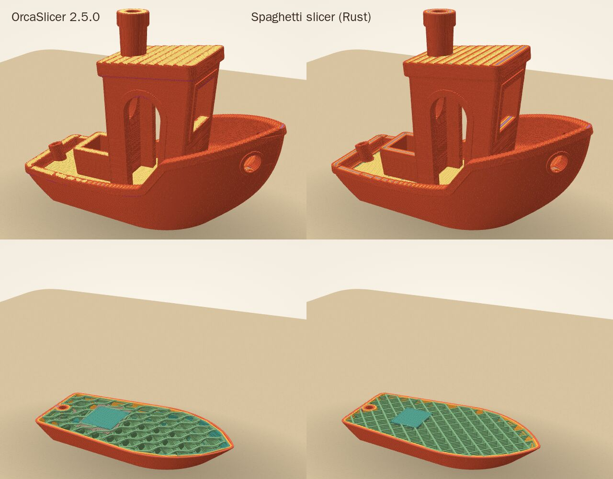

# Proposal: a slicer of our own, in Rust

Status: in [`slicer-rs/`](../../slicer-rs), measured against OrcaSlicer, and in the app beside OrcaSlicer's engine since Nov 13 (decision 0055): a model slices with it when its settings pick it, and Orca's engine slices what it can't yet ([slicer.md](../slicer.md)). Since Nov 13 its files carry the X2D's own start and end G-code and are ready for a first, watched test print (section 4). Carl Oscar asked on Nov 13, after slicing in the browser with Orca's engine ([slicing.md](slicing.md)), for a Rust implementation of slicing built for speed: "First step is actually building it, and making sure it's hyper performant". Later it might run on a bridge-like host as an offline slicing proxy.

## 1. What it is

A self-contained crate, about 37,000 lines of Rust on eight small crates (polygon booleans, a port of Clipper2 for the offsets Orca makes with it, a Voronoi diagram, deflate, CRC32, MD5, maths functions, and threads natively). It turns STL and plain 3MF files into a `.gcode.3mf`, with the defaults the app slices with (Bambu Lab X2D, 0.4 mm nozzle, 0.20 mm Standard, Bambu PLA Basic, Textured PEI) or with the slicing settings people choose (below). Its files open in Spaghetti as Orca's do: the reader finds the estimate, weight, filament, settings and plate picture, and the 3D view shows every layer by feature. Around the toolpaths they carry the printer's own G-code, from the presets the app's engine ships (copied into `slicer-rs/profiles/x2d/`): the X2D's start and end, and its layer change and timelapse G-code, filled as Orca fills them (`src/template.rs` ports Orca's placeholder language). For the X2D's other nozzles, 0.2, 0.6 and 0.8 mm, the command line has Bambu's presets from the engine's release 2 too (`profiles/x2d-0.2/` and the others: each nozzle's machine, its Standard process and Bambu PLA Basic), and slices with them with `--nozzle 0.2`.

The same code builds two ways:

- **Native**: a 4.0 MB command line, `spaghetti-slicer model.stl -o model.gcode.3mf`, slicing on every core (OrcaSlicer's AppImage is 210 MB).
- **WebAssembly**: a 3.5 MB module (1.20 MB gzip; Orca's engine is 11 MB, 3.4 MB gzip), one thread, with a plain C interface and no generated bindings (`src/wasm.rs`).

What it does, in order:

1. **Read**: binary and text STL; 3MF with units, components, transforms and Bambu's object names (a sliced 3MF is refused). Corners are welded, and an inside-out model is turned right way out. Their heights are the ones Orca slices at: Orca holds each part round the middle of its bounding box in floats, which can move a corner a float's step (section 3).
2. **Lay out**: arranged on the plate as the app's `arrange.ts` does, or kept where a Bambu project placed it. A model that is too big, too tall, or one too many is refused, and so is one kept partly off the plate, as Orca refuses it; one wholly off it (on another of a project's plates) is left out.
3. **Slice** every layer at its middle into outlines, in integer coordinates of 0.1 µm, made as Orca makes them: each object's on its own, joined, closed (gaps and notches under 0.1 mm filled, Orca's `slice_closing_radius`) and simplified. The first layer is pulled in against elephant's foot as Orca pulls it in (its `elephant_foot_compensation`, ported, `src/elephant.rs`): by the profile's 0.15 mm where a shape has room for the first layer's outer wall and its spacing, less where it narrows, and not at all where it is thinner than that, so a thin rib keeps its whole first layer.
4. **Regions**, as Orca's classic walls: two walls, the outer one placed precisely, and only the outer one round a top surface and on an object's last layer (`only_one_wall_top`); gap fill along the middle of what is too narrow for a wall (Orca's medial axis of a Voronoi diagram, ported); a small island too narrow for its outer wall gets one loop of a thinner line instead (Bambu's narrow loops in Orca's classic walls). Then Orca's own passes over a layer's surfaces: 5 top and 3 bottom layers, and solid infill wherever a slope would leave the shell thin ("ensure vertical shell thickness"); every top surface, bottom surface and bridge grown into the infill beside it, bridges spanning the way Orca's bridge detection picks (`src/surfaces.rs`); internal bridges where Orca makes them, across the sparse lines below and reaching to the nearest of them (`src/bridges.rs`); 15 % sparse infill, with small sparse areas made solid.
5. **Supports**, when the settings ask for normal ones (Orca's `normal(auto)`, the app's "normal" and "snug" styles): Orca's generator, ported (`src/support.rs`, from its `SupportMaterial.cpp` and `SupportCommon.cpp`); in the snug style the areas follow the overhangs, closed and rounded off, instead of the grid below (section 3). An overhang steeper than the support angle, or a small island that starts in the air (a sharp tail), gets a contact layer the top gap below it, stretched onto Orca's support grid (its rasteriser, `src/grid.rs`); columns run down from there to the plate, or to a top surface of the model, which gets a contact layer of its own; between the contacts the support has layers of its own, as thick as the printer allows and evened out (0.28 mm at most here, so most fall between the model's layers); it keeps the XY gap off the model, has two interface layers at each contact and a flange on the plate. They print in Orca's support pattern (`src/base_support.rs`: lines on the support grid, joined into zig-zags along the column's edge), the flange as a loop round rectilinear lines; on a layer the model shares, an object's support prints when the tour first comes to it, inside its labels. On the plate only (`support_on_build_plate_only`), nothing stands on the model: whatever a layer below covers is cut from the overhangs, the contacts and the columns, and no bottom contact is made, as Orca's `buildplate_covered` does. A project's painted supports (each painted triangle's `paint_supports`, or the module's `paint_supports` after an STL) hold with every style as Orca's do: where they are painted to enforce support it gets some, where they are painted to block it none, and with supports only where painted (Orca's `normal(manual)` and `tree(manual)`) it gets only what is painted to enforce it (section 3). Tree supports, the app's style unless people pick another (Orca's `tree(auto)` in its default style, which Orca makes organic), are Orca's organic trees, ported (`src/tree/`, from its `TreeSupport3D.cpp`: PrusaSlicer's port of CuraEngine's trees, with Orca's own overhang detection). They hold up the overhangs Orca's trees find: steeper than the support angle and not too small, or with supports only where needed just those that reach more than 3 mm from what holds them, and islands that start in the air. Each gets a roof of interface layers where it is large enough, and tips under it on the support's lines; from there the branches grow down layer by layer, widening, moving clear of the model and merging where they meet, until they stand on the plate or on the model. Each branch then becomes a round tube, smoothed clear of the model and cut into the layers, which prints as a loop round it (two round the thick ones), with a flange on the plate. On the plate only, no branch stands on the model. Without supports, it warns of each object that needs them as Orca does (its `is_support_necessary`, which runs the trees' overhang detection whatever the supports): one with an island that starts in the air ("It seems object … has floating regions. Please re-orient the object or enable support generation."), else with an overhang reaching more than 6 mm from what holds it ("… has a floating cantilever."), in the summary's `warnings` with Orca's kind, `need_support_on`.
6. **Toolpaths and G-code**, every layer in parallel. Paths print in Orca's order (`src/order.rs`): a layer's islands on Orca's tour of them, which ends next to the plate's origin; in each island the walls round each hole and then round the outline, inside out, each stopping a tenth of the nozzle short of where it started (Orca's seam gap), and each outer wall starting where Orca's aligned seam placer starts it (`src/seam.rs`, section 3), its inner walls in line with it; then its infill and gap fill, chained as Orca chains them. Sparse infill is Orca's crosshatch (or, when asked, its gyroid, grid, cubic, honeycomb, triangles, tri-hexagon, quarter cubic or lateral lattice) on each object's own grid, or its lightning trees, grown for each object from the top down (`src/lightning.rs`); either is cut to the area and joined along the walls as Orca joins it (`src/fill.rs`). Solid infill, tops, bottoms and bridges are Orca's monotonic lines (`src/monotonic.rs`), and the narrow bands of solid infill along slopes print in loops and lines along their middle, where Orca's Arachne fill puts them (`src/solid.rs`). Walls that run beyond the layer below print as overhang walls, and walls and bridges slow down where they hang, by how far (`src/overhang.rs`). Every path is simplified as Orca simplifies them before printing: a point goes where dropping it keeps the path within the profile's resolution (0.012 mm; 0.04 mm for sparse infill). On the first layer, each object's brim prints just before it (`src/brim.rs`): Orca's auto brim, the X2D's default, which gives an object one only where its footprint is small for its height, or the brim people turn on, round the outside, inside holes or both, or Orca's brim ears at the outline's sharp corners. Travels retract where Orca's do (always off an outer or overhang wall and before a wall, never within the object's inside on the way to infill) and wipe as Orca's do, lifts are Orca's (spirals for Bambu PLA; for the generic filaments its Auto Lift, up the travel slope as the travel sets off, or a spiral where it sets off over an overhang of the last 0.4 mm of layers, `src/lift.rs`), speeds and accelerations are the X2D's for each feature, and short layers slow down as Orca's cooling slows them (the fastest extrusions first, all to one speed). Between the layers come what Orca writes there: the printer's layer change G-code, a timelapse photo at the spot Orca's picker would choose, and the fans; around each object's moves, the labels (`M624`/`M625`) that let the printer skip it. The file carries Orca's markers (`; FEATURE:`, `; CHANGE_LAYER`, `M73` progress), so readers of Bambu files follow it. In spiral vase mode (`src/spiral.rs`) the settings are Orca's for it (one wall, no top shells, no sparse infill), every layer keeps only its outline's largest loop above the bottom shells, and from there the layers are written one after the other, each loop starting where the last one ended (as Orca's do there, with no seams to place) and climbing a layer as it goes round, as Orca's spiral vase writes it: its first turn's flow ramped up, the last turn run again flat with the flow ramped down, and, when asked, each turn eased towards the one below.
7. **Several filaments**, a plate whose objects each print in a filament of their own (a Bambu Studio or Orca project names each object's, the command line's `--filaments` gives each file one, and so does the WebAssembly module's `add_in`), as Orca 2.5 prints it on the X2D (`src/toolchange.rs`, `src/wipe_tower.rs`, `src/filaments.rs`). The filaments go on the X2D's two nozzles as Orca groups them ("Auto For Flush", its `FilamentGroup`), or as the setup's manual map says: of every way to share them out, the one that keeps each filament on a nozzle that reaches all its objects (the right one prints from x = 20.5 mm and up to 256 mm), that fits each nozzle's AMS (one 4-slot unit, as Orca's command line assumes), and then costs least, the flush its layers need counted as time plus the time loading and unloading takes; the larger group then goes on the left nozzle. Two filaments get a nozzle each, the first the right one. Each layer prints them in Orca's order: the first layer by size, the others nozzle by nozzle, each nozzle's filaments in the order that flushes least, starting with the nozzle that ended the layer below. Between them come Orca's tool changes, on Orca's prime tower (its Type1 tower for Bambu printers, ported: the rib wall with its fillets, the gaps the travels pass through, its brim, the purge after each change, and the 1 mm lines that ram the filament before a nozzle change; its wall and brim fitted with arcs, `G2` and `G3`, as Orca fits them, `src/arc_fit.rs`), with the X2D's `change_filament_gcode` filled as Orca fills it. Where a nozzle changes filament, the printer flushes the old one away by itself, as much as Orca's flush volumes say (its table of colours and its multipliers per nozzle, `src/filaments.rs`). The estimate times the changes as Orca's does (the extruder change, loading and unloading, the flush, and the moves the printer makes by itself, which the template gives as `;VG1` comments), and the file's totals, header, settings and plate description list every filament with its nozzle, as Orca's do. Where a nozzle waits for its next use, it cools and heats again as Orca's G-code processor has it, in a pass after the estimate (`src/preheat.rs`): `M104 T… S… N0 ;Multi extruder pre cooling` where the wait begins, and `;Multi extruder pre heating` at the move from which heating ends as the wait does, by each move's time as Orca's estimator hands it out. An object whose parts print in different filaments (a project's, the command line's `--parts`, or the module's `add_part`) prints as Orca prints it (`src/parts.rs`): each part is sliced on its own, a part cuts itself out of the parts before it where they overlap (the later one wins), and the parts in one filament merge into a region, which prints as an object of its own in that filament. What Orca works out for the whole object takes all of its regions together: where its infill is anchored, the layer below its walls hang over, its lightning trees, its seams (hidden in the joins between its regions where it can, as Orca's are), its brim, the first layer pulled in round all of it, and the one label the printer skips it by. Painted colours (each painted triangle's `paint_color` in a project, or the module's `paint` after an STL) print as Orca's segmentation by paint splits them (`src/segment.rs`, section 3): the painted sides, and the shells under painted tops and bottoms, what is painted in a filament going to that filament's region.
8. **Estimate and pack**: the print time comes from a port of Orca's move planner (acceleration, jerk, the X2D's limits), with the changes Bambu made to it, which Orca's estimator carries: a curve slows down to what the acceleration allows round it, and a corner's jerk counts X, Y and Z together. Timed with it, Orca's own G-code comes to Orca's estimate within 0.3 % for every feature. The plate picture is the app's `render.ts`, ported. The package is deflated in parallel.

Left for later: the other styles of support, and arachne walls (section 5).

### Settings

It slices from the same settings object as the app's engine (decision 0047). The app's `sliceSetup` turns people's slicing settings (`src/shared/slicing/settings.ts`: quality, walls, infill and pattern, supports, brim, filaments, plate, nozzle, scale) into OrcaSlicer configs through `orca.ts`, the one place that knows Orca's presets and keys, and hands them to Orca's engine. The Rust slicer takes that same setup, as JSON: `spaghetti-slicer --setup setup.json` natively, `setup()` in WebAssembly, and `node slicer-rs/bench/setup.mts presets.json '<settings>'` writes one with the app's own code. It reads every setting by Orca's own keys (`src/config.rs`), laid over the X2D's presets, so a layer height, a filament or a plate needs no code of its own: Fine at 0.12 mm takes Orca's 0.12 mm process, ABS takes Generic ABS, with its first-layer and later temperatures and its heated chamber. The fans follow Orca's cooling layer by layer: off for the filament's first layers, then by how long each layer takes. A setup for another nozzle brings that nozzle's presets whole, as the app's `sliceSetup` takes Bambu's for the nozzle fitted (decision 0056), so the WebAssembly module slices for any nozzle without presets of its own. Without a setup it slices with the X2D's defaults, to the same file as before.

What it can't do yet, it refuses by name ("can't slice with a raft in this style of tree support yet"), so the app can slice those with Orca's engine: rafts where Orca's classic trees make them (slim, strong or hybrid trees set, with supports on or off) or in several filaments, an object whose parts are in different filaments in spiral vase mode (and, on a plate in several, models that don't say which they print in), a plate in several filaments without a prime tower or that flushes into its objects, a smooth timelapse and wrapping detection (with which Orca prints a tower for one filament too), printing one object after another, brim ears painted on, and the beams Orca can interlock an object's filaments with where they meet. What it prints otherwise than the settings ask, it says with the file ("gyroid sparse infill printed as straight lines"): sparse infill patterns other than crosshatch, gyroid, grid, cubic, honeycomb, triangles, tri-hexagon, quarter cubic, lateral lattice, lightning and straight lines, solid infill patterns other than monotonic and straight lines (zig-zag), arachne walls (classic), and ironing and fuzzy skin (none). Bambu's tray id goes in the plate's description only for Bambu PLA Basic (`GFA00`), as the engine's presets carry Orca's own ids.

## 2. Speed and memory

Every runner slices the same placed models with the app's defaults; the Orca runners read the flattened presets the app's engine uses. Times are the median of three runs. Memory is the process's peak resident memory, or for Chromium how much its processes grew while slicing. Everything ran in an agent's sandbox (4 ARM cores, nothing else running). The glasses and the text are from before the seams were Orca's, which add about a fifth (below); their models weren't in the sandbox that measured the seams. [`slicer-rs/bench/README.md`](../../slicer-rs/bench/README.md) says how to run it again.

| Runner | 3DBenchy (225,154 triangles) | Steampunk glasses (30,080) | UOBF text with clips (1,354) | 12 Benchies on one plate (2,701,848) |
| --- | --- | --- | --- | --- |
| **Rust, native, 4 threads** | **0.62 s, 40 MB** | **0.62 s, 45 MB** | **0.09 s, 21 MB** | **6.75 s, 254 MB** |
| Rust, native, 1 thread | 2.03 s, 37 MB | 2.20 s, 44 MB | 0.25 s, 22 MB | 24.7 s, 242 MB |
| Rust, WebAssembly, Node | 3.04 s, 150 MB | 3.18 s, 143 MB | 0.48 s, 132 MB | 34.9 s, 434 MB |
| **Rust, WebAssembly, Chromium** | **2.96 s, 114 MB** | **3.17 s, 73 MB** | **0.46 s, 64 MB** | **34.9 s, 534 MB** |
| OrcaSlicer 2.5.0, native, 4 threads | 1.42 s, 208 MB | 1.48 s, 256 MB | 0.35 s, 112 MB | 16.3 s, 964 MB |
| Orca's engine, WebAssembly, Node | 8.65 s, 597 MB | 7.68 s, 626 MB | 1.75 s, 483 MB | 93.4 s, 1,927 MB |
| Orca's engine, WebAssembly, Chromium (the app today) | 8.81 s, 489 MB | 8.36 s, 458 MB | 1.72 s, 351 MB | 97.2 s, 2,050 MB |

- **Native, it is 2.3 to 3.8 times faster than OrcaSlicer** on the same four cores, in a quarter to a sixth of the memory.
- **In the browser, it is 2.6 to 3.7 times faster than OrcaSlicer's engine**, in a quarter of the memory or less, from a module a third the size. In Chromium, on one thread, it slices a Benchy in about 2.1 times what native OrcaSlicer takes on four cores.
- **Its own memory is small**: the WebAssembly heap ends at 30 MB for a Benchy, 29 MB for the glasses and 194 MB for the plate; the rest of the Node figures is Node itself and the model files. Orca's engine starts at a 256 MB heap.
- **Most of the time is spent on regions**: the polygon booleans and offsets of walls, shells and gap fill, of the shells on slopes and of the surfaces grown into the infill beside them. For the plate, natively, regions take 2.9 s of 5.3 s; toolpaths and G-code 1.7 s, slicing into outlines 0.28 s, reading 0.1 s, the picture 0.09 s and packing 0.1 s. A corner exactly on a layer's cutting plane leaves pieces of outline that meet only there, which slicing joins end to nearest end, slowly: while the Benchies' lettering lay on the cut at 0.3 mm (from when the layers were cut at floats' heights until the heights were Orca's, Nov 14), the plate took 1.9 s to slice into outlines. Making the outlines as Orca makes them, each object's joined, closed and simplified, costs 0.1 s of that on the plate (simplified once before the closing too, so that it offsets a seventh of the points), and 1 to 4 % in the browser. Toolpaths doubled when solid infill took Orca's monotonic lines and narrow loops: the loops' lines along the middle of a band come from a Voronoi diagram, as gap fill's do, and splitting a region into lines and loops takes polygon operations of its own. That made the four models 3 to 59 % slower to slice (the text, all narrow strokes, the most). Orca's print order, with its local search over each island's chain of paths and its tour of a layer's islands, then cost another 2 to 10 % natively and 7 to 19 % in the browser (the glasses, with the most paths to an island, the most). Overhangs cost nothing measurable: each wall's distance from the layer below is looked up in a grid of that layer's edges, and the polygon offsets that decide where a wall leaves what holds it up run only near where it might; the four models slice within the benchmark's noise of before. Simplifying every path, as Orca does, and gap fill on Orca's medial axis cost nothing measurable either; one wall round top surfaces costs 3 to 5 % on a Benchy, the glasses and the plate (finding the tops wide enough for it, island by island, near the tops only). One thread is 2.7 to 3.6 times slower than four, and WebAssembly another 1.4 to 1.8 times. Orca's infill, joined along the walls, costs about 3 % of the toolpaths' time against straight lines. Lightning's trees grow layer after layer, one object at a time: a Benchy at 10 % slices 7 % slower with them than with crosshatch, the plate 3 % (its objects grow side by side). Brims cost under 1 %: they are worked out once, before the layers, from what lies near each (46 ms for the plate's twelve). When supports are off, only Orca's check for objects that need them runs (section 3), the trees' first pass over the layers with the overhangs that can't reach 6 mm left unmeasured: 3 to 5 % natively (13 ms of a Benchy's slice, 0.16 s of the plate's) and 1 to 5 % in WebAssembly. With normal ones a Benchy slices in 0.86 s natively (native Orca 1.6 s), 0.38 s of it the supports: mostly carrying the columns down the model layer by layer, which can't run in parallel, and finding the overhangs.
- **Seams cost a fifth.** Placing them as Orca does (section 3) is nearly all Orca's visibility: on a Benchy the 22,600 samples within reach of an outer wall cast 25 rays each, 565,000 in all, which take about 0.25 s of the seam placer's 0.36 s natively on one thread and about half of its 0.48 s in WebAssembly (natively, cutting the mesh down takes 30 ms and the rest 80 ms: the ray tree, the candidates and their overhangs, lining them up; the command line's timings count the seams with the regions). Orca's own seam placer takes 1.7 s of a Benchy on one core and 0.64 s on four (its aligned seams against its back ones, which cast no rays). Side by side with the slicer before seams, a Benchy takes 20 % longer natively on one thread (1.78 s against 2.14 s), 25 % on four (0.52 s against 0.64 s) and 19 % in Node (2.55 s against 3.03 s), and the plate 18 % natively on one thread (20.8 s against 24.5 s) and on four (5.78 s against 6.82 s) and 18 % in Node (28.2 s against 33.3 s). Profiling took a tenth off natively (a sample is measured only when a candidate near it first asks, and the ray tree tests its boxes as Orca's does) and more than a third in WebAssembly, where `hypot` is a slow library call (Orca measures lengths as the square root of the sum of the squares anyway) and V8 ran the ray walk at half speed inlined into the seam placer's one long function: a Benchy's seams there went from 0.85 s to 0.48 s. Fewer rays would move the seams off Orca's: with 9 rays a sample instead of 25, ours started within 0.5 mm of Orca's on 49 to 55 % of a Benchy's outer loops on the four nozzles instead of 68 to 89 %, with half the samples on 49 to 51 %, and with both on 35 to 65 %, while the seam placer still took 43 % of its time. Nor can a plate's copies share one visibility: each cuts down to a mesh of its own (the plate's twelve Benchies to 15,976 to 15,992 triangles), as each does in Orca. So the slicer keeps Orca's sampling (section 5 has what could make it cheaper).

### With tree supports

With Orca's organic trees everywhere (the X2D's support settings otherwise), the same way:

| Runner | 3DBenchy | Steampunk glasses |
| --- | --- | --- |
| **Rust, native, 4 threads** | **1.06 s, 56 MB** | **2.94 s, 101 MB** |
| Rust, WebAssembly, Node | 4.55 s, 157 MB | 12.4 s, 185 MB |
| OrcaSlicer 2.5.0, native, 4 threads | 2.02 s, 261 MB | 3.38 s, 441 MB |
| Orca's engine, WebAssembly, Node | 10.5 s, 636 MB | 15.4 s, 874 MB |

With them a Benchy slices 1.9 times faster than native Orca and 2.3 times faster than Orca's engine, and the glasses, with trees under every part, 1.15 and 1.25 times faster; memory stays at a quarter of Orca's or less. Tree supports still cost more than they should: the glasses' supports take 2.3 s of the 2.94 natively, where Orca's take about 1.9 s. Working out where each size of branch may go on every layer takes about what Orca's does (0.56 s against 0.50), but placing the tips takes four times as long (0.18 s against 0.04), growing the branches 1.7 times (0.56 s against 0.33) and drawing them 1.3 times (0.72 s against 0.57), nearly all of it polygon booleans and offsets. Until Nov 14 the glasses sliced with trees no faster than with Orca (3.49 s natively, 14.7 s in Node): shrinking an area past a tree's many small round branches folds the offset's path back over itself thousands of times, and our polygon library (`i_overlay`) resolved those crossings many times slower than Orca's Clipper2. The offsets now resolve their paths with clipper2-rs, a port of Clipper2 to Rust, which took a Benchy from 1.25 s to 1.06 s natively and from 5.69 s to 4.55 s in WebAssembly, and the glasses from 3.49 s to 2.94 s and from 14.7 s to 12.4 s; it grew the module by 66 kB (26 kB gzip). The trees' booleans could go the same way (section 5).

With Orca's classic trees everywhere, the same way, in their slim, strong and hybrid styles:

| Runner | 3DBenchy: slim, strong, hybrid | Steampunk glasses: slim, strong, hybrid |
| --- | --- | --- |
| **Rust, native, 4 threads** | **0.75 s, 0.93 s, 0.75 s; 52 to 54 MB** | **2.79 s, 5.88 s, 2.83 s; 114 to 129 MB** |
| Rust, WebAssembly, Node | 3.70 s, 4.63 s, 3.71 s; 148 to 176 MB | 13.2 s, 29.1 s, 13.6 s; 178 to 199 MB |
| OrcaSlicer 2.5.0, native, 4 threads | 2.18 s, 2.33 s, 2.19 s; 256 to 276 MB | 8.05 s, 8.81 s, 8.04 s; 574 to 593 MB |
| Orca's engine, WebAssembly, Node | 13.0 s, 14.2 s, 13.0 s; 631 to 682 MB | 44.2 s, 48.3 s, 44.5 s; 1,127 to 1,156 MB |

A Benchy slices with them 2.5 to 2.9 times faster than native Orca and 3.1 to 3.5 times faster than Orca's engine, the glasses 2.8 and 3.3 times with slim or hybrid trees and 1.5 and 1.7 times with strong ones, in a quarter of the memory or less. Strong trees on the glasses first took twice Orca's time (17.5 s): their branches merge into broad areas outlined by thousands of short edges, and the second wall and its anchor shrink those by up to 0.63 mm, which folds the offset's path back over itself some 90,000 times; our polygon library resolved that in one union twenty times slower than Orca's Clipper2. Those offsets then resolved the path a few folds at a time, which took the branches' paths from 9.8 s to 1.1 s, and the areas each size of branch must keep out of are worked out ahead on every core, as Orca does, and grown once for each size rather than for each branch, which took growing the branches from 3 s to under 1. Since Nov 14 every offset that follows Orca's resolves its whole path with Clipper2's own sweep (clipper2-rs, above), as Orca's do, which took another 1 to 9 % off a Benchy's trees and 6 to 13 % off the glasses' (strong ones from 6.70 s to 5.88 s natively).

### In two filaments

A 36 mm block with an S cut through it in orange and the S in blue, 10 mm tall (`bench/colour.py`), as two objects, each in its filament: on a nozzle each, as Orca groups them, and both on the left nozzle (Orca's manual grouping), which flushes at every change. 50 tool changes either way.

| Runner | Two colours, two nozzles (1,384 triangles) | Two colours, one nozzle |
| --- | --- | --- |
| **Rust, native, 4 threads** | **0.04 s, 24 MB** | **0.04 s, 22 MB** |
| Rust, native, 1 thread | 0.08 s, 24 MB | 0.07 s, 23 MB |
| Rust, WebAssembly, Node | 0.27 s, 136 MB | 0.26 s, 132 MB |
| OrcaSlicer 2.5.0, native, 4 threads | 0.32 s, 112 MB | 0.30 s, 112 MB |

The tower and the tool changes cost little: the plate slices 7 times faster than native Orca, and its WebAssembly memory ends at 21 MB. The module grew by 333 kB (111 kB gzip) for them, most of it the tower (116 kB of code) and the planning of the changes (87 kB). Orca's pre-heating, which times every move of the finished G-code again, takes 7 ms of the two-nozzle plate's time natively and 18 ms in WebAssembly (one nozzle, where no nozzle waits, under 1 ms), and 14 kB gzip of the module. Weighing every grouping as Orca does takes under 1 ms for up to four filaments and 2 ms natively (4 ms in WebAssembly) for eight, and 8 kB gzip of the module. Fitting the tower's walls with arcs, as Orca does, takes 3 ms of the two-nozzle plate's time natively and 7 ms in WebAssembly (without the fitting the tower costs what it did), and 10 kB gzip of the module. A plate in one filament slices to the same file as before, byte for byte.

### On the other nozzles

A Benchy for each of the X2D's other nozzles, with Bambu's presets for it, as above: on the 0.2 mm nozzle 0.10 mm layers (480 of them) and four walls, on the 0.6 mm 0.30 mm layers and on the 0.8 mm 0.40 mm, with two walls each. Every runner slices with the same presets (`bench/run.py` hands them to Orca's engine and native Orca too):

| Runner | 0.2 mm nozzle, 0.10 mm layers | 0.6 mm nozzle, 0.30 mm layers | 0.8 mm nozzle, 0.40 mm layers |
| --- | --- | --- | --- |
| **Rust, native, 4 threads** | **1.41 s, 67 MB** | **0.49 s, 36 MB** | **0.47 s, 35 MB** |
| Rust, native, 1 thread | 5.09 s, 62 MB | – | – |
| Rust, WebAssembly, Node | 7.10 s, 158 MB | – | – |
| **Rust, WebAssembly, Chromium** | **6.94 s, 111 MB** | – | – |
| OrcaSlicer 2.5.0, native, 4 threads | 2.23 s, 310 MB | 1.19 s, 168 MB | 1.08 s, 161 MB |
| Orca's engine, WebAssembly, Node | 15.1 s, 722 MB | – | – |
| Orca's engine, WebAssembly, Chromium (the app today) | 14.7 s, 588 MB | – | – |

The 0.2 mm nozzle's twice as many layers, of thinner lines, take a Benchy 2.3 times as long to slice as at 0.20 mm, natively and in the browser alike, and it stays 1.6 times faster than native Orca and 2.1 times faster than Orca's engine in Chromium, in a fifth of its memory (measuring the shells as Orca does costs it 5 %, a Benchy at 0.4 mm 1 %; laying the narrow bands' beads by Arachne's rules, from one medial axis for each band, made it 2 to 3 % faster than the stand-in before, and Arachne's filter on where a band's bead count changes costs nothing measurable). The larger nozzles slice 2.3 to 2.4 times faster than native Orca. Their presets are in the command line only: the WebAssembly module slices whatever presets the app's setup brings, so they cost it nothing, and Orca's bridging flow, which the 0.2 mm presets need (section 3), grew it by 2 kB (1 kB gzip); Arachne's bead rules grew it by 11 kB, and its filter by 20 kB (6 kB gzip).

### Output size

| Model | Rust `.gcode.3mf` | Orca's G-code, packed as the app packs it | Rust G-code | Orca's G-code |
| --- | --- | --- | --- | --- |
| 3DBenchy | 882 kB | 654 kB | 3.19 MB | 2.61 MB |
| Steampunk glasses | 1.46 MB | 1.46 MB | 6.20 MB | 6.59 MB |
| UOBF text with clips | 169 kB | 148 kB | 831 kB | 845 kB |
| 12 Benchies on one plate | 8.75 MB | 5.66 MB | 36.81 MB | 29.35 MB |
| Two colours, two nozzles | 136 kB | 122 kB | 879 kB | 938 kB |
| 3DBenchy, 0.2 mm nozzle | 3.05 MB | 2.18 MB | 11.30 MB | 8.66 MB |
| 3DBenchy, 0.6 mm nozzle | 517 kB | 383 kB | 1.78 MB | 1.53 MB |
| 3DBenchy, 0.8 mm nozzle | 361 kB | 274 kB | 1.18 MB | 1.06 MB |

Our G-code runs from 6 % shorter than Orca's (the glasses) to 25 % longer: both drop the points a path doesn't need, but Orca also fits arcs to curves (its gyroid and crosshatch waves among them), where we write short lines, and lines of varying width (gap fill, narrow solid infill) take a width line for each stretch; walls slowing down over an overhang take a speed for each stretch, as Orca's do. Packed, ours runs from the same size (the glasses) to 55 % larger. We deflate at level 4 in parallel chunks, for speed, and our G-code packs less tightly: at level 6 in one stream, as Orca's above, the plate's would be 8.1 MB against 5.7 MB.

### Faster in WebAssembly

On Nov 14 the WebAssembly build was profiled in Node (V8's sampling profiler, which keeps Rust's function names) on a Benchy, the 12-Benchy plate and both models with organic trees, for where the browser loses time. Four changes took the largest of it, each leaving the file as it was, G-code and picture byte for byte:

| WebAssembly, in Node | Release 20 | Now | Change |
| --- | --- | --- | --- |
| 3DBenchy | 3.09 s | 2.90 s | −6.0 % |
| 3DBenchy, organic trees | 5.42 s | 5.06 s | −6.5 % |
| Steampunk glasses, organic trees | 14.1 s | 13.6 s | −3.4 % |
| 12 Benchies on one plate | 36.2 s | 33.5 s | −7.5 % |

Medians of interleaved runs (five for the Benchy, three for the others) in the same sandbox as above, whose speed drifts by a few percent over minutes. The module is 10 % smaller (3.92 MB to 3.54 MB, as main stands with the painted sides, and 2 % gzipped).

- **The plate's outlines.** Slicing cuts every object on a layer together, and a mesh with broken edges leaves chains that don't close, which it joins end to nearest start. Each end looked at every start: with twelve Benchies, up to 3,444 chains on a layer and 439 million distances for the plate (3 million for one Benchy), each squared in 128 bits, a call into software in WebAssembly. A grid of the starts, and squares in 64 bits, took the plate's slicing into outlines from 3.6 s to 1.3 s in WebAssembly; natively the plate slices 3 % faster on four threads.
- **`hypot`.** In WebAssembly, Rust's `hypot` is CORE-MATH's, correctly rounded, and its three fused multiply-adds are calls into software there, as WebAssembly has none: 4 % of the glasses with trees, mostly smoothing branches. `fmath.rs` takes the same fast path with Dekker's exact products instead and hands the rest (special values, sizes far apart, results too near halfway between two doubles) to `hypot` itself, so it gives the same bits. Natively `hypot` is glibc's, as before; glibc is now and then a unit in the last place off the correctly rounded value, so far never on a model here.
- **The thumbnail.** Its pixel loop, inlined into the renderer, ran at half speed in V8, as the seam rays once did (above): as a function of its own, the picture takes half the time (170 ms to 90 ms on a Benchy), pixel for pixel the same.
- **Allocation.** Talc's allocator instead of Rust's own (dlmalloc) in WebAssembly: about as fast on a Benchy, a little faster with trees, and the module's code 11 % smaller with it.

Since release 24 the polygon library (i_overlay) is patched, vendored as `cpp_map` is (`vendor/i_overlay`), where it splits segments at their crossings. It finds them in passes, as rounding each crossing to the integer grid can make new ones, and passes again until one makes none: up to 13 on a layer of tree supports, each over every pair of segments, for a few crossings after the first. A pass after the first now tests only the pairs with a piece of a segment the last one split, while those are under a quarter of the segments (every other pair was tested before, found apart and hasn't changed since), and the segments it didn't split stay in order rather than being sorted again. Against the code before it, interleaved in Node: a Benchy 2.7 % faster (2.75 s to 2.67 s), with organic trees 3.4 %, the glasses with trees 7.8 % (12.7 s to 11.7 s) and the plate 4.4 % (30.6 s to 29.3 s); natively, on four threads, 4 to 8 %. The G-code stays byte for byte the same on these and on 32 other plates (each kind of support, rafts, brims, two filaments, parts, a Benchy painted on its back with and without trees), and so do these four's pictures.

Tried and left out: WebAssembly's SIMD for the seam rays (a ray tested against a node's two children at once) took 12 % off their walk but only about 1 % off a slice, as the walk itself costs more than the box tests, and the module would need a browser with SIMD (Safari 16.4 or later; the app's Orca engine needs none). Scanning four segments at a time for where they cross, in the polygon library's list solver (i_overlay), came out slower: a segment has about seven others to look at, too few for SIMD to make up for setting it up. Its tree solver from 256 segments rather than 2,000 was slower; its list solver up to 8,000 helped a Benchy (−2.7 %) but slowed the glasses. And the same polygon operation on the same input twice in one slice is under 2 % of the points: not worth a cache.

Where a Benchy's time goes now, in WebAssembly: regions 58 % (walls, shells and surfaces, and the seams' 565,000 rays), toolpaths 28 %, slicing into outlines 5 % and the picture 3 %. Nearly half of it is the polygon library: splitting segments where they cross (a quarter of a Benchy), the sweep that works out each edge's fill, building the graph. Since release 24 the first of these is patched (above); boostvoronoi, whose exact predicates' big-integer arithmetic takes another 4 %, could be patched the same way. The largest lever is threads: natively a slice is three times faster on four cores than on one, but WebAssembly's threads need a cross-origin isolated page (COOP and COEP headers), which the app isn't (its Orca engine was patched to run without one), and a worker pool for rayon.

## 3. Quality against Orca

The same models in native OrcaSlicer 2.5.0, with the same settings and placements:

| Model | Layers, Rust / Orca | Filament, Rust / Orca | Estimate, Rust / Orca | Extruding, Rust / Orca | Travel, retractions and lifts, Rust / Orca | Retractions, Rust / Orca |
| --- | --- | --- | --- | --- | --- | --- |
| 3DBenchy | 240 / 240 | 11.31 g / 11.32 g (−0.1 %) | 38.0 / 37.8 min (+0.7 %) | 24.2 / 24.2 min (−0.2 %) | 8.7 / 8.4 min (+3.8 %) | 1,486 / 1,445 |
| Steampunk glasses | 253 / 253 | 7.64 g / 7.66 g (−0.2 %) | 75.9 / 76.4 min (−0.7 %) | 27.6 / 27.9 min (−1.0 %) | 43.1 / 43.4 min (−0.6 %) | 8,491 / 8,665 |
| UOBF text with clips | 68 / 68 | 4.02 g / 4.02 g (−0.0 %) | 18.8 / 18.8 min (+0.1 %) | 9.7 / 9.6 min (+0.3 %) | 4.0 / 4.0 min (+0.0 %) | 696 / 686 |
| 12 Benchies on one plate | 240 / 240 | 135.70 g / 135.77 g (−0.1 %) | 364.0 / 361.6 min (+0.7 %) | 250.5 / 252.9 min (−0.9 %) | 108.3 / 103.5 min (+4.7 %) | 17,922 / 17,401 |

All four are measured with release 22, the first layer pulled in as Orca pulls it in (below); until then the glasses and the text were from before the shells were measured as Orca measures them, Arachne's beads in the narrow bands and Orca's heights, and came 1.0 % and 0.2 % over Orca's estimate. The estimate is the whole print. Both count its start alike, 5 min 8 s: the X2D's allowance for levelling the bed and the moves of its start G-code, timed as Orca times them. The rest is split the same way for both: the time spent extruding (every feature's), and everything else after the start (travel, retractions, wipes and lifts). Since Nov 14 the offsets that follow Orca's, the slices' closing among them, resolve their paths as Clipper2 does (section 2): that moved these four models' plastic by under 0.02 % and their estimates by under 0.1 %, and they retract a little more often, nearer Orca's count (a Benchy ten times more).

A Benchy's filament by feature, in mm³ (Rust / Orca): outer wall 2,410 / 2,410, inner wall 2,346 / 2,343, sparse infill 1,385 / 1,382, internal solid infill 1,488 / 1,476, gap infill 557 / 574, internal bridge 364 / 370, top surface 260 / 261, bridge 113 / 114, bottom surface 37 / 38, overhang wall 13 / 13.

With a generic filament (Generic PLA here), which lifts with Orca's Auto Lift, the estimate comes within 1.1 % of Orca's on a Benchy, 4.1 % on the glasses, 0.7 % on the text and 0.5 % on the plate. Lifting in spirals instead had put 6 to 22 % on them, the travels, retractions and lifts taking 36 to 44 % longer than Orca's. Where both slicers' travels set off from the same place, they lift alike: on box models with ledges, the same spirals on the same layers. On a Benchy and the glasses ours lifted in spirals more often, on 87 travels against Orca's 49 and on 2,857 against 2,325, its loops ending beside overhangs more often than Orca's, whose seams keep off them; that was before the seams were Orca's (below), and wants measuring again. Finding each layer's overhangs costs a generic filament's slice 1 to 2 % (5 ms for a Benchy, 46 ms for the plate, natively); Bambu PLA, which lifts in spirals, slices to the same file as before.

In the 3D view the two Benchys look alike from outside (the picture is of the first version, whose sparse infill was still straight lines and whose slopes had no extra solid infill). The differences are inside and on top:

- **Layers are cut where Orca cuts them**, halfway up each layer, at the heights Orca gives the model's corners. Orca holds each part of a model round the middle of its bounding box, moved there in floats (`ModelVolume::center_geometry_after_creation`), puts it on the bed in doubles and moves it back in floats when it slices, so a corner can end a float's step from where the file put it; ours does the same with the heights (`mesh::settle_heights`). It decides on which side of a cut a face lies that the file puts exactly on it: the lettering under a Benchy, 0.3 mm deep, ends just under the cut at 0.3 mm in Orca, which closes it on its second layer and bridges over it there. Until Nov 14 ours cut the letters open on that layer and bridged a layer higher: walls round the letters that Orca's layer hasn't (25 mm³), and the solid infill above them a layer off (layer by layer the Benchy's solid infill was 149 mm³ off Orca's; it is now 40 mm³ off).
- **The first layer is pulled in as Orca pulls it in**, against elephant's foot (its `elephant_foot_compensation`, ported in `src/elephant.rs`): every 0.5 mm along its outline each shape is measured for how much of it lies inside there, and pulled in by the profile's 0.15 mm where it has room for the first layer's outer wall, its spacing and the compensation on both sides, by less where it narrows, and not at all where it is narrower than the wall and its spacing (0.96 mm on the 0.4 mm nozzle), smoothed along the outline as Orca smooths it. Until release 22 the whole first layer was pulled in by 0.15 mm, so anything under about 0.65 mm wide printed nothing on it, and narrow parts came in from both sides. Ribs 0.45 to 0.7 mm wide now print their first layer as Orca's, the same walls and plastic to the micrometre; a Benchy's first outer wall lies within 0.013 mm of Orca's at 95 % of its points (it was 0.15 mm in where Orca holds back, round the letters under the hull), its inner wall within 0.02 mm (0.06 mm before; between two letters ours fits a small loop where Orca's prints gap fill, as in the glasses' narrow parts, so the first layer's inner wall takes 1.5 % more plastic than Orca's, and it leaves a thin wedge at the bow that Orca fills with short lines, its bottom surface 2.2 % short), and on the 0.8 mm nozzle its first layer's outer wall takes Orca's plastic (5.7 % short before). An object of several filaments is pulled in round all of its regions together, as Orca's is. Since the same release a top, bottom or bridge that fills the whole inside of its walls reaches into them as Orca's does: hairline slivers the polygon operations left between it and the walls' inside had cut its lines short of the walls. With both, a Benchy's top surface comes 0.2 % short of Orca's plastic (0.8 % before), and the first layer's bottom surface on the 0.6 mm nozzle 1.5 % (12 %).
- **Walls** match on a Benchy and the text to about 1 %, a top surface having the outer wall alone round it as Orca's do (below). Each loop stops a tenth of the nozzle short of where it started, as Orca's do (its seam gap), rather than print over its own start; that brought every model's walls a little closer to Orca's (the glasses' outer wall from 0.6 % over to 0.2 %). On the glasses ours have 4 % more inner wall, on layers without a top: in some narrow parts Orca's second wall stops sooner than ours and leaves the rest to gap fill (section 5). A small island too narrow for an outer wall and most of a spacing beside it (at 0.4 mm, about 0.71 mm) and under the area of a band that wide and 10 mm long (7.1 mm²) prints as Orca's does since Nov 14: one loop of a thinner line (0.37852 mm for the 0.42 mm wall, in Orca's whole nanometres), with nothing inside it (Bambu's narrow loops, `offsets_with_smaller_width`). Ribs 0.45 to 0.7 mm wide now take Orca's plastic to the 0.001 mm³ and their walls lie within 5 µm of Orca's, where the full-width line took about 10 % more, and an island 0.38 to 0.42 mm wide, which got nothing, gets its loop (a painted half of a thin wall often is one). Of the bench models only the Benchy on the 0.2 mm nozzle has such an island, a tiny one at 24.7 mm, now printed with Orca's width and plastic.
- **Gap fill** follows Orca's rules for which gaps to fill and prints them as Orca does, a line as wide as the gap plus a little (h·(1 − π/4)), so that it takes the gap's area in plastic. Its lines are Orca's medial axis, ported: no branch into a corner, each free end drawn out to the outline at its full width, short dead ends dropped, and a line running on through a junction where Orca's does. It comes within 4 % of Orca's on a Benchy, the text and the plate, its lines ending as Orca's do (a tenth of them narrowing to nothing, against two fifths before); the glasses' is 7 % lighter, where Orca's second wall stops sooner than ours (above). With no sparse infill Orca's walls skip the pass that finds the gaps the last wall leaves, and so do ours since Nov 14: a Benchy at 0 % infill had seven times Orca's gap fill (557 against 76 mm³), and now comes within 0.5 % of its plastic and 0.4 % of its estimate.
- **Sparse infill** is Orca's: its crosshatch, which turns its direction over a few millimetres of height (the waves at layer 30), and when asked its gyroid, grid (lines two ways), cubic (three ways, shifted with the height), honeycomb (hexagons, turned 60° every layer), triangles and tri-hexagon (three ways, the same on every layer, tri-hexagon's third way shifted into stars), quarter cubic (two ways, each twice, drawn apart and together with the height) and lateral lattice (one way, in two sets that lean either way with the height), on the same grid as Orca's (each object's own, from the middle of its bounding box), so the lines lie where Orca's do. A Benchy's grid, cubic, honeycomb, triangles, tri-hexagon, quarter cubic and lateral lattice come within 1 % of Orca's plastic and time (the last four within 0.4 % and 0.6 %). As Orca, the lines are joined along the walls into a few long paths, and an end that joins nothing hooks onto the wall (Orca's `connect_infill` and its anchors, ported). A Benchy's is within 1 % of Orca's. Lightning, the Light strength's pattern, prints only under the top surfaces: trees that reach in from the walls just far enough to hold a top up, carried down layer by layer and cut back at 45° until they're gone (Orca's `FillLightning`, from CuraEngine, ported with its points, their order and its trees' rules, and grown round where internal bridges will rest as Orca grows them). At the Light strength (two walls, 10 % lightning) a Benchy, the text and the plate come within 1 % of Orca's estimate and filament. The trees themselves take from a quarter less to a quarter more plastic than Orca's, model by model (a Benchy a quarter less, a 20 mm cube a quarter more): which point each tree reaches first follows a shuffle, and where a tree meets a wall Orca's port reads memory it never set, so its trees can't be matched one for one; ours do what CuraEngine's do there.
- **Solid infill goes where Orca's goes**, from Orca's own passes over a layer's surfaces, ported: as many shells under a top and over a bottom as Orca, and more wherever a slope would leave the shell thin ("ensure vertical shell thickness": the teal patches by Orca's walls at layer 30); every top, bottom and bridge grown into the infill beside it as far as Orca grows them (one and a half walls' width into solid infill, a wall's spacing into sparse); and solid infill resting on sparse infill made an internal bridge only where Orca makes one, where enough of it has nothing but sparse infill under it. The shells are measured as Orca measures them, on its infill area, which reaches into the walls by the infill/wall overlap: so a band along a sloping wall, or round the letters under a Benchy, is no wider than Orca's (it shifts into the wall rather than widening), and a piece of sparse infill turns solid only when it is under `minimum_sparse_infill_area` with that overlap counted (until Nov 14 both were measured inside the walls, which put 3 % more solid infill on a Benchy at 0.4 mm and 4 to 13 % more on the other nozzles). On a Benchy the areas come within a few percent of Orca's: 7,460 mm² of internal solid infill against the 7,380 Orca's plastic covers, and internal bridges, top surfaces and bridges within 10 %.
- **Solid infill is laid as Orca lays it.** In lines all one way: Orca's monotonic fill, ported, prints a line only after every line to its left that it touches, joins neighbours along the edge where that takes under three spacings, and chains the strips that come of it in the order Orca's ant colony search finds (with Orca's random generator and seed). Across each region the lines are spread evenly, up to a fifth further apart and printed that much wider, as Orca's are. Where lines would run short and zig-zag, in the narrow bands along sloping walls, Orca prints loops instead (`detect_narrow_internal_solid_infill`): its split of a region into lines and loops is ported, with the filter that finds the short lines, and the loops stand in for Orca's Arachne fill, with its bead counts and widths but not its skeleton: a band holds as many beads a line's spacing wide as Arachne's thresholds give, and the middle one or two take up what is left. So a band too thin for two beads is a line along its middle, as wide as the band; one that holds two is a loop of two half-bands; a wider one gets a loop half a bead in, and so on inwards, the odd middle beads along the band's medial axis. A loop's width follows the band's along each side, as Arachne's beads do, with its points no closer than the 0.5 mm Arachne's simplification keeps. Where a band is a little wider or narrower than a bead count takes, for a stretch, it keeps the count round it as Arachne's filter does (within a quarter of the nozzle of the width where the count would change): a bulge gets no loop of its own, a short narrowing doesn't break a loop, middle lines that meet are one line, and a band that runs all the way round is filtered all the way round. A Benchy's internal solid infill now weighs within 1 % of Orca's and prints within 1 % of its time; as zig-zag it took 26 % more plastic and 77 % more time, and with the stand-in before Arachne's rules (until Nov 14) a band two or three beads wide got a full bead each side and a line down the middle, up to 40 % more than the band.
- **Bridges** span the direction Orca's bridge detection picks (across the gap, from the edges that hold them), at this profile's flow (flat lines a nozzle wide, as `thick_bridges` is off), and bridges whose growth meets print as one. Internal bridges cross the sparse lines below and reach to the nearest of them at both ends, as Orca's do. Both are monotonic, joined along the edge at any length, as Orca's. A Benchy's bridges and internal bridges come within 1 % of Orca's.
- **Top surfaces** are as large as Orca's, grown into the infill beside them as Orca grows them, and printed as Orca's "monotonic line": every line on its own, one after the other across. As Orca's, they have the outer wall alone round them (`only_one_wall_top`, ported from `split_top_surfaces`): where the layer above leaves a top at least three inner walls wide (`min_width_top_surface`) and no bridge is near, the inner walls give way to top infill, which reaches the outer wall, and an object's last layer has one wall. Tops come within 2 % of Orca's plastic and 3 % of its time on all four models; with two walls round them they were 9 to 22 % short, and until the slices were closed as Orca closes them (Nov 14), 4 % short on a Benchy and the plate.
- **Travel is Orca's.** Paths print in Orca's order, ported from its sources: its tour of a layer's islands (exact up to ten, else greedy and then improved), each island's walls nested as Orca nests them (round each hole, then the outline, inside out, holes clockwise), and its infill and gap fill chained together by Orca's multi-fragment algorithm, a few paths exactly and more improved by its local search. Whether a travel retracts is Orca's rule too: not under 1 mm, always off an outer or overhang wall, and otherwise only where it leaves the object's inside, crosses a top or bottom surface or goes to a wall. A Benchy's travel now comes to Orca's length (21.7 m, as Orca's; it was 27.1 m), and the four models retract 0.98 to 1.03 times as often as Orca (they did 1.15 to 1.58 times; the Benchy's walls round its lettering, which Orca's second layer hasn't, made up for some of the difference until Nov 14). Moving (travel, retractions and lifts) takes within 5 % of Orca's time on all four; the glasses' took 7.5 % more while their gap fill still branched into corners and broke into short lines.
- **Overhangs are Orca's.** A wall's stretches more than half the nozzle beyond the layer below print as overhang walls, a bridge line wide at the bridge's speed (Orca's `detect_overhang_wall`), and walls and bridges slow down by how far they hang over the layer below's outline: at their own speed while little hangs, down through 50, 30 and 10 mm/s and back up to the bridge's speed where nothing holds them (`enable_overhang_speed`). Orca's passes over each path are ported: the points it adds where a line crosses the outline below, its probes along long lines, and its cuts that keep a slowdown to the stretch beside a slow end. Overhang walls come to within 3 % of Orca's length on a Benchy (184 against 189 mm), the text and the plate (2.21 against 2.27 m), and on the plate, where no layer slows down for cooling, the outer walls print 73.1 m slowed down against Orca's 72.0 m, 39.0 minutes at their speeds against 38.9. One difference: a sliver of the layer below thinner than a third of the nozzle, which Orca leaves out of what holds a wall up, holds ours up; the glasses, with their thin parts, come 4 % short of Orca's overhang walls.
- **Brims are Orca's.** Its auto brim, the X2D's default, is ported (`Brim.cpp`): an object gets one where its first layer is small for its height. The width grows with the height over the footprint's second moment of area, with the fastest of the profile's speeds (300 mm/s) and with how far the filament curls (Orca's table of materials); under 5 mm there is none, and it is at most 18 mm. A tall object's island too thin to hold on its own gets 5 mm anyway, no wider than the island. A brim people turn on is the profile's 5 mm round every island. The band starts 0.1 mm off the object, stays a line clear of the edges of other objects' openings, on the plate, out of an earlier object's brim and out of what the support's lowest layer prints (its flange, below), and is filled with loops from the outside in, an even number of them. On the first layer each loop prints from the point nearest the nozzle and stops the seam gap short of it, before the object's labels, as Orca's do. The glasses get the same 20 loops as Orca's round the two small islands of their first layer, 648.8 mm of line against 648.4 mm; a Benchy the same three tiny loops by islands of its first layer, 5.4 mm against 5.2 mm; and a fin 4 × 20 mm and 40 mm tall the same 20 loops, 1,544 mm both. Brim ears and brims inside holes are Orca's too (below).
- **The estimate is Orca's.** Its planner is Orca's estimator with Bambu's changes to it (section 1): timed with it, Orca's own G-code comes to Orca's estimate within 0.3 % for every feature. And our paths are simplified as Orca simplifies its own before printing them, so a line that runs along a wall no longer slows down for moves a few micrometres long: the plate's sparse infill had 33,000 moves under 0.05 mm where Orca's has 125, and took 6 % longer than Orca's; it now has 65, and takes 0.3 % longer. Ours comes within 0.7 % of Orca's on all four: a Benchy and the plate 0.7 % over, the glasses 0.7 % under (their brim takes Orca's 19 s now), and the text 0.1 % over. The Benchy and the plate came 0.6 and 1.2 % under until their seams were Orca's (section 3): their loops started elsewhere, so they retracted less often than Orca's. Feature by feature, the plate's walls, its sparse infill, its bottoms, its internal bridges and its tops take within 1.6 % of Orca's time, its bridges 4 % less for the same plastic; its solid infill 1.6 % more, for 0.9 % more plastic; and its gap fill 3.9 % less, for 3 % less plastic. A single model's short layers slow down for cooling, which hides part of these differences; a plate's layers are long enough not to. They slow as Orca's do, the fastest extrusions first and all to one speed; until Nov 13 every extrusion slowed alike, so a short layer took Orca's time but split it otherwise between its features (on a T with supports, 15 % more of it in the support and 15 % less in the inner walls).

### Seams

Each outer wall starts where Orca's aligned seam placer, the X2D's default, starts it: Orca's `SeamPlacer` ported (`src/seam.rs`, `src/seam_mesh.rs`). Every corner of an outer wall loop is a candidate, scored by how sharply the wall turns there (into the model best), how far it hangs past what the layer below holds up and how visible that spot is from outside; the best are then strung together from layer to layer along a curve fitted through them, and each inner wall starts in line with its outer wall's seam. Visibility is measured as Orca measures it: the mesh cut down to 16,000 triangles by collapsing its shortest edges, 30,000 points sampled on it and 25 rays cast from each. Section 2 says what that costs, and why it isn't measured more coarsely.

Orca's visibility rests on random numbers (libstdc++'s Mersenne twister, its shuffle and its uniform distributions, made here as libstdc++ makes them) and on every float of the cut-down mesh, so the port is held to Orca's own code: built from Orca 2.5's sources (`SeamPlacer.cpp`, `ShortEdgeCollapse.cpp`, `TriangleSetSampling.cpp`, `AABBTreeIndirect.hpp`) into a small program outside the repository, it cuts a Benchy down to the same 15,982 triangles, samples the same 30,000 points and finds each as visible as ours does, bit for bit, and a test holds ours to its figures for a torus. Two things beyond the seam code itself matter for that: Orca samples an object round the middle of its bounding box, and Orca's admesh drops an STL's triangles that have no area by moving the last one into their place, which sets the order the triangles are shuffled in; ours does both.

A Benchy on each nozzle against native Orca's G-code, each of Orca's outer wall loops beside ours on the same layer (the one that passes nearest Orca's start):

| Nozzle | Ours starts within 0.5 mm of Orca's | At its mirror image | Where Orca's starts in a corner, within 0.5 mm | Retractions, Rust / Orca | Estimate, Rust / Orca |
| --- | --- | --- | --- | --- | --- |
| 0.4 mm | 78 % (before: 10 %) | 13 % | 97 % | 1,476 / 1,442 (before: 1,385) | 32m 49s / 32m 36s (before: 32m 24s) |
| 0.2 mm | 68 % (4 %) | 19 % | 86 % | 3,278 / 3,291 (3,424) | 2h 22m 0s / 2h 20m 46s (2h 22m 52s) |
| 0.6 mm | 78 % (10 %) | 6 % | 91 % | 1,185 / 1,166 (1,040) | 21m 35s / 21m 28s (21m 0s) |
| 0.8 mm | 89 % (10 %) | 6 % | 92 % | 792 / 793 (659) | 16m 41s / 16m 41s (16m 10s) |

A corner is where Orca's loop turns by more than 30° over half a millimetre either way; about two thirds of its loops start in one. The Benchy is symmetric about its middle, and on the 0.2, 0.4 and 0.8 mm more than half of the loops that don't start where Orca's do start at the mirror image of its seam, as hidden: a corner and its twin score within a hair of each other, and which one a string of seams takes is settled by the last digits of the scores, which our walls, a few micrometres from Orca's, move. The rest are on gentle bends and smooth walls (the stern, the chimney), where the curve fitted through the string places the seam. Where a loop starts decides whether the travel after it is long enough to retract: ours now retracts within 2.4 % as often as Orca's on every nozzle and comes within 0.9 % of its estimate, where it was 4 to 17 % off and up to 3.1 %. `bench/seams.py` makes the comparison.

Not ported: painted seams (Orca's enforcers and blockers, which a project can carry), the nearest and random seam positions (they place as aligned, with a note), and moving a seam that lands on an overhang wall to the nearest part of the loop that isn't one. Where an object's parts print in different filaments, its seams hide in the joins between them as Orca's do (section 3, several filaments).

### Supports

With Orca's normal supports (`normal(auto)`, the X2D's support settings otherwise), on box models made to need them, a plate of two of them and a Benchy, against native OrcaSlicer 2.5.0 with the same settings and placements:

| Model | Layers, Rust / Orca | Support | Support interface | Filament | Estimate |
| --- | --- | --- | --- | --- | --- |
| A T: a pillar under a slab | 181 / 181 | 1,359 / 1,359 mm³ (+0.0 %) | 90.7 / 90.7 mm³ (+0.0 %) | 4.29 g / 4.27 g (+0.3 %) | 17.4 / 17.4 min (+0.1 %) |
| A shelf: a ledge off a wall | 202 / 202 | 1,224 / 1,224 mm³ (+0.0 %) | 122.3 / 122.3 mm³ (+0.0 %) | 5.84 g / 5.85 g (−0.0 %) | 19.5 / 19.6 min (−0.3 %) |
| A ledge over a step: support standing on the model | 191 / 191 | 1,565 / 1,565 mm³ (−0.0 %) | 268.2 / 268.2 mm³ (+0.0 %) | 8.09 g / 8.09 g (−0.1 %) | 20.3 / 20.3 min (−0.3 %) |
| The T and the shelf on one plate | 258 / 258 | 2,583 / 2,583 mm³ (+0.0 %) | 213.0 / 213.0 mm³ (+0.0 %) | 10.13 g / 10.12 g (+0.1 %) | 25.7 / 25.7 min (+0.1 %) |
| A fin with an arm: a brim round the flange | 234 / 234 | 253.4 / 253.4 mm³ (+0.0 %) | 33.6 / 33.6 mm³ (+0.0 %) | 3.23 g / 3.23 g (+0.0 %) | 21.7 / 21.7 min (−0.0 %) |
| 3DBenchy | 300 / 300 | 4,490 / 4,524 mm³ (−0.7 %) | 463.6 / 465.8 mm³ (−0.5 %) | 17.55 g / 17.60 g (−0.3 %) | 54.1 / 53.9 min (+0.4 %) |

The layers fall where Orca's do, the support's own 0.28 mm ones between the model's (the T's at 0.2, 0.4, 0.48, 0.6, 0.76, 0.8 mm…), and on the box models the support prints the same lines as Orca's to the micrometre, at the same speeds: each is cooled with the object layer above it, as Orca's cooling holds it back until an object layer comes. Support and interface take within 0.6 % of Orca's time on the box models, and within 0.8 % on a Benchy. On a Benchy a few of the columns' ends come out shorter than Orca's (section 5). The first layer's loop round the flange starts at another corner than Orca's (where Clipper's output begins a polygon), so a model with two flanges may print them in the other order.

A brim keeps out of the flange, as Orca's does: Orca measures what the support's lowest layer prints (each line grown by half its spacing, with square corners and flat ends) and leaves the brim out of it. A fin 4 × 20 mm and 40 mm tall, with an arm 10 mm up whose support reaches the plate beside it, gets the same 10 loops as Orca's round the flange, 1,225.6 mm of line against 1,225.4 mm, where the fin alone gets 20; until Nov 13 ours printed all 20 over the flange. At its closest a brim line passes 0.36 mm from a line of the flange (Orca's 0.45 mm), at the corner where our flange's loop starts and ends.

### Snug supports

Orca's snug style of normal supports (the app's "Snug") follows the overhangs instead of the grid: each contact and each layer of the columns is the area itself, closed across gaps of up to 4 mm (`support_closing_radius`) and rounded off outward by a support line (`smooth_outward`), with no part of it left without dense interface; the interfaces under it cover the whole overhang, rounded off as the trees' are. On the same models, against native OrcaSlicer 2.5.0:

| Model | Layers, Rust / Orca | Support | Support interface | Filament | Estimate |
| --- | --- | --- | --- | --- | --- |
| A T: a pillar under a slab | 181 / 181 | 1,221 / 1,221 mm³ (+0.0 %) | 74.4 / 74.4 mm³ (+0.0 %) | 4.09 g / 4.08 g (+0.3 %) | 17.1 / 17.1 min (+0.2 %) |
| A shelf: a ledge off a wall | 202 / 202 | 1,064 / 1,064 mm³ (+0.0 %) | 91.8 / 91.8 mm³ (−0.0 %) | 5.60 g / 5.61 g (−0.0 %) | 19.3 / 19.3 min (+0.1 %) |
| A ledge over a step: support standing on the model | 173 / 173 | 1,151 / 1,151 mm³ (+0.0 %) | 221.7 / 221.7 mm³ (+0.0 %) | 7.51 g / 7.51 g (−0.1 %) | 19.4 / 19.4 min (+0.0 %) |
| The T and the shelf on one plate | 258 / 258 | 2,285 / 2,285 mm³ (+0.0 %) | 166.2 / 166.2 mm³ (+0.0 %) | 9.70 g / 9.69 g (+0.1 %) | 25.1 / 25.1 min (+0.0 %) |
| A fin with an arm: a brim round the flange | 234 / 234 | 219.8 / 219.8 mm³ (+0.0 %) | 24.4 / 24.4 mm³ (+0.0 %) | 3.18 g / 3.18 g (+0.0 %) | 21.7 / 21.7 min (+0.1 %) |
| 3DBenchy | 283 / 283 | 2,557 / 2,552 mm³ (+0.2 %) | 297.0 / 297.0 mm³ (+0.0 %) | 14.90 g / 14.91 g (+0.0 %) | 49.5 / 49.5 min (+0.0 %) |

On the box models the support is Orca's to the micrometre, a tenth less plastic than on the grid. On a Benchy the support comes within 0.2 % of Orca's and the interface level with it. The support's areas and offsets are Orca 2.5's own (Clipper2, `offset_c2`), for both styles now: the grid's prints the same lines as before on the box models, and on a Benchy within 0.01 mm³. A layer of the support's own with nothing to print (a ring of support too thin to fill, round the Benchy's chimney) is left out, as Orca writes nothing for a layer with nothing on it.

### Tree supports

With Orca's organic trees (`tree(auto)` in its default style, everywhere, the X2D's support settings otherwise), on the same box models, a Benchy and the glasses, against native OrcaSlicer 2.5.0 with the same settings and placements:

| Model | Layers, Rust / Orca | Support | Support interface | Filament | Estimate |
| --- | --- | --- | --- | --- | --- |
| A T: a pillar under a slab | 125 / 125 | 752.0 / 768.7 mm³ (−2.2 %) | 55.5 / 55.5 mm³ (+0.0 %) | 3.48 g / 3.49 g (−0.2 %) | 20.4 / 20.4 min (+0.2 %) |
| A shelf: a ledge off a wall | 150 / 150 | 904.8 / 899.2 mm³ (+0.6 %) | 69.7 / 69.7 mm³ (+0.0 %) | 5.37 g / 5.37 g (+0.1 %) | 25.0 / 24.8 min (+0.6 %) |
| A ledge over a step: branches standing on the model | 125 / 125 | 1,453 / 1,442 mm³ (+0.8 %) | 87.8 / 87.8 mm³ (+0.0 %) | 7.72 g / 7.71 g (+0.1 %) | 29.4 / 29.4 min (+0.0 %) |
| The T and a shelf on one plate | 150 / 150 | 1,657 / 1,668 mm³ (−0.7 %) | 125.2 / 125.2 mm³ (+0.0 %) | 8.85 g / 8.86 g (−0.1 %) | 36.0 / 35.8 min (+0.3 %) |
| A fin with an arm | 200 / 200 | 241.1 / 241.7 mm³ (−0.3 %) | 18.5 / 18.5 mm³ (+0.0 %) | 3.19 g / 3.19 g (+0.0 %) | 22.6 / 22.5 min (+0.3 %) |
| 3DBenchy | 240 / 240 | 2,760 / 2,754 mm³ (+0.2 %) | 40.5 / 41.5 mm³ (−2.4 %) | 14.83 g / 14.84 g (+0.0 %) | 58.9 / 59.2 min (−0.6 %) |
| Steampunk glasses | 253 / 253 | 9,271 / 9,329 mm³ (−0.6 %) | 26.6 / 26.3 mm³ (+1.0 %) | 19.28 g / 19.38 g (−0.5 %) | 147.4 / 145.0 min (+1.7 %) |

The roofs are Orca's: on the box models the same contact and interface layers, as the tips start where Orca's do. The branches come within 2.2 % of Orca's plastic on the box models, 0.2 % on a Benchy and 0.6 % on the glasses. Which branches merge, and on which layer, follows the order in which the polygon library hands back an area's points, which Orca's code walks: since Nov 14 the offsets resolve their paths with Clipper2's own sweep, Orca's engine (clipper2-rs, section 2), so the areas they hand back start and run as Orca's do, and branches merge where Orca's merge far more often. That took a Benchy's support from 6.3 % over Orca's to 0.2 %, the fin's from 4.7 % over to 0.3 % under, the ledge's from 3.3 % to 0.8 % and the T's from 3.5 % under to 2.2 %. The booleans are still our library's, which hands its points back in an order of its own, so a few branches still merge some layers sooner or later than Orca's; as each prints as a loop round it, two branches side by side take more plastic than the one they would merge into. On a Benchy one roof, at 9 mm, comes out a fifth smaller than Orca's and 2 mm off: its overhang is found otherwise there, which isn't pinned down yet. The support mostly takes a little more time than its plastic says: Orca writes the loops as arcs, we as short lines, which slow down at every corner.

With supports only where needed (`support_critical_regions_only`, the app's "Where needed"), the trees hold up only overhangs that reach more than 3 mm from what holds them, and islands that start in the air. All the box models' overhangs do, and they slice as above, as Orca's do. A Benchy gets none, from Orca or from us: until Nov 14 ours held up specks beside its hull, at the stern and bow, which Orca's slicing closes into the hull and simplifies away, as ours now does (section 1).

### Classic tree supports

With Orca's older trees, the app's "Slim tree", "Strong tree" and "Hybrid" (`tree(auto)` with `tree_slim`, `tree_strong` or `tree_hybrid`, everywhere, the X2D's support settings otherwise), on the same models, against native OrcaSlicer 2.5.0. Each cell gives ours against Orca's for the support, its interface and the estimate:

| Model | Layers, Rust / Orca | Slim tree | Strong tree | Hybrid |
| --- | --- | --- | --- | --- |
| A T: a pillar under a slab | 181 / 181 | −0.4 %, 0.0 %, +0.5 % | −0.4 %, 0.0 %, +0.4 % | 0.0 %, 0.0 %, −0.1 % |
| A shelf: a ledge off a wall | 202 / 202 | −0.5 %, 0.0 %, +0.3 % | −0.4 %, 0.0 %, +0.2 % | 0.0 %, 0.0 %, 0.0 % |
| A ledge over a step: branches standing on the model | 181 / 181 | −0.3 %, 0.0 %, +0.5 % | −0.3 %, 0.0 %, +0.5 % | −0.3 %, 0.0 %, +0.5 % |
| The T and a shelf on one plate | 258 / 258 | −0.4 %, 0.0 %, +0.6 % | −0.4 %, 0.0 %, +0.6 % | 0.0 %, 0.0 %, +0.1 % |
| A fin with an arm | 234 / 234 | −0.4 %, 0.0 %, +0.2 % | −0.4 %, 0.0 %, +0.1 % | −0.4 %, 0.0 %, +0.3 % |
| 3DBenchy | 348 / 335 | −11.7 %, +8.3 %, −3.9 % | −0.1 %, +10.1 %, −0.7 % | −9.8 %, +8.5 %, −3.8 % |

On the box models the trees are Orca's: every node of every branch stands where Orca's does, to the nanometre, in all three styles (held to Orca's own log of its nodes), under the same roofs and interface. That took placing the tips as Orca places them, along each overhang's outline in Orca's nanometres rather than our 0.1 µm: Orca orders the tips by a hash of their positions, and that order decides where branches meet, so a tip a few nanometres off grew another tree. Each outline also starts where Clipper2 starts it, which sets where the first tip goes. Hybrid holds up a broad overhang with Orca's normal support, so the T, the shelf and the plate of both come out the same to the line. Elsewhere the support is 0.3 to 0.5 % lighter than Orca's because Orca writes each branch's loop as arcs and we write it as chords, simplified to the same 0.0375 mm; with chords at the circles' own points the box models come within 0.2 % (section 5's arc fitting). Since Nov 14 the loops start where Clipper2 starts them, as the offsets that draw them resolve their paths with Clipper2's sweep (section 2), so they retract as often as Orca's (the slim T 622 times, Orca 621; it was 610), which puts the estimate up to 0.6 % over Orca's where it was within 0.4 %. With supports only where needed, the T gets the same trees and a Benchy none, from Orca or from us.

On a Benchy the trees stand where Orca's stand, but for overhangs at the edge of what Orca holds up. Along the stern at 9 mm a run of slivers, one each layer, lies 0.457 mm apart in ours, where Orca's lie close enough to join (about 0.42 mm) into one overhang big enough to hold up; we drop ours as too small. Where these slivers end shifts by tens of micrometres with a fraction of a micrometre in the outlines, as they lie where the hull's flare crosses the overhang angle. With no tips there, the support's own layers below are spread over 19.4 mm instead of 8.6 mm, so the Benchy gets 348 layers to Orca's 335, and a few roofs higher up fall the other way too (8 to 10 % more interface). Where the branches above them meet shifts with the smallest change in the outlines: resolving the offsets with Clipper2's sweep, which moves no node on the box models, moved a Benchy's slim trees from 8.5 to 11.7 % under Orca's plastic and its hybrid ones from 4.9 to 9.8 % under, and its strong ones from 0.8 % over to 0.1 % under.

### On the plate only

A project can keep its supports off the model (`support_on_build_plate_only`, Bambu Studio's "On build plate only"), which the app takes from a project made for any printer. Orca's three generators each do it their own way, and ours port all three: normal supports cut whatever the layers below cover from the overhangs, the contacts and the columns, and make no bottom contact (`buildplate_covered`); organic trees keep every branch off the model (`support_rests_on_model` off, which the port of `TreeSupport3D` carried from the start); and classic trees prune each branch that can't reach the plate, from its foot up to its tip with every branch merged into it, and neither merge a roof with its overhang nor end a branch in a bottom interface (`drop_nodes`, `draw_circles`). Against native OrcaSlicer 2.5.0, each cell ours against Orca's support and interface, in mm³:

| Model | Normal | Snug | Organic trees | Slim trees |
| --- | --- | --- | --- | --- |
| A ledge 16 mm out over a step 10 mm out | 663.3 / 663.3, 48.6 / 48.6 | 512.8 / 512.8, 32.3 / 32.3 | 939.0 / 900.5 (+4.3 %), 57.4 / 57.4 | 612.4 / 614.3 (−0.3 %), 33.6 / 33.6 |
| A table on a block: a slab 30 mm square over a block 40 mm square | none / none | none / none | 2,025 / 2,067 (−2.0 %), 55.4 / 55.4 | 2,512 / 2,520 (−0.3 %), 50.0 / 50.0 |
| A roof over a block, reaching past it | 1,385.9 / 1,385.8, 72.4 / 72.4 | 1,116.6 / 1,116.6, 41.7 / 41.7 | 1,181 / 1,239 (−4.7 %), 69.5 / 69.5 | – |
| 3DBenchy | 2,021 / 2,056 (−1.7 %), 151.3 / 155.3 (−2.6 %) | – | 2,962 / 2,913 (+1.7 %), 33.0 / 33.0 | 2,249 / 2,727 (−17.5 %), 26.1 / 33.6 |

Normal supports on the plate only are Orca's on every layer of the box models (the T, the shelf and the fin with an arm too, which stand on the plate anyway), in the grid and snug styles alike. The table's slab lies wholly over its block, so it gets none, from Orca or from us; under the ledge the support stands on the plate beyond the step and wraps round its ends. On a Benchy the support lacks the same 35 mm³ as without plate-only (33 mm³), where a few column ends come out shorter (section 5). The trees differ from Orca's as they do without it (the step's and the roof's organic trees by the same 4 to 5 % with plate-only and without). On the table, where plate-only takes Orca's organic trees from 1,335 to 2,067 mm³ of support and 202 to 55 mm³ of interface (no branch stands on the block, all lean out round it), and its slim ones from 3,263 to 2,520 mm³ and 324 to 50 mm³, ours follow within 2.0 % and 0.3 %, their interface to the 0.1 mm³; strong and hybrid trees come within 0.3 % too. A Benchy's classic trees differ by more, as they do without plate-only (−11 % for slim ones, above): where the slivers along its stern start other trees, plate-only prunes others. With a 40° threshold, which leaves those slivers out, its slim trees on the plate only come within 1.9 % of Orca's support and 1.4 % of its interface (without plate-only 1.1 % and 10 %). Without plate-only, every model and setting tried (79 slices: every style of support on six box models and a Benchy, rafts, the other nozzles, the 12-Benchy plate and the plates in several filaments) slices to the same file as before, byte for byte.

### Painted supports

A project can paint supports on its model (Bambu Studio's support painting: each painted triangle's `paint_supports`, split as Orca's TriangleSelector splits it, as painted colours are; the module takes them with `paint_supports` after an STL). What is painted to enforce support gets some, whatever the model's angle there; what is painted to block it gets none, though it overhangs; and with supports only where painted (Orca's `normal(manual)` and `tree(manual)`) nothing else gets any. Ours reads them as Orca does (`project_and_append_custom_facets`): the painted leaves facing down, each layer's seen from below on the slab the layer is sliced in, as the bottoms of painted colours are (`slice_mesh_slabs`, `src/segment.rs`), and the upright ones as points. Normal supports take them as Orca's generator does (`src/support.rs`): blockers, grown 0.1 mm, cut the overhangs and the sharp tails; where the layer reaches beyond the one below under an enforcer, the contact layer holds it up as an overhang (a hair off the layer below), and with supports only where painted that is all the generator finds; on the plate only, what enforcers hold up is projected down apart from the rest, trimmed by the layer alone and given a bottom contact where it lands, as Orca's are. Trees take them as Orca's tree overhang detection does (`TreeSupport::detect_overhangs`, `src/tree/overhangs.rs`), for organic and classic trees alike: blockers, grown by the trees' 0.2 mm, cut the overhangs, the cantilevers and the sharp tails on every layer of an object that has any; under an enforcer, what reaches beyond the layer below is grown by the tips' 0.8 mm (Orca's "hack to make enforcers work on steep overhangs") less the layer below and held up after the overhangs found; with supports only where painted, only the first layer's sharp tails are found besides; and each upright enforced leaf gets a tip of its own on the layer at its centre's height: a circle 0.5 mm round it for organic trees, a contact node steered the way the leaf faces for classic ones. Against native OrcaSlicer 2.5.0, a T (the support test model, a slab 40 mm wide on a pillar 20 mm tall) with its left arm's underside painted to enforce support, its right arm's to block it, or its pillar's left side, and a ledge over a step painted underneath, each cell ours against Orca's support and interface in mm³:

| Model | Normal | Organic trees | Hybrid trees | Slim trees | Strong trees |
| --- | --- | --- | --- | --- | --- |
| T, left arm enforced, only where painted | 681.94 / 681.94, 45.37 / 45.37 | 448.7 / 449.3 (−0.15 %), 33.8 / 33.8 | 680.84 / 680.83, 52.93 / 52.92 | 522.0 / 480.0 (+8.7 %), 56.9 / 55.9 | 834.9 / 774.8 (+7.8 %), 57.4 / 57.5 |
| T, right arm blocked, where needed | 681.94 / 681.94, 45.37 / 45.37 | 378.2 / 381.1 (−0.77 %), 27.7 / 27.7 | 636.43 / 636.42, 42.26 / 42.26 | 296.0 / 297.1 (−0.36 %), 45.4 / 45.4 | 372.1 / 373.4 (−0.35 %), 45.7 / 45.7 |
| T, pillar's left side enforced (upright), only where painted | none / none | 78.6 / 78.2 (+0.50 %) | 77.3 / 77.5 (−0.30 %) | 66.7 / 66.9 (−0.30 %) | 77.3 / 77.5 (−0.30 %) |
| Ledge over a step, enforced, only where painted | 1,190.64 / 1,190.64, 142.24 / 142.24 (on the plate only) | 1,009.9 / 1,002.1 (+0.78 %), 65.2 / 65.2 | 1,440.6 / 1,441.9 (−0.09 %), 103.5 / 103.5 | 882.9 / 853.2 (+3.5 %), 104.0 / 102.3 | 1,474.2 / 1,446.7 (+1.9 %), 109.2 / 107.9 |

Normal supports are Orca's on every layer of each, in the snug style too (the enforced T 610.68 / 610.67 and 37.18 / 37.18, the step on the plate only 929.79 / 929.79 and 121.14 / 121.14), and so are a leaf half painted (632.67 / 632.67) and an arm mirrored from the other (a turned part, whose code goes by the file's corners). Organic and hybrid trees come as close as they do unpainted (the unpainted T: organic −2.2 %, hybrid +0.00 %). Slim and strong trees under an enforcer are further off: Orca's enforced overhang runs along the layer below's outline, so some of their tips lie on the object's outline, a few on its corners, where the way out is as short past either side and Orca takes the side its avoidance's outline lists first, which ours, its outlines started elsewhere, doesn't follow; the branches then merge otherwise (three trunks under the T's arm where Orca's has two). Until ours took a tip on an outline as outside it, as Orca's line clipping does, such tips didn't move and ended a layer down (`cut_by`, `src/tree/classic/drop.rs`). On a Benchy with its bow's underside painted to enforce support, everything turned down over 20 mm (its cabin and roof) painted to block it and its stern's upright sides between 5 and 10 mm enforced: normal supports 1,826.0 against 1,837.2 mm³ (−0.61 %), interface 134.15 against 134.28; only where painted 1,282.9 against 1,289.2 (−0.49 %); hybrid trees −0.71 % (interface +0.12 %); slim trees only where painted +3.1 % (interface +1.7 %); organic trees −6.2 % where needed and +1.8 % only where painted, as Orca's add branches along the hull's side where needed that ours don't (unpainted, at the same spot: organic +2.1 %, hybrid −2.0 %, slim −3.2 %, their interface +8.6 %). The paint changes nothing for a model without it: every model and setting tried (the 79 slices above) slices to the same file as before, byte for byte, and the painted ones slice to the same file in WebAssembly as natively. Not ported: Orca's split of painted leaves where a neighbour is split finer (`get_facets_strict`'s T-joints), which can add upright points; and support enforcers and blockers that are modifier meshes rather than paint (`slice_support_enforcers`), which the app doesn't hand on.

### Objects that need supports

Without supports, ours warns of the same objects as native OrcaSlicer 2.5.0, in the same words, on every model tried: floating regions on the glasses, the text with clips and the app's drying rack (an arm that starts in the air beside its post); a floating cantilever on the T, the shelf, the fin with an arm, the ledge over a step, a slab 32 mm long on a 2 mm post and a ledge 8 mm out from a wall; nothing on a Benchy, the plate of 12, two blocks, a ledge 5 mm out and a cube, and on a plate of the cube, the rack and the 5 mm ledge only the rack. The check is the trees' first pass over the layers, with the overhangs that can't reach 6 mm left unmeasured: it adds 3 to 5 % to a slice without supports natively (13 ms of a Benchy's 0.49 s, 0.16 s of the plate's 5.55 s) and 1 to 5 % in WebAssembly (60 ms of a Benchy's 2.4 s), and changes nothing in the file.

### Several filaments

The two-colour plate (section 2), against native OrcaSlicer 2.5.0 with the same two filaments (Bambu PLA Basic in the app's stand-in orange and blue), the same placement and the tower where the app puts it (the back right corner):

| Plate | Tool changes, Rust / Orca | Orange (the block) | Blue (the S) | Prime tower | Flushed | Estimate |
| --- | --- | --- | --- | --- | --- | --- |
| Two nozzles, as Orca groups them | 50 / 50 | 8.22 g / 8.22 g (−0.0 %) | 2.90 g / 2.90 g (−0.1 %) | 2,737 / 2,737 mm³ (0.0 %) | 0 / 0 g | 51.2 / 51.3 min (−0.3 %) |
| One nozzle, flushing | 50 / 50 | 11.71 g / 11.71 g (−0.0 %) | 5.61 g / 5.61 g (−0.1 %) | 1,981 / 1,981 mm³ (0.0 %) | 7.15 / 7.15 g | 86.2 / 86.4 min (−0.2 %) |

A filament's grams are all it uses, flush included: Orca's G-code processor counts the first nozzle's worth (92 mm³) of a flush to the filament it pushes out and the rest to the one it changes to. The tower prints every extrusion of Orca's, on every layer of both plates, to the micron the G-code gives: its tool changes, purges and nozzle-change ramming, and its wall and brim as Orca's arcs (`G2`, `G3`), fitted as Orca fits them, to 0.1 mm. It stands where Orca's does: Orca places the tower by the corner of its wall after fitting the arcs, which move that corner (the 20 µm by which ours stood off before), and our wall's outline comes from the same nanometres as Orca's, its fillets' points in single precision and its corners where Clipper2's union puts them. The tower's time comes to Orca's within 0.1 s on either plate (480.1 against 480.2 s on two nozzles; as short lines, ours took 4 s longer). The estimate times what Orca's does: on two nozzles, 5 s for each change of nozzle and 29 s to load the second one the first time; on one, 29 s each to unload and load and the flush (`SYNC T5` here); and on both, the moves the printer makes by itself after a change (`;VG1 E4 F523`, `;VG1 E4 F261`: about 1.4 s a change), which Orca's estimator adds to the total but leaves out of its per-layer times (so its layers add up to 68 s less than its total on this plate). Leaving those moves out (1.36 s a change, by Orca's total), our layers take within a second of Orca's, all but the last, which takes 7 s less than Orca's (not pinned down).

What differs: Orca's estimate of a tool change's travels round the tower differs a little from ours where it leaves the tower; with 14 filaments or more Orca clusters them onto the nozzles instead of weighing every grouping, which we don't port (a 4-slot AMS on each nozzle, as Orca's command line assumes, holds eight); and on a plate of five filaments or more of several types, Orca may take a nearly as good grouping whose types match the AMS slots it imagines (filled from the plate's own types), which we leave out. A plate in one filament slices to the same file as before, byte for byte.

Three filaments or more go on the nozzles as Orca puts them. On 160 plates of two to eight blocks in random colours and heights (`bench/groups.py`), some standing where the right nozzle can't reach and some clear of it, our grouping is Orca's on every one. On 60 of them, of two to eight filaments, every tool change goes to the same filament with the same flush as Orca's, each filament's grams come within 0.01 g of Orca's and the estimate within 0.5 % (ours a little shorter). Three things the two-filament plates never showed come with it: the right nozzle flushes by Orca's single-nozzle table (`flush_data_standard.txt`), as Orca's command line reads that nozzle's volume type past the end of a one-value list and finds no variant for it; a flush's first 92 mm³ counts to the filament it pushes out; and Orca takes flush volumes and lengths in single precision (`;VG1 E0.0751686` on the one-nozzle plate, where we wrote `…688`).

The tower holds on other plates too. On 30 random ones of three to eight filaments (`groups.py --plates 30`), every tower extrusion is Orca's on 1,083 of their 1,180 layers. On 94 of the rest one arc's centre (`I`, `J`) is 1 to 5 µm off Orca's, with the same ends and plastic (once 54 µm, on an arc of 301 mm radius, which moves its path by 10 nm), and on three first layers Orca fits a stretch of the tower's outline with other arcs, within the same 0.1 mm. Most of that is in the fillets' points, made with single-precision sines and cosines: native Orca takes these from the system's maths library (glibc's in the sandbox) and we from musl's (the `libm` crate), as WebAssembly does, so that native and WebAssembly agree; with glibc's, 1,134 of the layers match. Orca's own arcs can differ between platforms in the same way.

The nozzle that waits cools and heats again as Orca's does. On two nozzles both files have 51 coolings and 50 heatings (the nozzle that waits at the end cools to 25 °C), each for the same nozzle on the same layer as Orca's. Every heating goes to Orca's temperature; a cooling goes as low as the nozzle cools before it must heat again, which by our times comes within 2 °C of Orca's (0.4 °C on average). Every cooling follows the same line as Orca's; a heating begins a few moves from where Orca's does, because our paths differ a little. Run on Orca's own G-code with its lines taken out, our pass puts 93 of the 101 back exactly and the rest a move or 1 °C away, where our estimator's time differs from Orca's by 0.2 % (0.08 s a layer). That check is `ORCA_GCODE=… cargo test --release --test slice -- --ignored preheat`. On one nozzle neither file has any: no nozzle waits. The lines come after the estimate, as Orca's do, and without them the file is the same as with `enable_pre_heating` off.

Objects made of parts in different filaments print as Orca's. Two projects, against native OrcaSlicer 2.5.0 with the same two filaments and the tower where the app puts it: the block and the S as two parts of one object (`bench/colour.py --project`), and a block with a tower over its edge in the other filament and a nub sunk into its top in its own (three parts of one object that cut into each other):

| Project | Tool changes, Rust / Orca | Orange | Blue | Outer walls that start where Orca's do | Estimate |
| --- | --- | --- | --- | --- | --- |
| Block and S, one object | 52 / 52 | 8.23 g / 8.23 g | 2.87 g / 2.89 g (−0.7 %) | 100 of 150 (as two objects, none) | 51.1 / 51.4 min (−0.4 %) |
| Block, tower and nub | 73 / 73 | 7.01 g / 7.01 g | 3.26 g / 3.26 g | 170 of 170 | 50.5 / 50.5 min (−0.1 %) |

Every feature of each filament comes within 1 % of Orca's but the S's solid infill (−23 %): Orca prints that narrow band in Arachne's lines of varying width, as it does when the S is an object of its own, where ours runs loops of one width. The block's outer wall starts at the other back corner from Orca's, which scores the same; every loop that meets another region starts where Orca's does, hidden in the join. With lightning infill the object's trees grow over both of its regions, as Orca's: the estimate within 0.1 % and the plastic within 1 % of Orca's (the trees themselves differ as on any model, above). A plate without such an object slices to the same file as before, byte for byte.

Painted colours print as Orca's segmentation by paint splits them (`src/segment.rs`, from Orca 2.5's MultiMaterialSegmentation.cpp). First the sides: each painted triangle, split as Orca's TriangleSelector splits it, is cut at every layer and projected onto the outline it runs along; the outline is coloured by what lands on it, and an island coloured more than one way is split along its Voronoi graph. Then the tops and bottoms: every triangle of the object that faces up (down), painted or not, is projected onto the layer whose slab it lies in, as Orca's `slice_mesh_slabs` projects it, less what the layer over (under) it covers. Each such patch colours its own layer whole, and the shell layers under a top (over a bottom) one outer wall's width and spacing further in on each (0.797 mm at 0.2 mm layers), as many layers as the shells (`top_color_penetration_layers` and `bottom_color_penetration_layers`, which follow the shells at 0); so an unpainted top or bottom takes its shells back into the object's own filament, and a box painted on its sides prints its first and last layers in its own. The sides give way to the tops and bottoms, and each of the object's regions gives what is painted in another filament to that filament's region (`apply_mm_segmentation`). A painted region's maximum width and interlocking depth (`mmu_segmented_region_max_width` and `_interlocking_depth`, 0 in the presets) keep it to a band along the outline, as Orca's do; Orca's interlocking beams between an object's filaments (`interlocking_beam`) aren't ported and are refused. Against native OrcaSlicer 2.5.0 in two filaments, a 20 mm box painted on its front has every wall of every layer within 1 µm of Orca's: its first layer all in its own filament, the two over it with the paint in a band 0.8 and 1.6 mm deep, and likewise under its top. So has the box painted on half its front, cut along the diagonal (the painted region grows from layer to layer); a frame painted inside its opening and a block standing on a painted 45° chamfer have them exactly on Orca's, a stripe painted across a box and a wedge painted on its sloping top within 20 µm (as unpainted, where a few corners stand 15 µm off Orca's along the edge), and a 24-sided prism painted on four sides within 4 µm between its shells. On each, the painted filament comes within 0.3 % of Orca's: the sparse infill's lines are Orca's, joined along the edge in another order where a region isn't convex, as ours joins them on such shapes unpainted (up to 0.2 mm³ a layer). It took four things besides the segmentation. An object of several regions finds its solid shells over all of them, as Orca's `discover_vertical_shells` does, so the walls where its regions meet don't call for solid infill where the paint's edge moves from layer to layer. Each painted region is simplified as Orca's walls simplify it, so that points a hair apart where the split meets don't make a flat of an inner corner. A painted half of a thin wall, often too narrow for an outer wall, prints as Orca's narrow loop (section 3, walls). And a layer's filaments are those that print something on it, as Orca's tool ordering counts them, so the sliver a split can leave where two colours meet adds no tool change. On a Benchy with every face turned aft painted (52,191 of its 225,154 triangles), ours comes to 18.98 and 9.55 g against Orca's 19.02 and 9.53 g, with as many tool changes (238), 2 h 47 min against 2 h 49 min; the tops and bottoms add a tenth of a second to its slice (1.72 s against 1.59 s with the sides alone, natively). Every wall lies within 0.97 mm of Orca's on 233 of its 240 layers. Those 0.97 mm are corners: where a painted edge of the outline meets an unpainted one, Orca keeps the longest of the Voronoi edges leaving that point, and at a hole's corner two of them can be within microns of the same length, so the wedge between them goes to the paint or not by the outline's last micron. On five layers the split itself goes otherwise (1 to 7 mm off, without the shells too), and on two a top or bottom patch a fraction of a mm² in size does (over the lettering under the hull, and in a notch in its side), not yet traced. The Voronoi diagrams are Orca's too. Where a painted stretch ends partway along a straight edge, boost's diagram has no vertex at that point, only an edge running from the inside out through it, which Orca's `clip_infinite_edge` points by a segment's ends as boost's `segment_data` keeps them; until ours took them in that order rather than by x and y, it sent that edge the wrong way and split nothing on such a layer. On a wedge painted on half its sloping top, that was a third of Orca's plastic in the paint; it is now within 0.1 mm³ of Orca's (126.7 against 126.6), and the Benchy's layer at 15.2 mm came from 2.2 mm off Orca's to 0.96 mm. Where boost gets a diagram wrong (a vertex missing, an edge crossing the outline, edges out of turn round a vertex), Orca makes it again from the outline turned by 30° (else 36°, 25.7° or 16.4°) and turns the result back (`VoronoiDiagram::construct_voronoi`), and so does ours: it finds the same 30 faulty diagrams on that wedge as Orca's log reports. On the Benchy it finds three that Orca's log doesn't, most likely points that fall exactly on a line on our 0.1 µm grid and not on Orca's 1 nm one, and its repair moves those layers' walls by 12 µm at most.

Supports in several filaments follow Orca's too. With a prime tower Orca turns the support's own layer heights off (`normalize_fdm_2`), so its supports' layers follow the object's, and their gaps go to whole layers; ours did not, and since release 17 does: two T's (the support test model) in two filaments, with classic hybrid trees, came out with 181 layers to Orca's 125 and two and a half times the tower's plastic; now with Orca's 125 layers, its tower to the cubic millimetre and its support (+0.00 %), at 0.12 mm layers too (208 layers each). Slim and strong trees come within 0.4 % of Orca's support, organic ones as in one filament (−2.2 %). Normal supports print on the object's layers then too, as Orca's do (`synchronize_layers`, ported in `support.rs`): each top contact is the object layer its gap, rounded to whole layers, reaches below the overhang, each bottom contact the one it reaches above the surface the support stands on (`sync_gap_with_object_layer`), and the columns between them print on every object layer, with no layers of their own (`raft_and_intermediate_support_layers`). A T in filament 1 and a ledge over a step in filament 2 come out as Orca's: 150 layers each, 2,682.90 mm³ of support against 2,682.87 and 179.97 of interface against 179.96, the tower to the cubic millimetre and every layer's support within 0.01 mm³ of Orca's, and in the snug style 2,267.79 against 2,267.77 with the interface exact. A Benchy beside a cube in two filaments has Orca's 240 layers and 75 tool changes, its support 0.76 % and its interface 0.49 % short of Orca's, as in one filament (section 3), and its estimate 1.5 % over Orca's (1.1 % without supports). A project can turn the support's own layer heights off in one filament too, and the T then comes to 1,429.40 mm³ of support against 1,429.38 and 67.90 of interface against 67.90; on a raft (in one filament: in several a raft is still refused), the first layer of support over it takes 0.33 % more than Orca's, which thins it where it overlaps the raft's contact (`modulate_extrusion_by_overlapping_layers`, not ported). Until Nov 14 ours refused normal supports in several filaments, and with the support's own layer heights off. Orca prints a tower only for a plate that prints in more than one filament: release 17 turned the support's own heights off whenever the setup gave several, which took a T printing in one of two filaments to 125 layers against Orca's 181, with 26 % less interface; since release 18 that waits for the plate's filaments too, and so does the refusal of a raft in several filaments.

Orca prints supports in no filament of their own ("don't care", `support_filament` 0, as the X2D's presets have it), and since release 18 so does ours (`src/toolchange.rs`), where it printed each object's support in the object's filament. A layer's supports print in the filament the layer starts with, so they add no filament change; a layer of support alone, in the one the layer below ended with. Where a nozzle changes filament, the flush goes into the layer's supports first (`flush_into_support`, on in the X2D's presets): object by object, each one's base and then its interface takes what is left of the flush, and prints straight after the change in the filament flushed into; what they can't take, the tower does. Where the base takes it all, base and interface print apart, as Orca's do. An object's brim prints with the first filament on the first layer that prints any of the object, its support included. With that, an object whose parts print in different filaments gets supports, worked out for the whole object as Orca works them out (`src/lib.rs`), where it was refused. Against native Orca 2.5 with hybrid trees (the X2D's presets, the tower where the app puts it), release 18 against main before it:

| Plate | Support, Rust / Orca | Prime tower | Each filament's plastic, Rust / Orca | Estimate, Rust / Orca |
| --- | --- | --- | --- | --- |
| A T of three parts in two filaments (refused before) | +0.00 % (interface +0.01 %); 99 of 99 layers in Orca's filament | Orca's to the 0.001 mm³ | +0.09 %, −0.01 % | 63.4 / 63.6 min (−0.4 %) |
| Two T's in two filaments | +0.00 %; 99 of 99 layers in Orca's filament (was none) | Orca's | +0.14 %, +0.17 % (was −1.1 %, +1.7 %) | −0.3 % (was −0.6 %) |
| Three T's in three filaments, two sharing a nozzle: the change flushes into the supports | +0.00 %; 99 of 99 layers in Orca's filament (was none) | Orca's | within 0.16 % (was up to 19 %) | −0.3 % (was +1.3 %) |
| Three tables with a shelf, in three filaments: on two layers base and interface print apart | −0.25 % (interface +0.04 %); base and interface on all 99 layers in Orca's filaments (was none) | Orca's | within 0.14 % (was up to 63 %, its flushes 19 % of the weight) | −0.4 % (was +6.9 %) |

On the T of three parts, organic trees come to Orca's +3.6 %, as they do on the T in one filament (+3.5 %); slim and strong ones to +4.8 % and −1.1 %, as their layers follow the object's (in one filament −0.35 %). Flushing into the objects or their infill (`flush_into_objects`, `flush_into_infill`) where a change flushes is refused; so is a plate in several filaments without a prime tower, and a smooth timelapse or wrapping detection, with which Orca prints a tower for one filament too. Plates without supports, and supports in one filament, slice to the same files as before, byte for byte.

Supports in filaments of their own (`support_filament`, `support_interface_filament`) print as Orca's since Nov 15. A layer with support prints in the base's and the interface's own filaments too (Orca's `collect_extruders`): the first layer in its objects' order (`generate_first_layer_tool_order`), then the supports' filaments, ascending. A layer of support alone whose interface has a filament of its own and whose base doesn't prints the base in the filament that flushes least from the interface's, not the interface's own while it keeps out of the base (`support_interface_not_for_body`, on in the presets). A change flushes only into what prints in "don't care" filament, and never into the base from or to the interface's filament while the interface keeps out of it. A filament past those the plate has is filament 1, as Orca clamps it. Where the interface has a filament of its own other than the base's, Orca prints the interface layer farthest from each contact as base interface: the support pattern at the interface's spacing, in the base's filament and line (`num_top_base_interface_layers` and its bottom twin: one of each when more than one interface layer is asked for; under a soluble interface over a base that isn't, meeting the object without a gap, half of them, two at most). Ours makes them as Orca's `generate_interface_layers` does for normal supports and organic trees (whose roofs place them too, and which fill them with straight lines, as their sheath asks), and classic trees print a roof's first layer and a floor's top one as support (`draw_circles`). Against native Orca 2.5 on the T in filament 1 of two, the tower where the app puts it (ours / Orca's, mm³):

| Supports | Support | Interface | Tower |
|---|---|---|---|
| Normal, interface in filament 2 | 1,463.35 / 1,463.33 | 33.95 / 33.95 | 2,141.72 / 2,141.72 |
| Normal, base and interface in filament 2 | 1,429.40 / 1,429.38 | 67.90 / 67.90 | 5,490.57 / 5,490.57 |
| Normal, base in filament 2 | 1,429.40 / 1,429.38 | 67.90 / 67.90 | 5,348.23 / 5,348.23 |
| Snug, interface in filament 2 | 1,313.29 / 1,313.29 | 27.82 / 27.82 | 2,141.72 / 2,141.72 |
| Organic, interface in filament 2 | −2.1 % (−2.2 % in one filament) | 27.74 / 27.74 | 2,141.72 / 2,141.72 |
| Hybrid, slim and strong trees, interface in filament 2 | +0.00 %, −0.34 %, −0.37 % | within 0.05 % | 2,141.72 / 2,141.72 |

With normal supports every layer's support is within 0.01 mm³ of Orca's, and so on the step with three interface layers (112.06 mm³ of interface, as Orca's) and with a cube beside the T in filament 2. On a Benchy with its interface in filament 2, normal supports and organic trees come as close as in one filament (support −0.76 % and +3.2 %, interface −0.12 % and −1.2 %) with Orca's tower to the cubic millimetre; hybrid trees put 3.2 % more on the tower, as small floors ours makes where Orca's don't (in one filament too: +6.9 % of interface) each cost two filament changes. Until Nov 15 ours refused supports in a filament of their own on a plate in several, and in one filament printed an interface set to filament 1 without its base interface layers: the T took 90.73 mm³ of interface where Orca's takes 45.37 (now 45.37, and 1,403.95 of support against 1,403.94).

A support material's interface, as Bambu Studio sets it when the interface's filament is one (one of the sample's X2D projects prints PLA under a PETG interface), is dense (`support_interface_spacing` 0), interlaced (`rectilinear_interlaced`), and meets the object without a gap. Since Nov 15 dense interfaces print in straight lines, as Orca's interface filler does over 95 % (`contact_fill_pattern`), laid half a line along from the grid as its rectilinear fill lays them at full density, where ours printed them in the support pattern (0.18 % more plastic on the T); and interlaced ones turn an eighth of a turn either way by their layer's interface id. Ours counts the ids as Orca's `generate_support_layers` does (each layer with an interface takes the next; a layer of top contacts alone one more than the layer they stand on), and for classic trees as their roofs and floors count up (`draw_circles`). On the T and the step, normal, snug, organic, hybrid and slim supports come to Orca's interface within 0.02 %, dense or not, with every interface layer's lines in Orca's direction. So do the 108 interface layers of a Benchy under normal supports, once the layers count as Orca's do: where Orca takes a difference with a safety offset (the base cut by the contacts over it) or ours leaves a hairline where its points, 0.1 µm apart, can't tell two edges apart (the support cut by the object), a shape that an opening by 0.1 µm takes away is dropped (`difference_safe`), since a layer whose only interface was such a sliver (0.3 µm² on the Benchy's roof) counted one more and turned every interface above it the other way. The organic tree's 6 on the Benchy turn as Orca's too. Snug supports, whose columns on the Benchy come to 0.45 % more than Orca's, count one layer more where they meet the hull's flare (an interface of 1 mm² that Orca's narrower columns don't reach), so 117 of their 121 interface layers there turn the other way from Orca's, each still crossing the layer under it; and the classic trees' layers on the Benchy lie at other heights than Orca's, so theirs can't be held to it there. A gap of 0 is still refused: Orca then puts the contact layer on the object's layer under the overhang, prints the object's overhangs as bottom surfaces rather than bridges (`detect_surfaces_type`), and in the auto pattern prints the contact in concentric loops. An interlaced raft is refused too.

### Other nozzles

A Benchy on each of the X2D's other nozzles (section 2), against native OrcaSlicer 2.5.0 with the same presets (release 22):

| Model | Layers, Rust / Orca | Filament, Rust / Orca | Estimate, Rust / Orca | Extruding, Rust / Orca | Travel, retractions and lifts, Rust / Orca | Retractions, Rust / Orca |
| --- | --- | --- | --- | --- | --- | --- |
| 0.2 mm nozzle, 0.10 mm layers | 480 / 480 | 11.03 g / 11.01 g (+0.1 %) | 147.2 / 145.7 min (+1.0 %) | 120.5 / 119.7 min (+0.7 %) | 21.5 / 20.9 min (+2.9 %) | 3,286 / 3,255 |
| 0.6 mm nozzle, 0.30 mm layers | 160 / 160 | 12.30 g / 12.34 g (−0.3 %) | 26.8 / 26.6 min (+0.9 %) | 15.2 / 15.1 min (+0.4 %) | 6.5 / 6.3 min (+2.8 %) | 1,192 / 1,157 |
| 0.8 mm nozzle, 0.40 mm layers | 120 / 120 | 13.79 g / 13.87 g (−0.6 %) | 21.9 / 21.8 min (+0.3 %) | 12.6 / 12.5 min (+0.9 %) | 4.1 / 4.1 min (−1.1 %) | 780 / 785 |

Bambu's presets for the 0.2 mm nozzle lay bridges with half as much plastic again (`bridge_flow` 1.5), and Orca's bridging flow, now ported, gives the lines their shape: a bridge or an overhang wall is a flat line at the same spacing, half as tall again (0.15 mm on a 0.10 mm layer), and an internal bridge a round thread √1.5 times the nozzle's width (0.245 mm), its lines that and 0.05 mm apart. A Benchy's bridges, internal bridges and overhang walls now come within 1.1 % of Orca's plastic on the 0.2 mm; before, with the extra plastic left out, they had two thirds to three quarters of it. On every nozzle the walls, sparse infill, top surfaces and bridges come within 4 % of Orca's plastic, most within 1 %, and a 20 mm cube within 0.4 % of Orca's plastic and 1.2 % of its printing time (the tests hold each nozzle's cube to 2 %).

What differs: internal solid infill comes within 2.2 % of Orca's plastic (0.2 % over on the 0.2 mm, 2.0 % on the 0.6 mm, 2.2 % on the 0.8 mm; until the shells were measured as Orca measures them it was 4 to 13 % over, and until the narrow bands took Arachne's bead counts, 2.5 % over on the 0.2 mm, whose bands are the most). The 0.2 mm's bands run close to the width where two beads take over from one, and until they kept their bead count as Arachne's filter does (Nov 14) every stretch a little over it got a loop of its own and every short narrowing a stub of middle line: 1,584 pieces of solid infill under 2 mm against Orca's 653 (now 541), 58.9 m of travel against Orca's 52.5 m (now 54.8 m) and 2.6 % on the estimate (now 1.0 %); its solid infill still takes 2.0 % longer than Orca's, for 0.2 % more plastic. Gap fill comes 3 to 9 % short (on the 0.8 mm half of Orca's on the first layer, round the letters under the hull): where a gap ends in a corner, Orca's medial axis keeps short branches that print over the line's end two to four times, a third of the 0.8 mm's shortfall (25 of 74 mm³), and its lines reach further. On the 0.6 mm the internal bridge under the deck, which reaches less far than Orca's, comes 7 % short (the first layer's bottom surface came 12 % short until release 22 pulled it in as Orca does, and now 1.5 %). With Orca's seams (section 3) every nozzle retracts within 3 % as often as Orca's, its travels take within 3 % of Orca's time (the 0.4 mm's 3.8 % longer) and its estimate comes within 1 % of Orca's; before them the 0.2 mm retracted 4 % more often than Orca's and the 0.6 and 0.8 mm 11 and 18 % less, and the estimates came 0.6 to 2.5 % off. The head and tail of each file are Orca's as for the 0.4 mm nozzle (section 4), the settings block listing that nozzle's values.

### Spiral vase

Three models in spiral vase mode, as a project asks for it (`spiral_mode` on, the rest the app's defaults), against native OrcaSlicer 2.5.0:

| Model | Layers, Rust / Orca | Filament, Rust / Orca | Estimate, Rust / Orca | Outer wall, Rust / Orca |
| --- | --- | --- | --- | --- |
| Cylinder, 40 mm across, 40 mm tall | 201 / 201 | 3.211 g / 3.212 g (−0.02 %) | 19.86 / 19.92 min (−0.3 %) | 1,839.6 / 1,839.9 mm³ |
| Twisted six-lobed vase, 60 mm tall | 301 / 301 | 4.732 g / 4.733 g (−0.01 %) | 26.47 / 26.43 min (+0.1 %) | 3,035.8 / 3,035.8 mm³ |
| Block, 24 × 24 × 10 mm | 51 / 51 | 0.839 g / 0.839 g (−0.02 %) | 9.17 / 9.29 min (−1.3 %) | 349.9 / 349.9 mm³ |

The settings are Orca's for it, whatever the presets say: one wall, no top shells, no sparse infill. The bottom shells print as Orca's (the first layer a bottom surface, the third a top surface, solid infill between), and above them every layer keeps only its outline's largest loop, as Orca's slices and walls do there. Those layers are written as Orca's spiral vase writes them (its `SpiralVase`, ported): each loop starts at the point nearest where the last one ended and climbs the layer's height as it goes round, in step with the length printed; its retractions and travels are dropped; the first turn's flow ramps up from `spiral_starting_flow_ratio`; and the last turn runs again, flat at the top, its flow ramping down to `spiral_finishing_flow_ratio`, which Orca counts as one more layer (201 for a 40 mm cylinder). On the twisted vase each turn starts within 0.002 mm of Orca's and carries its plastic within 0.01 %, and the block's extrusions are Orca's, move for move. With Orca's smoothing on (`spiral_mode_smooth`: each turn eased towards the one below, by up to twice the nozzle) and the ramps at 0.3 and 0.2, the vase comes within 0.01 % of Orca's plastic and 0.14 % of its time. A plate of more than one object in spiral vase mode is refused, as Orca refuses it. It slices fast though written one layer after the other above the bottom, as each turn starts where the last one ended: the whole command takes 0.21 s for the vase against Orca's 0.51 s, and 63 ms for the cylinder against 274 ms; in WebAssembly the vase takes 1.0 s, to the same G-code.

What differs, none of it spiral vase's own:

- **The first layer's bottom surface** prints in five runs on the cylinder where Orca's monotonic fill makes one (without spiral vase too), so it ends elsewhere and the spiral's first loop starts elsewhere.
- **Cooling where walls slow down for overhangs**: on a layer short enough to slow down, Orca's walls end up about 2.6 % faster than its own minimum layer time allows when some of their stretches print at overhang speeds, and ours keep to it (with `enable_overhang_speed` off they match); the cause in Orca's code isn't found yet.
- **The block's estimate**: Orca's estimator puts 6 to 7 s more on the block's travels and moves than ours, with or without spiral vase; timed with ours, Orca's file comes within 0.2 s of our own.

### Brim ears and brims inside holes

A project can ask for brim ears, or for its brim inside holes or on both sides. Orca's are ported (`Brim.cpp`): an ear is a disc at each corner of the first layer's outline, grown by the gap and simplified to within 1 mm (`brim_ears_detection_length`), that turns by more than 55° (180° less `brim_ears_max_angle`), its radius the brim's width less the gap and a line (4.0 mm); in a hole, at the corners that point into it, unless `brim_ears_outer_only`. A brim inside a hole runs from the gap in to the brim's width, mitred as Orca's, and where an object has none round its outside, other objects' brims keep a line off it. Against native OrcaSlicer 2.5.0, with the app's defaults otherwise:

| Model | Brim | Loops, Rust / Orca | Brim, Rust / Orca |
| --- | --- | --- | --- |
| Block, 24 mm square | Ears | 16 / 16 | 27.57 / 27.56 mm³ (+0.05 %) |
| Triangle, 26 mm sides | Ears | 12 / 12 | 22.86 / 22.85 mm³ (+0.06 %) |
| Frame, 40 mm with a 20 mm square hole | Inside | 14 / 14 | 53.98 / 53.97 mm³ (+0.02 %) |
| Frame | Both sides | 24 / 24 | 210.65 / 210.62 mm³ (+0.01 %) |
| Plate, 50 mm with a six-pointed star-shaped hole | Ears | 40 / 40 | 66.45 / 66.40 mm³ (+0.08 %) |
| Plate with the star-shaped hole | Inside | 22 / 22 | 77.87 / 77.82 mm³ (+0.05 %) |
| Plate with the star-shaped hole | Both sides | 32 / 32 | 270.37 / 270.31 mm³ (+0.02 %) |
| 3DBenchy | Ears | 20 / 20 | 29.78 / 29.81 mm³ (−0.11 %) |
| 3DBenchy | Inside | 10 / 10 | 11.37 / 11.37 mm³ (+0.04 %) |
| 3DBenchy | Both sides | 20 / 20 | 113.14 / 113.15 mm³ (−0.00 %) |
| 12 Benchies on one plate | Ears | 240 / 240 | 357.42 / 357.71 mm³ (−0.08 %) |

The ears go where Orca's go (none on a cylinder, none in the frame's square hole, whose corners point out of it; four outside the star plate and six in its hole), and a Benchy's brim loops start where Orca's do and print in its order, whichever kind. On the block, the triangle and the star plate, whose corners lie exactly alike, the ears print in another order than Orca's: chaining them, Orca's search breaks exact ties in distance otherwise than ours (`order.rs`). Which corners get ears depends on where the outline grown by the gap starts, since simplifying it keeps that point, so it is grown as Orca grows it, by Clipper2: grown by our other offset, the triangle got none. On the plate the first two Benchies print in the opposite order to Orca's, as they do with its auto brim (the first layer's tour, not the brims). The estimates stay within 1 % of Orca's, as without these brims.

### Rafts

A project can print on a raft (`raft_layers`). Orca's is ported (its `SlicingParameters`, `generate_raft_base` and the raft's part of `generate_support_toolpaths`; `raft.rs`): of n layers, (n + 1) / 2 are interface, the last of them the contact layer the object rests on, and the rest base; the first is as thick as any first layer, the others three quarters of the nozzle. The object starts 0.1 mm over it (`raft_contact_distance`) at its own layer height, its first layer at a first layer's speeds but its usual widths, with no elephant's foot compensation and no brim. The contact layer is the object's first layer grown by 1.5 mm (`raft_expansion`): as it is where the settings' tree supports make the raft, as Orca's make it even with supports off (the X2D's default, organic trees), on the support grid where normal supports do. Under it the interface and the base, half a millimetre wider, and on the plate a loop round lines at 90 %, 2 mm wider than the contact layer (`raft_first_layer_expansion`); under organic trees the base's other layers have a loop too. Columns of normal supports stand on the raft's interface, printed through it; organic trees stand on the plate, through the raft (below). Orca's G-code cools the object's first support layers, as many as the raft has, each on its own rather than with the object layer above, so a quick one slows down; so does ours. Against native OrcaSlicer 2.5.0, with the app's defaults otherwise (supports off unless said):

| Model | Raft | Layers, Rust / Orca | Support, Rust / Orca | Interface, Rust / Orca |
| --- | --- | --- | --- | --- |
| Block, 24 mm square | 1 layer | 51 / 51 | – | 63.75 / 63.75 mm³ |
| Block | 3 layers | 53 / 53 | 169.96 / 169.96 mm³ | 186.85 / 186.85 mm³ |
| Block | 5 layers | 55 / 55 | 215.59 / 215.59 mm³ | 283.51 / 283.51 mm³ |
| Frame, 40 mm with a 20 mm square hole | 2 layers | 42 / 42 | 364.11 / 364.11 mm³ | 193.21 / 193.21 mm³ |
| Plate with a six-pointed star-shaped hole | 4 layers | 34 / 34 | 706.23 / 706.17 mm³ (+0.01 %) | 634.18 / 634.17 mm³ |
| Cylinder | 3 layers | 103 / 103 | 191.10 / 191.10 mm³ | 217.49 / 217.50 mm³ |
| 3DBenchy | 3 layers | 243 / 243 | 161.08 / 161.19 mm³ (−0.07 %) | 176.61 / 176.62 mm³ (−0.01 %) |
| 3DBenchy, normal supports' settings | 3 layers | 243 / 243 | 209.26 / 209.26 mm³ | 232.90 / 232.90 mm³ |
| T, under normal supports | 3 layers | 200 / 200 | 1444.43 / 1444.01 mm³ (+0.03 %) | 172.89 / 172.89 mm³ |
| Ledge, under normal supports | 4 layers | 196 / 196 | 1836.23 / 1835.39 mm³ (+0.05 %) | 544.03 / 544.03 mm³ |
| Fin arm, under normal supports | 3 layers | 239 / 239 | 318.49 / 318.34 mm³ (+0.05 %) | 92.10 / 92.10 mm³ |
| T, under organic trees | 1 layer | 127 / 127 | 753.6 / 770.7 mm³ (−2.2 %) | 70.77 / 70.77 mm³ |
| T, under organic trees | 3 layers | 129 / 129 | 807.5 / 824.1 mm³ (−2.0 %) | 102.23 / 102.23 mm³ |
| T, under organic trees | 5 layers | 131 / 131 | 834.3 / 851.0 mm³ (−2.0 %) | 127.36 / 127.36 mm³ |
| T, under organic trees, 0.3 mm over the raft (`raft_contact_distance`) | 3 layers | 130 / 130 | 809.3 / 811.4 mm³ (−0.3 %) | 102.23 / 102.23 mm³ |
| Shelf, under organic trees | 3 layers | 154 / 154 | 979.6 / 985.7 mm³ (−0.6 %) | 151.76 / 153.45 mm³ (−1.1 %) |
| Fin arm, under organic trees | 3 layers | 204 / 204 | 280.7 / 279.1 mm³ (+0.6 %) | 64.86 / 64.86 mm³ |
| 3DBenchy, under organic trees | 3 layers | 244 / 244 | 2,971 / 2,948 mm³ (+0.8 %) | 217.15 / 218.16 mm³ (−0.5 %) |
| Block, under organic trees with nothing to hold up | 3 layers | 53 / 53 | 169.96 / 169.96 mm³ | 186.85 / 186.85 mm³ |

The raft's layers match Orca's within 0.01 % on the box models; the 0.1 mm³ the Benchy's lacks is all on its first layer, 1.2 mm less line where Orca writes 86 mm of the loop round the hull as arcs. Under normal supports the columns take a little more than Orca's: their first layer overlaps the contact layer in height, and Orca prints it thinner over the contact (`modulate_extrusion_by_overlapping_layers`, which ours leaves out; section 5). The estimates stay within 1 % of Orca's, as without a raft; on the cylinder the raft's loops print 0.9 s slower than Orca's, which fits them as arcs. Since release 20 a raft goes under organic trees too, as Orca's `TreeSupport3D` builds it. The support's layers under the object are the raft's own, its contact layer, then the gap over it in steps no thicker than the support's thickest layer (0.28 mm here), so the T on three layers prints a layer of branches alone at 0.9 mm before its first at 1.1 mm. The contact layer is a roof under the object's first layer grown by 1.5 mm (`generate_raft_contact`); tips below it go, and so do those on it within twice that of its edge (`finalize_raft_contact`). The trees stand on the plate through the raft: its first layer is their feet and the raft's base together, and above it the raft prints round the branches, which print as branches (the organic part of `generate_raft_base` and of the raft's toolpaths). On the T, whose branches pass clear of the raft's contact layer, the raft's interface and contact layers are Orca's exactly. Elsewhere they differ only where branches cut through them, or turn to interface beside the contact layer: that, and the support, is the trees' own difference from Orca's, as without a raft (tree supports, above), where branches merge and how thick their trunks are near the plate. The estimates stay within 1 % of Orca's. Rafts where Orca's classic trees make them (slim, strong or hybrid set, with supports on or off) are refused for now, as their rafts are their own (`TreeSupport`), and so are rafts in several filaments: with a prime tower Orca turns the support's own layer heights off (`normalize_fdm_2`), which rounds the raft's gap up to a layer, and prints the tower through the gap on layers of its own.

## 4. The printer's G-code, against Orca's

A bad start can drive the nozzle into the bed, so everything around the toolpaths is held to native OrcaSlicer's file for the same models in the same place. [`bench/headtail.py`](../../slicer-rs/bench/headtail.py) diffs the head of the two files (from the top to the first printed line: header, settings, the machine limits, the printer's start G-code, the first layer change and the travel down to the first path) and their tail (from the last printed line to the end: the last retraction and lift, the last timelapse photo, the end G-code and the totals), line by line. For the four benchmark models, besides the header's six lines that name the slicer, its estimate and the labels, of Orca's 452 to 529 head lines 7 to 10 differ, and of its 149 to 153 tail lines 6 to 16. Every difference is one of these:

- **Our name and our estimate.** `; generated by` names our slicer, without Orca's date and time (the same models give the same file). The header's printing times and the first progress line (`M73 P0 R…`) carry our estimate, which differs from Orca's (section 3); the start's own time is Orca's, 5 min 8 s.
- **Object labels.** Orca numbers objects with its internal ids (22 for a single model; 323, 342, … for twelve), we number them 1, 2, 3…; the header's list, `; start printing object, unique label id: …`, `; stop printing object, unique label id: …` and the plate's object list (`slice_info.config`) agree with each other. The `M624` masks are the same as Orca's: one bit per object, in label order.
- **The settings block.** Orca lists its whole configuration (743 settings), we list the 29 we use. Six of those read differently: Orca lists both nozzles' values (`nozzle_diameter = 0.4,0.4`, and the wall and travel speeds) and quotes the filament preset's name. The printer doesn't read this block.
- **Progress lines** (`M73 P… R…`). Orca's estimator puts one after any move where the percentage or the minutes left change, which puts one or two inside the start G-code; ours come at the start of every layer, where Spaghetti's 3D view reads each layer's time. They only drive the printer's progress display.
- **The bed levelling area** (`G29 A1 …`, `G29 A2 …`): the first layer's outline and brims, and the 2 mm Orca keeps around them. Identical for the UOBF text; for a Benchy, the glasses and the plate within 1 µm (`Y117.902 … J20.1955` against `Y117.903 … J20.1964`), from rounding the first layer's outline.
- **The first travel and the last wipe.** Where the first path starts and how the last retraction splits: the first `G1 X… Y… F60000`, and the last `G1 E-… F1800` with the wipe after it (the wipe goes at the last path's speed, and retracts what the extruder can at that speed; the rest goes before it). As Orca's, a brim prints before its object's labels.
- **The totals.** Filament used in mm, cm³, g and cost, from the toolpaths (section 3).
- **A plate in several filaments**, besides the above: where a pre-heating line goes (`M104 T1 S220 N0 ;Multi extruder pre heating`, a few moves from Orca's where our paths differ, its temperatures within 2 °C); the first layer's start, where Orca moves down to the first layer (`G1 Z.2 F60000`) before the layer change and retracts after it, and its first path starts at another corner; and now and then an arc of the tower whose centre is a few microns off Orca's (section 3). The settings block lists each filament's values (`filament_colour = #F2754E;#4F7FC7`), each nozzle's and `filament_map`, as Orca's; the bed levelling area takes in the tower, the machine limits are the highest of the nozzles used (`M203 … E120` for the right one's Bowden), and the plate's description, its filament sequence and the per-extruder start values (`M620.17 T0 … L0`) are Orca's.

Everything else is Orca's, line for line, for all four models: the 400-line start G-code with its temperatures, homing, bed levelling, nozzle cleaning and purge line; the fans; the first layer change; the travel onto the first layer (`G1 Z.6`, `G1 Z.2`, `G1 E.4 F1800`); the last lift (`G17`, `G3 Z… I1.217 J0 P1  F60000`); the last timelapse photo at Orca's spot (`M9711 … U131 V186 …` for a Benchy); the 100-line end G-code; and `M73 P100 R0`. Inside the file the layer changes, photos, labels, lifts and travels take Orca's form too, and each layer's height is written as Orca writes it: in the layer change, from the top of the layer below in single precision (`0.200001`, `0.199997`), and again where a path's own differs (`; LAYER_HEIGHT: 0.4` before a thick internal bridge, `0.28` for a layer of support).

The tests hold the filled start, end, layer change and timelapse G-code to Orca's own output for a Benchy, the timelapse spot to Orca's for all four models, and walk every move of a sliced file: printing only at the layer's height with the filament pushed back, never travelling below the layer, staying on the plate, retractions that add up exactly, spiral lifts that stay on the plate, and every object's moves inside its labels.

## 5. What it would take to reach Orca's quality

In order of what matters for a good print with the default profile. A small item is a session or two, a large one weeks:

| What | Why | Size |
| --- | --- | --- |
| A first test print of a Benchy, watched | The start and end G-code are Orca's (section 4), but nothing has printed yet | A print |
| Painted seams, and the nearest and random ones | A project can paint where its seams go (Orca's enforcers and blockers) or ask for each loop's seam nearest the nozzle or anywhere: ours places them as aligned, with a note. Orca's aligned seams are in (section 3) | Small |
| The second wall in narrow parts, as Orca's | On the glasses, in some narrow parts ours runs on where Orca's stops short and leaves the rest to gap fill: 4 % more inner wall and 8 % less gap fill than Orca's, on layers without a top surface. Why isn't pinned down: the offsets that make the walls are Orca's | Small |
| Gap fill on every nozzle | On a Benchy, gap fill comes 3 to 9 % short of Orca's: where a gap ends in a corner, Orca's medial axis keeps short branches that print over the line's end two to four times (a third of the 0.8 mm's shortfall), and its lines reach further (section 3) | Small |
| Arc fitting | Orca's default, a curve in one move: Orca writes the plate's walls in 342,000 moves, we in 564,000. Smaller files and smoother curves; and the classic trees' loops, which as chords take 0.3 to 0.5 % less plastic than Orca's arcs (section 3) | Small |
| The overhang fan: more fan over overhangs and bridges | With the default PLA the fan runs full from the second layer, so nothing changes; filaments that cool less (PETG, ABS) get no extra fan there yet | Small |
| Seams for less | Placing seams as Orca does adds a fifth to a slice, in the browser too, nearly all of it Orca's 565,000 rays on a Benchy (section 2). Fewer rays move the seams off Orca's. WebAssembly's SIMD, testing a node's two children at once, took 12 % off the rays' walk but only about 1 % off a slice (section 2): the walk itself costs more than its box tests, so what would help is a tree that visits fewer nodes | Medium |
| Faster tree supports, merging as Orca's | In the browser the glasses slice with trees only 1.25 times faster than Orca's engine (section 2), where without supports they slice 2.6 times faster: their supports take 2.3 s natively where Orca's take about 1.9 s, mostly placing the tips, growing the branches and drawing them. Since the offsets resolve their paths with Clipper2's sweep, branches merge where Orca's do far more often; the booleans could go the same way, through Orca's own wrappers round Clipper2 and their fill rules (tried with our fill rule instead, booleans that hand back Clipper2's points sliced the glasses with trees 9 % faster on one thread but took a Benchy's support back to 4.9 % over Orca's). A Benchy's roof at 9 mm comes out a fifth smaller (section 3) | Medium |
| What normal supports still lack | Orca thins a column's layer where it overlaps a contact layer in height (`modulate_extrusion_by_overlapping_layers`): on the models here only where columns stand on a raft, 0.03 to 0.05 % more support than Orca's (section 3). On a Benchy 0.7 % less support than Orca's: a few column ends come out shorter, where Orca's lines pass a few nanometres inside or outside a corner and ours, at 0.1 µm, run exactly through it | Small |
| Painted colours | Multicolour prints from MakerWorld are mostly painted or made of parts: objects made of parts print as Orca's (section 3), and so does paint, its sides, tops and bottoms, split by Voronoi diagrams built and repaired as Orca's (section 3); left are seven of a painted Benchy's 240 layers, where a split or a small top patch goes otherwise. The app hands painted projects to ours since release 23 | Small |
| What a plate in several filaments still lacks | With 14 filaments or more, Orca's clustering of them onto the nozzles; on a plate of five or more of several types, Orca's matching of the types to the AMS slots it imagines | Small |
| Arachne walls | Not the profile's default (`wall_generator = classic`); for thin details | Large |

The estimate will follow once the features above are in: the planner already models the X2D. A rough guess at parity with Orca for single-filament prints without supports: three to four weeks of sessions, each item measured against Orca as in this proposal.

### What keeps it from being the app's slicer

What the app's "Slice with…" can ask for (`src/shared/slicing/settings.ts`), tried on Nov 13 with a Benchy and the setup the app makes (`bench/setup.mts`). The app hands a slicer the meshes it has laid down, scaled, arranged and given fins itself, so those already work with any slicer. The Rust slicer slices for every nozzle the X2D takes (0.2, 0.4, 0.6 and 0.8 mm) at every layer height each takes, measured against Orca at each one's Standard (0.10, 0.20, 0.30 and 0.40 mm), 1 to 12 walls, 0 to 100 % infill, the six patterns people pick and zig-zag, normal and tree supports where needed or everywhere, auto, on and off brims, all seven plates, and filaments of any kind, one or several (each object in its own, section 3). What stops it, in the order of the work: a refusal makes the app fall back to Orca's engine; a note means it slices, but otherwise than asked.

1. **Tree supports**, the app's support style unless people pick another: they slice, in the app since release 3, within 2.2 % of Orca's support (section 3; since release 10, which resolves the offsets as Clipper2 does and slices them 15 to 20 % faster). Left: their speed in the browser (section 2).
2. **Nozzles other than 0.4 mm**: they slice with the presets the app's setup brings for each (Bambu's, decision 0056), within 1 % of Orca's plastic and 3 % of its estimate on a Benchy (section 3), the 0.2 mm's bridges with the extra plastic its presets ask for (in the app since release 5). Left: their gap fill (section 5); their retractions, which follow the seams, come within 2.4 % of Orca's now that the seams are Orca's (section 3).
3. **Filaments other than PLA**: they slice as Orca slices them, the generic filaments lifting the nozzle with Orca's Auto Lift (section 3; in the app since release 6).
4. **Several filaments**: they slice now, each object in its filament, on the X2D's two nozzles or one, grouped onto the nozzles as Orca groups them, with Orca's tool changes, tower (its arcs too) and flushing, and the waiting nozzle cooled and heated again as Orca's is (section 3). The app hands the module each object's filament (`add_in`, as its engine gets `extruder` per object; from release 4), so a plate in several slices with ours there; Orca's grouping of three filaments or more is in the app since release 7, the tower's arcs since release 8. Objects made of parts in different filaments slice as Orca's (section 3; release 16), and the app hands them to ours part by part (`add_part`); OrcaSlicer's engine still gets such an object whole, in its own filament. Painted colours slice with ours in the app since release 23: it hands ours each object's paint after its mesh, or each part's (`paint`), as its engine gets `paint.filaments`. Ours reads a project's paint as Orca does (each painted triangle's `paint_color`, or the module's `paint` after an STL), its codes split as Orca's TriangleSelector splits them (`src/paint.rs`), and prints it as Orca's segmentation by paint (MultiMaterialSegmentation.cpp) splits it (`src/segment.rs`, section 3): the painted sides, the narrow outer loops their thin slivers need, and the tops and bottoms with their shells, split by Voronoi diagrams built and repaired as Orca's.
5. **The other supports**: slim, strong and hybrid trees (Orca's older tree code) slice as Orca's, their branches node for node on the box models (section 3; in the app since release 9), and so do snug normal supports (since release 7), supports on the plate only, in every style (since release 25), which a project made for any printer brings (`support_on_build_plate_only` is one of the keys the app takes from it, `INTENT_KEYS` in `configs.ts`), and normal supports in several filaments, on the object's layers, and painted supports, in every style (since release 26; section 3), which the app hands ours as its engine gets them (`paint_supports`, as the engine's `paint.supports`). Supports in filaments of their own, which only a project made for the X2D brings (2 % of a sample of 200 projects set an interface filament), slice as Orca's since Nov 15 (section 3), and so do a support material's dense, interlaced interfaces; the gap of 0 such a project sets over them is still refused.
6. **The patterns only a project asks for**, 13 of them from adaptive cubic to TPMS-D: triangles, tri-hexagon and quarter cubic print as Orca's (section 3; since release 11), the other ten as straight lines, with a note (small to medium each).
7. **The rest of what a project's settings can ask for**: spiral vase slices as Orca's (section 3; since release 12), and so do brim ears and brims inside holes (since release 14) and rafts, with supports off and under normal supports (since release 17) and under organic trees (since release 20). Left: Arachne walls, ironing and fuzzy skin (notes); one object after another, brim ears painted on, and rafts under classic trees or in several filaments (refused; a raft with supports off sliced without it until Nov 13).

Parts that float in the air no longer stop it: the app gave a model without supports to Orca's engine when its mesh check found a part that may start in the air, for Orca's warning; ours now warns of the same objects in the same words (section 3), so since release 6 the app keeps such a model.

Before any of it, a watched print (section 5's first row). For the module in the app: hand it the app's placed meshes with their placement kept (`slice` with flag 1) and a setup whose `slicing.scale` is 100, since otherwise it scales the models by that and arranges the plate again.

## 6. Where it could run

- **On a bridge-like host, as an offline slicing proxy.** A 4 MB program, slicing a Benchy in under half a second and a full plate in about 5 s, in 250 MB. It needs nothing installed, and nothing from Bambu or the internet.
- **In the browser, in place of Orca's engine.** The download shrinks from 3.4 MB to 1.20 MB gzip, a Benchy is ready in about three seconds instead of nine, and a phone's memory is spared. Only once quality is at parity: today the engine *is* Orca, and its files are what the printer's own software would make.
- **In the Worker itself**, for single models: a Benchy needs 30 MB of WebAssembly memory and 2.3 s of CPU. That fits in a Worker's 128 MB, if the account's CPU limit allows a few seconds a request. Orca's engine can't run there (its heap starts at 256 MB). A plate of many models would not fit.

## 7. Recommendation

Keep Orca's engine in the app: its files are Orca's. Continue the Rust slicer for the bridge first, where speed and footprint matter most and nothing in the app has to change. Go down the list in section 5, starting with a first watched print of a Benchy on the X2D. Run the benchmark again after each item. Once the quality table reads within a few percent everywhere and the prints look right, decide whether it replaces the engine in the browser.

## Notes

- **Licence.** The crate is our own code, but it follows libslic3r's algorithms and constants closely (classic walls, gap-fill limits, the planner), learned from OrcaSlicer's behaviour and sources, so treat it like the engine: derived from AGPL-3.0 code ([slicing.md](slicing.md), section 5). Carl Oscar confirmed on Nov 14 that its releases are under the AGPL: `slicer-rs/LICENSE` holds the licence's text and `Cargo.toml` says `AGPL-3.0-only`, as OrcaSlicer licenses its own code (version 3, without "or later"), and each release zip carries that LICENSE beside its Corresponding Source.
- **CI.** One job, `.github/workflows/slicer-rs.yml`, runs only when `slicer-rs/` or the workflow changes ([docs/ci.md](../ci.md)). It checks formatting and lints (native and WebAssembly), runs the tests, builds both targets, and slices a model end to end. The tests hold a 20 mm cube to native Orca's filament (±5 %) and printing time (±15 %).
- **Determinism.** The same models give the same file byte for byte: natively on any number of threads, and in WebAssembly. The Voronoi crate keeps its sweep line in a skip list whose shape came from a random generator, and in degenerate spots the diagram depended on that shape, so a Benchy came out differently from run to run; the skip list is vendored (`vendor/cpp_map`) with each list drawing its levels from a fixed sequence of its own. Tree supports' tubes take their sines and cosines from the libm crate natively too, as WebAssembly does: the system's differ from it in the last bit now and then. CI checks that the native and WebAssembly builds slice a model to the same file, with normal supports and with trees too.
